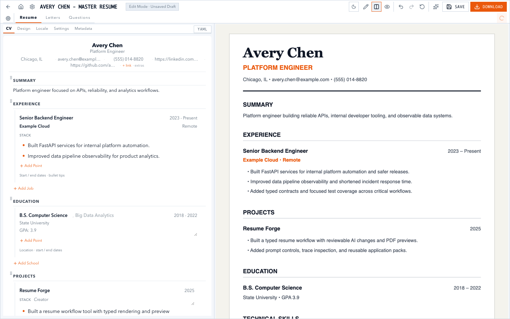
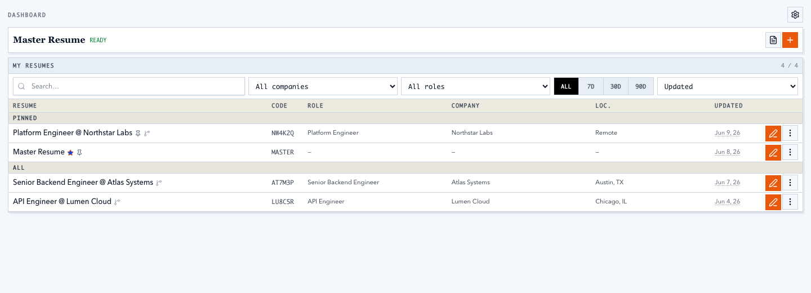
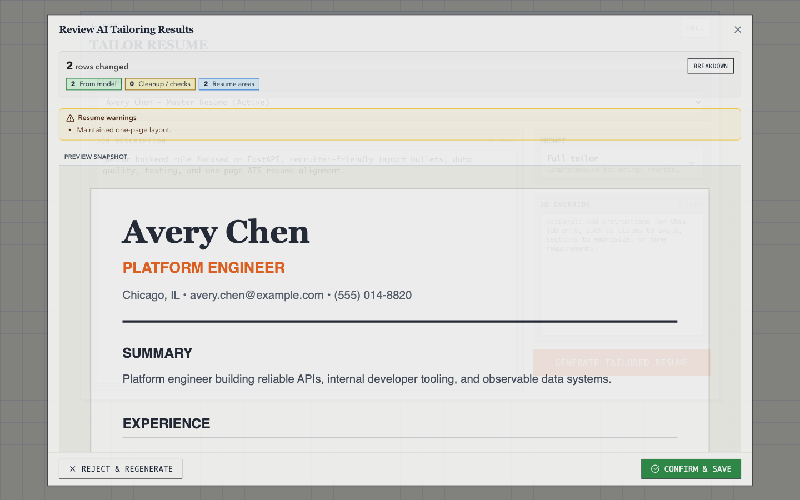
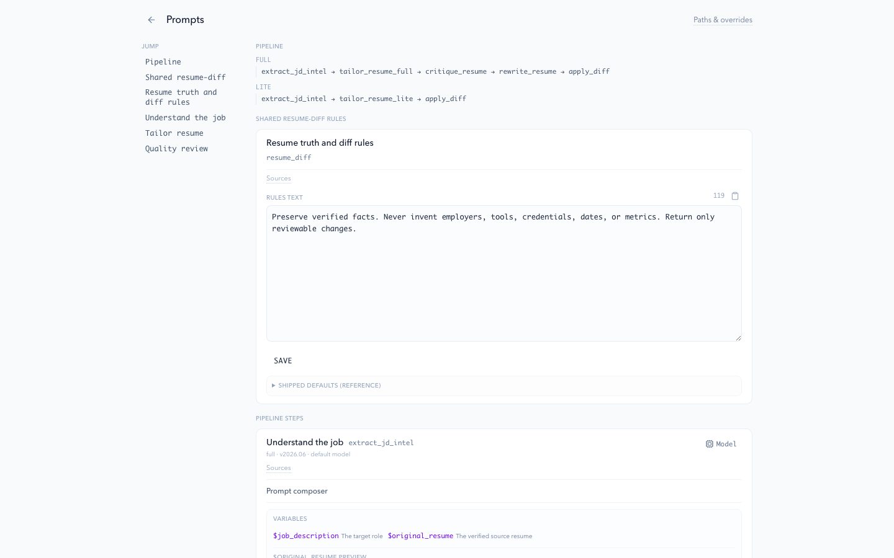
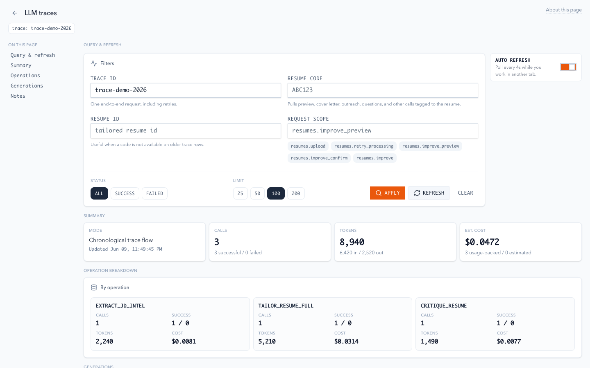
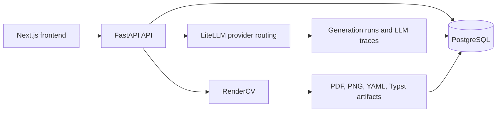

<p align="center">
  
</p>

<h1 align="center">Resume Workbench</h1>

<p align="center">
  A local-first workspace for building a master resume, tailoring it to real jobs,
  reviewing every AI-assisted change, and exporting complete application packs.
</p>

<p align="center">
  <a href="LICENSE"></a>
  <a href="https://nextjs.org/"></a>
  <a href="https://fastapi.tiangolo.com/"></a>
  <a href="https://www.postgresql.org/"></a>
</p>



[View the complete showcase landing page](docs/images/showcase/landing.png).

## Why this project exists

Most resume tools hide the source data, flatten everything into a document, or make AI edits difficult to inspect. Resume Workbench keeps the workflow explicit:

- one structured master resume
- job-specific copies with reviewable diffs
- editable cover letters and outreach messages
- application questions stored with the matching job
- reproducible PDF and preview artifacts
- provider, prompt, timing, and trace visibility

All screenshots in this repository use fictional people, companies, contact details, and job data.

## Core features

| Workflow | What it provides |
| --- | --- |
| **Master resume** | Structured visual editor, raw RenderCV YAML, autosave, custom sections, and live preview |
| **Job tailoring** | Full and lightweight modes, streamed progress, local diff validation, and confirm-before-save |
| **Application packs** | Tailored resume, job context, cover letter, outreach note, questions, and generated files |
| **PDF system** | RenderCV themes, layout controls, locale settings, PNG previews, and PDF exports |
| **AI controls** | Multiple providers through LiteLLM, per-step model choices, prompt catalog, and shared rules |
| **Observability** | LLM request traces, response metadata, token estimates, stage timing, and failure details |
| **Local-first storage** | PostgreSQL records plus locally stored rendering artifacts and configuration |

## Product tour

| Dashboard | Tailoring review |
| --- | --- |
|  |  |

| Prompt catalog | Generation traces |
| --- | --- |
|  |  |

## Architecture



The browser talks to the Next.js app. Next.js proxies API requests to FastAPI. FastAPI owns resume processing, AI orchestration, persistence, validation, and document generation.

Read the deeper technical overview in [docs/ARCHITECTURE.md](docs/ARCHITECTURE.md).

## Quick start

Requirements: Docker, Python 3.13+, Node.js 22+, npm 10+, and [uv](https://docs.astral.sh/uv/).

```bash
# Database
docker compose up -d postgres

# Backend
cd apps/backend
cp .env.example .env
uv sync --extra dev
uv run alembic upgrade head
uv run uvicorn app.main:app --reload --port 8000
```

In a second terminal:

```bash
cd apps/frontend
npm ci
npm run dev
```

Open [http://localhost:3000](http://localhost:3000), then configure an AI provider in **Settings**.

For Docker, provider options, troubleshooting, and production notes, use [SETUP.md](SETUP.md).

## Repository map

```text
apps/
  backend/       FastAPI, SQLAlchemy, Alembic, RenderCV, LiteLLM
  frontend/      Next.js application and product showcase
docs/
  agent/         Detailed implementation handbook
  images/        Supporting documentation images
infra/
  cliproxyapi/   Optional local subscription/OAuth proxy template
tests/           Root Playwright end-to-end coverage
```

## Documentation

- [Feature guide](docs/FEATURES.md)
- [Architecture](docs/ARCHITECTURE.md)
- [Privacy and data flow](docs/PRIVACY.md)
- [Complete setup](SETUP.md)
- [Contributor guide](.github/CONTRIBUTING.md)
- [Engineering handbook](docs/agent/README.md)
- [Security policy](.github/SECURITY.md)

## Development checks

```bash
# Frontend lint, unit tests, and production build
cd apps/frontend && npm run verify

# Backend tests and lint
cd apps/backend
uv run pytest
uv run ruff check app tests

# Root browser tests
cd ../..
npm ci
npx playwright install chromium
npm run test:e2e
```

## Privacy and security

Resume Workbench is intended for local or self-hosted use. Resume content is stored in your PostgreSQL database and generated artifacts are stored in your configured local artifact directory. AI generation sends the required prompt content to the provider you choose.

Do not commit `.env` files, provider credentials, local databases, generated resumes, trace exports, or CLIProxy auth files. The repository ignores these paths by default. See [docs/PRIVACY.md](docs/PRIVACY.md) for the exact data boundaries.

## Project status

The main workflows are implemented and covered by backend, frontend, and browser tests. This is an actively maintained personal open-source project, not a hosted resume service. Review the security and privacy notes before exposing an instance to the public internet.

## Credits and lineage

Resume Workbench is a substantial derivative of [Resume Matcher](https://github.com/srbhr/Resume-Matcher). That project provided the original open-source foundation and product inspiration. The current Workbench architecture, PostgreSQL storage, RenderCV workflow, application-pack model, prompt controls, and observability experience were developed in this repository.

The project also builds directly on:

- [RenderCV](https://github.com/rendercv/rendercv) for structured resume rendering
- [LiteLLM](https://github.com/BerriAI/litellm) for multi-provider model access
- [FastAPI](https://fastapi.tiangolo.com/), [SQLAlchemy](https://www.sqlalchemy.org/), [Alembic](https://alembic.sqlalchemy.org/), and [PostgreSQL](https://www.postgresql.org/) for the backend
- [Next.js](https://nextjs.org/), [React](https://react.dev/), and [Tailwind CSS](https://tailwindcss.com/) for the frontend
- [MarkItDown](https://github.com/microsoft/markitdown) for document ingestion
- [CLIProxyAPI](https://github.com/router-for-me/CLIProxyAPI) for the optional local proxy workflow
- [Contributor Covenant](https://www.contributor-covenant.org/) for the community code of conduct structure

See [NOTICE](NOTICE) and [LICENSE](LICENSE) for attribution and licensing details.
