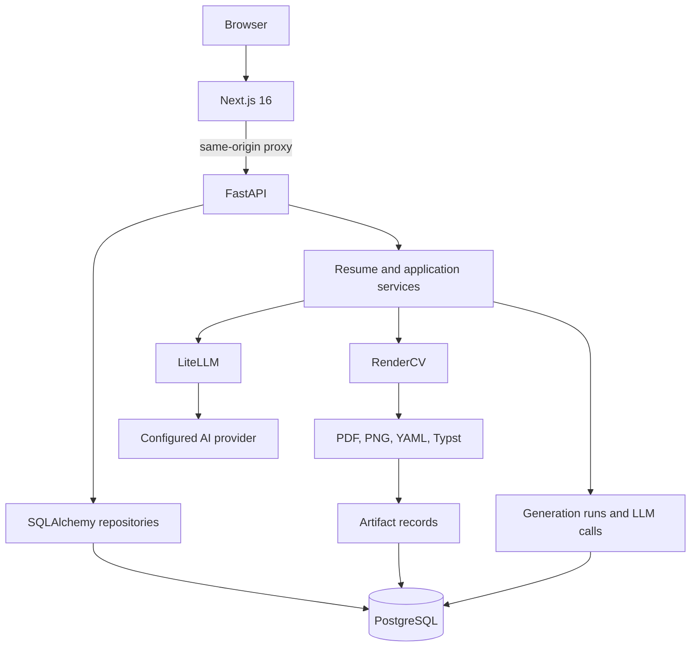
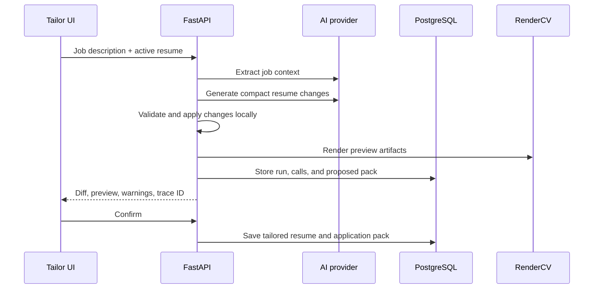

# Architecture

## System overview

## Frontend

`apps/frontend` is a Next.js App Router application.

- Dashboard manages the active resume and tailored copies.
- Builder edits structured content, RenderCV settings, cover letters, and outreach.
- Tailor streams generation progress and shows the diff before confirmation.
- Settings controls providers, prompts, model overrides, and language.
- LLM traces expose generation evidence and timing.

## Backend

`apps/backend` is a FastAPI application.

- Routers define the HTTP API.
- Services own parsing, tailoring, validation, rendering, and auxiliary writing.
- Repository classes isolate database access.
- Pydantic schemas define request and response contracts.
- Alembic migrations version the PostgreSQL schema.

## Resume rendering

Structured resume JSON is converted to a RenderCV payload, rendered into a bundle, stored on disk, and recorded in the artifacts table. Resume preview and PDF output use this same pipeline so the preview matches the exported document.

## Tailoring flow

## Source-of-truth rules

- PostgreSQL is the source of truth for application records.
- RenderCV is the source of truth for resume document output.
- `additional.groups` is the canonical flexible additional-section shape.
- Prompt source files live under `apps/backend/app/prompts/text`.
- LLM trace rows are the evidence layer for model calls.

The detailed engineering handbook is in [agent/README.md](agent/README.md).
