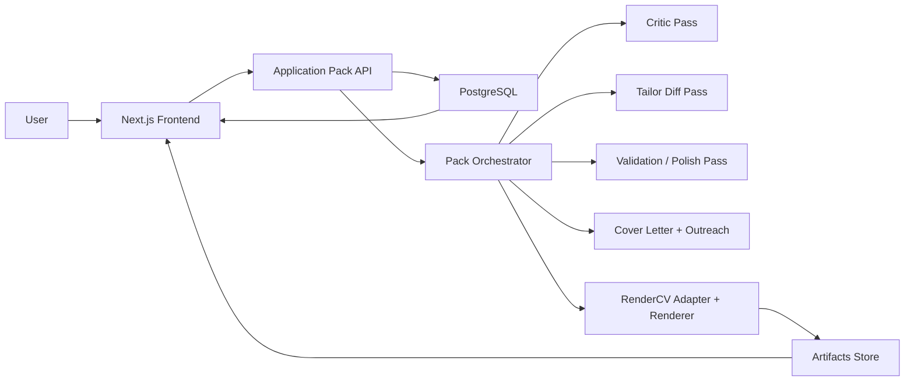
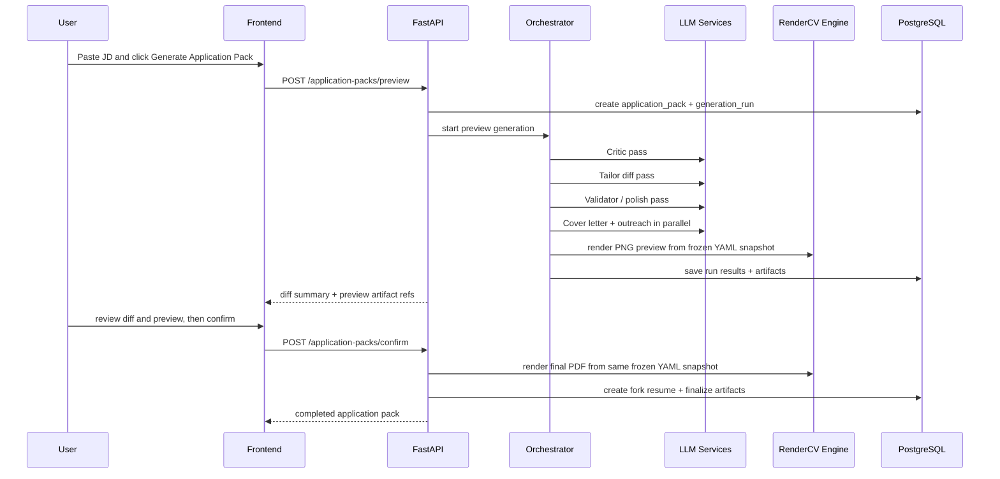

# Phase 5: Detailed Technical Plan for Building on Top of Resume-Matcher

## Decision

This phase assumes we are **building on top of `Resume-Matcher`** and **integrating `RenderCV` as the rendering engine**.

The goal is not to "copy three repos into one project."

The goal is:

- keep the strongest parts of `Resume-Matcher` for workflow and AI generation
- replace its weakest infrastructure pieces
- use `RenderCV` for preview and final resume rendering
- borrow `Reactive Resume`'s patch/validation discipline where it improves safety

That gives us the lowest-ambiguity implementation path.

## What We Are Building

The target product flow is:

1. upload or maintain one master resume
2. paste a job description
3. click one action to generate an **application pack**
4. review the tailored resume diff
5. review the RenderCV preview
6. get all artifacts together:
   - tailored resume fork
   - final PDF
   - cover letter
   - LinkedIn / outreach message
7. confirm and save the pack under company / role / timestamp

## Non-Goals for This Phase

To keep the build path direct and safe, we explicitly do **not** do these in v1:

- recreate the full `RenderCV` hosted web app
- introduce agentic prompt graphs with branching autonomy
- support multiple master resumes in the first data model
- build a new frontend from scratch
- rewrite the app into a monorepo with new frameworks

## Final Architecture



## Keep / Replace / Add: High-Level Summary

| Area | Keep from Resume-Matcher | Replace | Add |
|---|---|---|---|
| Backend framework | FastAPI app structure | TinyDB storage | SQLAlchemy + Alembic + Postgres |
| AI generation | LiteLLM wrapper, prompts, diff/refinement logic | full-resume rewrite tendency | critic pass + patch guard + application-pack orchestrator |
| Resume import | MarkItDown + parse service | nothing major | stronger metadata extraction and normalized snapshots |
| Resume rendering | none as final renderer | React/Playwright resume rendering | RenderCV engine for PNG/PDF |
| Cover letter PDF | Playwright is acceptable | nothing major | shared artifact naming/storage |
| Frontend forms | builder forms, tailor page, diff modal | current resume preview and print route | RenderCV preview pane + application pack panel |
| Template controls | current settings panel concept | current CSS-driven settings model | RenderCV theme profile controls |

## Source Reuse Plan by Repo

## 1. Resume-Matcher: Files We Keep and Refactor

These are the files we keep as the starting foundation.

| Source File | Action | Target | Reason |
|---|---|---|---|
| `temp/reference/Resume-Matcher/apps/backend/app/main.py` | Keep with minor edits | same file | Good FastAPI entry point and router wiring |
| `temp/reference/Resume-Matcher/apps/backend/app/llm.py` | Keep | same file | Good multi-provider abstraction and retries |
| `temp/reference/Resume-Matcher/apps/backend/app/services/parser.py` | Keep | same file, minor extension | Good upload -> markdown -> structured resume flow |
| `temp/reference/Resume-Matcher/apps/backend/app/services/cover_letter.py` | Keep | same file, minor extension | Already gives cover letter, outreach, title generation |
| `temp/reference/Resume-Matcher/apps/backend/app/services/improver.py` | Split and refactor | logic moved into new services | Good diff-based tailoring core |
| `temp/reference/Resume-Matcher/apps/backend/app/services/refiner.py` | Keep and wrap | same file or new namespace | Good validation/polish layer |
| `temp/reference/Resume-Matcher/apps/backend/app/prompts/templates.py` | Keep as baseline | split into prompt-pack files | Strong starting prompt inventory |
| `temp/reference/Resume-Matcher/apps/backend/app/prompts/enrichment.py` | Keep | same file | Useful for optional enrichment flow |
| `temp/reference/Resume-Matcher/apps/frontend/app/(default)/tailor/page.tsx` | Keep and evolve | same file | Best existing entry point for JD-driven flow |
| `temp/reference/Resume-Matcher/apps/frontend/components/tailor/diff-preview-modal.tsx` | Keep | same file | Already strong review UX |
| `temp/reference/Resume-Matcher/apps/frontend/components/builder/*form*.tsx` | Keep | same files | Good manual editing foundation |
| `temp/reference/Resume-Matcher/apps/frontend/components/builder/cover-letter-editor.tsx` | Keep | same file | Reusable artifact editor |
| `temp/reference/Resume-Matcher/apps/frontend/components/builder/outreach-editor.tsx` | Keep | same file | Reusable artifact editor |

## 2. Resume-Matcher: Files We Replace

| Current File | Replace With | Why |
|---|---|---|
| `temp/reference/Resume-Matcher/apps/backend/app/database.py` | new `app/db/*` package | TinyDB is the largest architectural weakness |
| `temp/reference/Resume-Matcher/apps/backend/app/pdf.py` for resume PDFs | new `app/rendering/rendercv_engine.py` + `app/rendering/document_pdf.py` | Resume PDFs should come from RenderCV, not browser HTML |
| `temp/reference/Resume-Matcher/apps/backend/app/routers/resumes.py` as the all-in-one orchestration file | split routers | It currently mixes CRUD, preview, AI generation, PDF export, and confirm logic |
| `temp/reference/Resume-Matcher/apps/frontend/components/dashboard/resume-component.tsx` | RenderCV preview components | React template renderer should no longer be the source of truth |
| `temp/reference/Resume-Matcher/apps/frontend/components/resume/*` | retire after migration | Local CSS templates will be replaced by RenderCV |
| `temp/reference/Resume-Matcher/apps/frontend/components/preview/*` | new preview components | Current pagination is useful, but no longer exact once RenderCV becomes authoritative |
| `temp/reference/Resume-Matcher/apps/frontend/app/print/resumes/[id]/page.tsx` | backend RenderCV preview/PDF endpoints | Frontend print route should no longer generate the resume PDF |
| `temp/reference/Resume-Matcher/apps/frontend/lib/types/template-settings.ts` | `lib/types/render-theme-settings.ts` | Current CSS variable model does not map cleanly to RenderCV |
| `temp/reference/Resume-Matcher/apps/frontend/components/builder/formatting-controls.tsx` | `render-theme-controls.tsx` | Controls must reflect RenderCV theme knobs, not old CSS knobs |

## 3. RenderCV: What We Use

For `RenderCV`, we should **not** copy the whole repo into our app. We should **install it as a backend dependency** and build a local adapter around it.

### RenderCV modules we will rely on directly

| RenderCV File | How We Use It | Where It Connects |
|---|---|---|
| `temp/reference/rendercv/src/rendercv/schema/rendercv_model_builder.py` | build validated RenderCV model from generated YAML/dict | `app/rendering/rendercv_engine.py` |
| `temp/reference/rendercv/src/rendercv/renderer/typst.py` | generate Typst source | `app/rendering/rendercv_engine.py` |
| `temp/reference/rendercv/src/rendercv/renderer/pdf_png.py` | generate PDF and PNG preview images | `app/rendering/rendercv_engine.py` |
| `temp/reference/rendercv/src/rendercv/renderer/html.py` | optional HTML output for debug/inspection | `app/rendering/rendercv_engine.py` |
| `temp/reference/rendercv/src/rendercv/schema/models/cv/*` | target schema our adapter maps into | `app/rendering/rendercv_adapter.py` |
| `temp/reference/rendercv/src/rendercv/schema/models/design/*` | theme and formatting model | `app/rendering/theme_profiles.py` |
| `temp/reference/rendercv/src/rendercv/renderer/rendercv_typst/*` | upstream built-in Typst package and themes | used through the package, not copied |

### RenderCV files we use as references, not as copied code

| File | Use |
|---|---|
| `temp/reference/rendercv/docs/ats_compatibility.md` | ATS acceptance criteria and test ideas |
| `temp/reference/rendercv/src/rendercv/schema/sample_content.yaml` | sample target shapes for adapter fixtures |

## 4. Reactive Resume: Concepts We Port, Not Code We Depend On

| Reactive Resume File | What We Borrow | New Local Target |
|---|---|---|
| `temp/reference/reactive-resume/src/utils/resume/patch.ts` | schema-validated patch application and clean error model | `app/services/resume_change_guard.py` |
| `temp/reference/reactive-resume/src/utils/resume/tailor.ts` | sanitize text output and validate bounds before applying edits | `app/services/change_sanitizer.py` |
| `temp/reference/reactive-resume/src/integrations/ai/tools/patch-resume.ts` | "minimal operations only" philosophy | informs `ResumeChange` contract |

## Target Backend Layout

Below is the structure I would implement inside the `Resume-Matcher` backend.

```text
apps/backend/app/
  main.py
  config.py
  llm.py
  routers/
    health.py
    config.py
    resumes.py
    jobs.py
    application_packs.py
    artifacts.py
    themes.py
  db/
    base.py
    session.py
    models.py
    repositories/
      resumes.py
      jobs.py
      application_packs.py
      generation_runs.py
      artifacts.py
  schemas/
    resume.py
    job.py
    application_pack.py
    artifact.py
    prompts.py
    rendering.py
  services/
    parser.py
    cover_letter.py
    job_metadata.py
    prompt_pack_loader.py
    resume_change_guard.py
    change_sanitizer.py
    tailor_diff_service.py
    critic_service.py
    validation_service.py
    application_pack_service.py
    artifact_service.py
  rendering/
    rendercv_adapter.py
    rendercv_engine.py
    theme_profiles.py
    document_pdf.py
  prompt_packs/
    default/
      house_rules.md
      critic_system.md
      critic_user.md
      tailor_system.md
      tailor_user.md
      validator_system.md
      validator_user.md
      cover_letter_system.md
      outreach_system.md
  migrations/
```

## Backend File-by-File Plan

## Keep Mostly As-Is

### `app/main.py`

Changes:

- register new routers
- initialize SQLAlchemy session factory
- initialize artifact storage path
- remove TinyDB shutdown logic
- keep Playwright shutdown only for cover-letter PDF if still used

### `app/llm.py`

Changes:

- keep current provider resolution and retry logic
- add request-scoped trace metadata for `generation_run_id`
- expose small helper wrappers:
  - `complete_text()`
  - `complete_json()`
  - `complete_with_schema()`

### `app/services/parser.py`

Changes:

- keep MarkItDown pipeline
- keep `restore_dates_from_markdown()`
- add extracted normalized markdown snapshot persistence
- add optional company / title / location metadata extraction after parse

## Replace Completely

### `app/database.py`

Replace with:

- `app/db/base.py`
- `app/db/session.py`
- `app/db/models.py`
- `app/db/repositories/*.py`

Reason:

- current TinyDB implementation blocks safe scaling
- current DB model makes migrations and data integrity difficult
- we need relational history for resumes, jobs, runs, and artifacts

### `app/pdf.py`

Split it into:

- `app/rendering/rendercv_engine.py`
  - for resume PNG/PDF/HTML generation through RenderCV
- `app/rendering/document_pdf.py`
  - optional Playwright HTML-to-PDF path for cover letters only

Reason:

- resume PDF generation should stop depending on a frontend print route
- RenderCV should be the single source of truth for resume output

### `app/routers/resumes.py`

Refactor into:

- `routers/resumes.py`
  - upload
  - fetch
  - update
  - list
  - set master
- `routers/application_packs.py`
  - preview pack generation
  - confirm pack
  - fetch run details
  - fetch diff summary
- `routers/artifacts.py`
  - preview image download
  - PDF download
  - YAML snapshot download

Reason:

- the current file is overloaded
- splitting routes makes integration with RenderCV and pack generation much easier

## New Backend Modules and Their Responsibilities

## `app/db/models.py`

Tables:

- `users`
- `resumes`
- `jobs`
- `application_packs`
- `generation_runs`
- `artifacts`

Recommended minimum columns:

### `users`

- `id`
- `email`
- `created_at`

### `resumes`

- `id`
- `user_id`
- `kind` (`master` or `fork`)
- `parent_resume_id`
- `application_pack_id`
- `title`
- `content_json`
- `original_markdown`
- `processing_status`
- `created_at`
- `updated_at`

### `jobs`

- `id`
- `user_id`
- `raw_description`
- `company_name`
- `role_title`
- `location_text`
- `source_url`
- `created_at`

### `application_packs`

- `id`
- `user_id`
- `master_resume_id`
- `job_id`
- `status` (`draft`, `preview_ready`, `confirmed`, `failed`)
- `prompt_pack`
- `selected_theme`
- `resume_fork_id`
- `created_at`
- `updated_at`

### `generation_runs`

- `id`
- `application_pack_id`
- `run_type` (`preview`, `confirm`, `regenerate`)
- `status`
- `critic_output_json`
- `tailor_output_json`
- `validator_output_json`
- `diff_summary_json`
- `error_message`
- `created_at`
- `finished_at`

### `artifacts`

- `id`
- `application_pack_id`
- `generation_run_id`
- `artifact_type` (`resume_png`, `resume_pdf`, `cover_letter_pdf`, `cover_letter_text`, `outreach_text`, `rendercv_yaml`, `rendercv_html`, `rendercv_typst`)
- `storage_key`
- `filename`
- `mime_type`
- `size_bytes`
- `created_at`

## `app/services/prompt_pack_loader.py`

Functions:

- `load_prompt_pack(pack_name: str) -> PromptPack`
- `load_house_rules(pack_name: str) -> str`
- `render_prompt(template_path: str, context: dict) -> str`

Reason:

- gives you prompt control without needing a prompt database UI on day one
- keeps prompt text editable, versioned, and visible
- allows us to start from Resume-Matcher prompt baselines cleanly

## `app/services/critic_service.py`

Functions:

- `run_critic_pass(master_resume, job_description, house_rules) -> CriticOutput`

Output shape:

- `missing_matches`
- `keywords_to_emphasize`
- `weak_bullets`
- `unsupported_claim_risks`
- `tone_notes`

This is the new "extra reasoning layer" you asked for.

## `app/services/tailor_diff_service.py`

This module will absorb the useful parts of current `services/improver.py`.

Functions:

- `extract_job_keywords(job_description) -> JobKeywordSet`
- `generate_resume_diffs(master_resume, job_description, critic_output, prompt_pack) -> ResumeChange[]`
- `apply_verified_diffs(master_resume, changes) -> TailoredResumeResult`

What moves here from the current code:

- prompt-injection sanitization
- path allowlist logic
- diff generation logic
- diff verification logic
- summary generation logic

What should stop living here:

- direct DB updates
- router-specific response shaping

## `app/services/resume_change_guard.py`

This is the Python equivalent of the `Reactive Resume` patch safety pattern.

Functions:

- `validate_change_paths(changes, resume_data)`
- `verify_original_values(changes, resume_data)`
- `apply_changes(changes, resume_data)`
- `validate_result_schema(result)`

Core rule:

- no change is applied unless:
  - the path is allowed
  - the path resolves
  - the original text matches
  - the result still validates against resume schema

## `app/services/change_sanitizer.py`

Functions:

- `sanitize_ascii_punctuation(text)`
- `normalize_quotes_whitespace(text)`
- `sanitize_resume_payload(payload)`

Borrowed from the character-safety logic seen in `Reactive Resume`.

## `app/services/validation_service.py`

Functions:

- `run_validator_pass(master_resume, tailored_resume, critic_output, job_description)`
- `remove_unsupported_claims()`
- `validate_no_date_changes()`
- `validate_no_skill_invention()`
- `validate_length_budget()`

This wraps the current `services/refiner.py` behavior into a cleaner final gate.

## `app/services/application_pack_service.py`

This becomes the main orchestration service.

Functions:

- `create_preview_pack(master_resume_id, job_id, prompt_pack, theme_settings)`
- `confirm_preview_pack(application_pack_id, generation_run_id)`
- `regenerate_artifact(application_pack_id, artifact_type, instructions)`

This service is where the one-click flow lives.

## `app/rendering/rendercv_adapter.py`

This is one of the most important new files.

Functions:

- `resume_json_to_rendercv_dict(resume_data, theme_settings, locale) -> dict`
- `map_personal_info()`
- `map_summary_section()`
- `map_experience_section()`
- `map_education_section()`
- `map_projects_section()`
- `map_additional_sections()`
- `map_custom_sections()`

Planned field mapping:

| Internal ResumeData | RenderCV Target |
|---|---|
| `personalInfo.name` | `cv.name` |
| `personalInfo.title` | `cv.headline` |
| `personalInfo.location` | `cv.location` |
| `personalInfo.email` | `cv.email` |
| `personalInfo.phone` | `cv.phone` |
| `personalInfo.website` | `cv.website` |
| `linkedin/github` | `cv.social_networks` |
| `summary` | text section like `Summary` |
| `workExperience[]` | `experience` section of `ExperienceEntry` |
| `education[]` | `education` section of `EducationEntry` |
| `personalProjects[]` | `projects` section of `NormalEntry` |
| `additional.technicalSkills` | `skills` section of `OneLineEntry` or grouped entries |
| `additional.languages` | `languages` section |
| `additional.certificationsTraining` | `certifications` section |
| `additional.awards` | `awards` section |
| `customSections.text` | text section |
| `customSections.stringList` | bullet or numbered section |
| `customSections.itemList` | `NormalEntry` section |

Date handling strategy:

- if a date has month precision, convert to `start_date` / `end_date`
- if it is fuzzy text, use RenderCV `date`
- if we cannot convert cleanly, preserve the raw text instead of inventing exact dates

## `app/rendering/theme_profiles.py`

Functions:

- `build_rendercv_design(theme_id, density_profile, page_size, overrides)`
- `build_rendercv_settings(output_paths, page_size, bold_keywords)`

This avoids mapping every old CSS setting one-to-one.

Instead, we expose a smaller, cleaner model:

- `theme_id`
- `page_size`
- `density_profile`
- `bold_keywords`
- optional font family override later

## `app/rendering/rendercv_engine.py`

This is the runtime bridge into the RenderCV package.

Functions:

- `render_preview_bundle(rendercv_dict) -> RenderPreviewBundle`
- `render_final_bundle(rendercv_dict) -> RenderFinalBundle`
- `write_yaml_snapshot(rendercv_dict, workdir) -> Path`
- `compile_rendercv_bundle(yaml_path, workdir) -> RenderBundle`

Implementation plan:

1. adapter creates a RenderCV dict
2. engine serializes dict to YAML using `ruamel.yaml`
3. engine calls RenderCV model builder
4. engine calls:
   - `generate_typst()`
   - `generate_png()` for preview
   - `generate_pdf()` for final output
   - `generate_html()` optionally for debug
5. engine stores artifact paths through `artifact_service.py`

Important design rule:

- preview and final PDF must come from the **same YAML snapshot**

That means:

- preview generation stores the exact RenderCV YAML snapshot
- confirmation reuses that same snapshot hash
- final PDF is never regenerated from mutated live form state

That removes a whole class of "preview did not match final PDF" bugs.

## `app/services/artifact_service.py`

Functions:

- `save_artifact(file_path, artifact_type, application_pack_id, generation_run_id)`
- `build_resume_filename(first_name, last_name, unique_id)`
- `build_cover_letter_filename(first_name, last_name, unique_id)`
- `get_artifact_response(artifact_id)`

Filename rule:

- resume PDF: `first_last_<shortid>.pdf`
- cover letter PDF: `first_last_cover_<shortid>.pdf`

This matches your earlier backtracking requirement.

## Frontend Layout Plan

## Keep

These pieces are still useful:

- `app/(default)/tailor/page.tsx`
- `components/tailor/diff-preview-modal.tsx`
- `components/builder/resume-form.tsx`
- all builder form components
- `cover-letter-editor.tsx`
- `outreach-editor.tsx`
- regenerate and enrichment components as optional advanced tools

## Replace

### Current preview system

Current files to deprecate:

- `components/dashboard/resume-component.tsx`
- `components/resume/*`
- `components/resume/styles/*`
- `components/preview/*`
- `app/print/resumes/[id]/page.tsx`

Why:

- once RenderCV is the renderer, the browser React template should no longer simulate the final output

## New frontend modules

Proposed new files:

```text
apps/frontend/
  app/(default)/tailor/page.tsx
  components/preview/
    rendercv-preview.tsx
    rendercv-preview-toolbar.tsx
    rendercv-preview-page.tsx
  components/builder/
    render-theme-controls.tsx
    application-pack-panel.tsx
    generation-run-status.tsx
    artifact-actions.tsx
  lib/api/
    application-pack.ts
    artifacts.ts
    themes.ts
  lib/types/
    render-theme-settings.ts
    application-pack.ts
```

## New frontend behavior

### `rendercv-preview.tsx`

Responsibilities:

- fetch preview image URLs from backend
- show page images
- show loading state while a new preview run is being compiled
- display a warning if preview is stale relative to current unsaved form edits

### `render-theme-controls.tsx`

Responsibilities:

- choose supported RenderCV theme
- choose page size
- choose density profile
- later expose bold keyword toggle or limited font overrides

Important simplification:

- this replaces the current CSS-level spacing and font panel
- we should **not** try to preserve every old control
- old controls will create mapping ambiguity that we do not need

### `application-pack-panel.tsx`

Responsibilities:

- show one-click `Generate Application Pack`
- show run status
- show artifacts created from the generation
- show confirm / reject / regenerate actions

## API Plan

## New endpoints

### `POST /api/v1/application-packs/preview`

Input:

- `master_resume_id`
- `job_id`
- `prompt_pack`
- `theme_settings`

Response:

- `application_pack_id`
- `generation_run_id`
- `diff_summary`
- `detailed_changes`
- `preview_artifact_ids`
- `cover_letter_text`
- `outreach_text`
- `title`

### `POST /api/v1/application-packs/confirm`

Input:

- `application_pack_id`
- `generation_run_id`

Response:

- `resume_fork_id`
- `resume_pdf_artifact_id`
- `cover_letter_pdf_artifact_id`
- `outreach_text`

### `GET /api/v1/application-packs/{id}`

Returns:

- pack metadata
- linked job
- linked master resume
- linked fork resume
- latest run status
- artifact list

### `GET /api/v1/artifacts/{artifact_id}`

Used for:

- preview image streaming
- PDF download
- YAML snapshot download

### `GET /api/v1/themes`

Returns:

- supported RenderCV themes
- labels
- preview thumbnails
- available page sizes

## Application Pack Execution Flow



## Smooth Integration Strategy

This migration should **not** be a big-bang rewrite.

It should be done in this order.

## Stage 1: Infrastructure Swap Without UX Change

Goal:

- make storage durable first

Changes:

- add Postgres to `docker-compose.yml`
- update `apps/backend/pyproject.toml`
- add Alembic
- add SQLAlchemy models
- rewrite `database.py` usage behind repositories
- keep current API responses stable

At the end of Stage 1:

- the app still behaves like Resume-Matcher
- but storage is now safe enough to build on

## Stage 2: Add RenderCV Rendering Behind a Feature Flag

Goal:

- integrate RenderCV without breaking the current preview flow

Feature flag:

- `RESUME_RENDER_ENGINE=legacy|rendercv`

Changes:

- add adapter and engine
- generate preview PNGs from backend
- add a small internal page to compare:
  - old React preview
  - new RenderCV preview

At the end of Stage 2:

- we can verify rendering quality before deleting old templates

## Stage 3: Add Application Pack Orchestrator

Goal:

- unify JD tailoring, cover letter, outreach, and preview into one backend flow

Changes:

- introduce `application_pack_service.py`
- split routes
- add prompt-pack loader
- keep current improve endpoints temporarily as compatibility paths

At the end of Stage 3:

- one-click generation exists
- current functionality still works

## Stage 4: Switch Frontend Preview to RenderCV

Goal:

- make RenderCV preview the default user-facing preview

Changes:

- add `rendercv-preview.tsx`
- replace `PaginatedPreview`
- simplify formatting controls to theme-oriented controls
- keep diff modal exactly because it is already strong

At the end of Stage 4:

- the UI is now honest about the final output

## Stage 5: Remove Legacy Resume Template Renderer

Goal:

- delete dead code and reduce maintenance burden

Remove:

- `components/resume/*`
- legacy print route for resume PDFs
- old template settings model

Keep:

- cover letter/outreach editors
- regenerate flows
- enrichment flows

## Concrete File Changes

## Backend package and config

### Modify

- `temp/reference/Resume-Matcher/apps/backend/pyproject.toml`
- `temp/reference/Resume-Matcher/apps/backend/requirements.txt`
- `temp/reference/Resume-Matcher/docker-compose.yml`
- `temp/reference/Resume-Matcher/apps/backend/.env.sample`

### Add dependencies

- `sqlalchemy`
- `alembic`
- `psycopg[binary]`
- `rendercv[full]`
- `orjson` optional

### Remove from critical path

- `tinydb`
- `playwright` for resume PDFs only

## Backend code files to add

- `apps/backend/app/db/base.py`
- `apps/backend/app/db/session.py`
- `apps/backend/app/db/models.py`
- `apps/backend/app/db/repositories/resumes.py`
- `apps/backend/app/db/repositories/jobs.py`
- `apps/backend/app/db/repositories/application_packs.py`
- `apps/backend/app/db/repositories/generation_runs.py`
- `apps/backend/app/db/repositories/artifacts.py`
- `apps/backend/app/services/prompt_pack_loader.py`
- `apps/backend/app/services/critic_service.py`
- `apps/backend/app/services/tailor_diff_service.py`
- `apps/backend/app/services/resume_change_guard.py`
- `apps/backend/app/services/change_sanitizer.py`
- `apps/backend/app/services/validation_service.py`
- `apps/backend/app/services/application_pack_service.py`
- `apps/backend/app/services/artifact_service.py`
- `apps/backend/app/services/job_metadata.py`
- `apps/backend/app/rendering/rendercv_adapter.py`
- `apps/backend/app/rendering/theme_profiles.py`
- `apps/backend/app/rendering/rendercv_engine.py`
- `apps/backend/app/rendering/document_pdf.py`
- `apps/backend/app/routers/application_packs.py`
- `apps/backend/app/routers/artifacts.py`
- `apps/backend/app/routers/themes.py`
- `apps/backend/app/schemas/application_pack.py`
- `apps/backend/app/schemas/job.py`
- `apps/backend/app/schemas/resume.py`
- `apps/backend/app/schemas/rendering.py`
- `apps/backend/app/prompt_packs/default/house_rules.md`
- `apps/backend/app/prompt_packs/default/critic_system.md`
- `apps/backend/app/prompt_packs/default/critic_user.md`
- `apps/backend/app/prompt_packs/default/tailor_system.md`
- `apps/backend/app/prompt_packs/default/tailor_user.md`
- `apps/backend/app/prompt_packs/default/validator_system.md`
- `apps/backend/app/prompt_packs/default/validator_user.md`
- `apps/backend/app/prompt_packs/default/cover_letter_system.md`
- `apps/backend/app/prompt_packs/default/outreach_system.md`

## Backend files to edit heavily

- `apps/backend/app/main.py`
- `apps/backend/app/config.py`
- `apps/backend/app/llm.py`
- `apps/backend/app/services/improver.py`
- `apps/backend/app/services/refiner.py`
- `apps/backend/app/services/parser.py`
- `apps/backend/app/services/cover_letter.py`
- `apps/backend/app/routers/resumes.py`
- `apps/backend/app/routers/jobs.py`
- `apps/backend/app/schemas/models.py`

## Frontend files to add

- `apps/frontend/components/preview/rendercv-preview.tsx`
- `apps/frontend/components/preview/rendercv-preview-page.tsx`
- `apps/frontend/components/preview/rendercv-preview-toolbar.tsx`
- `apps/frontend/components/builder/render-theme-controls.tsx`
- `apps/frontend/components/builder/application-pack-panel.tsx`
- `apps/frontend/components/builder/generation-run-status.tsx`
- `apps/frontend/components/builder/artifact-actions.tsx`
- `apps/frontend/lib/api/application-pack.ts`
- `apps/frontend/lib/api/artifacts.ts`
- `apps/frontend/lib/api/themes.ts`
- `apps/frontend/lib/types/application-pack.ts`
- `apps/frontend/lib/types/render-theme-settings.ts`

## Frontend files to edit heavily

- `apps/frontend/app/(default)/tailor/page.tsx`
- `apps/frontend/components/builder/resume-builder.tsx`
- `apps/frontend/components/builder/formatting-controls.tsx`
- `apps/frontend/lib/api/resume.ts`

## Frontend files to deprecate and later remove

- `apps/frontend/components/dashboard/resume-component.tsx`
- `apps/frontend/components/resume/index.ts`
- `apps/frontend/components/resume/resume-modern.tsx`
- `apps/frontend/components/resume/resume-modern-two-column.tsx`
- `apps/frontend/components/resume/resume-single-column.tsx`
- `apps/frontend/components/resume/resume-two-column.tsx`
- `apps/frontend/components/resume/styles/_base.module.css`
- `apps/frontend/components/resume/styles/modern-two-column.module.css`
- `apps/frontend/components/resume/styles/modern.module.css`
- `apps/frontend/components/resume/styles/swiss-single.module.css`
- `apps/frontend/components/resume/styles/swiss-two-column.module.css`
- `apps/frontend/components/preview/page-container.tsx`
- `apps/frontend/components/preview/paginated-preview.tsx`
- `apps/frontend/components/preview/use-pagination.ts`
- `apps/frontend/app/print/resumes/[id]/page.tsx`
- `apps/frontend/lib/types/template-settings.ts`

## Prompt Migration Plan

Start by splitting current prompt logic into a structured prompt pack.

### Inputs from Resume-Matcher to reuse immediately

- `IMPROVE_RESUME_PROMPT_NUDGE`
- `IMPROVE_RESUME_PROMPT_KEYWORDS`
- `IMPROVE_RESUME_PROMPT_FULL`
- `DIFF_IMPROVE_PROMPT`
- `EXTRACT_KEYWORDS_PROMPT`
- `COVER_LETTER_PROMPT`
- `OUTREACH_MESSAGE_PROMPT`
- `KEYWORD_INJECTION_PROMPT`
- `VALIDATION_POLISH_PROMPT`

### Prompt pack structure

`house_rules.md`

- your writing instructions
- punctuation restrictions
- truthfulness rules
- keyword emphasis rules

`critic_*`

- recruiter-style critique prompt

`tailor_*`

- diff-only targeted resume change prompt

`validator_*`

- final truthfulness and format gate

`cover_letter_system.md`

- wraps current cover letter baseline

`outreach_system.md`

- wraps current outreach baseline

## RenderCV Preview Strategy

For exactness, the preview should be **PNG-based first**.

Reason:

- PNG preview comes from the same Typst compilation path as the final PDF
- it is visually exact
- it avoids HTML/CSS drift

Optional debug mode:

- also store generated HTML and YAML for inspection

So the preview stack becomes:

- manual edit on left
- diff summary and change review in center
- exact RenderCV PNG preview on right

## Data Flow for Preview vs Confirm

### Preview run

- generate tailored resume JSON
- generate diff summary
- generate cover letter text
- generate outreach text
- generate RenderCV YAML snapshot
- generate PNG preview
- save everything under `generation_run`

### Confirm run

- validate preview snapshot hash still matches
- create fork resume from preview output
- generate final PDF from the stored YAML snapshot
- optionally generate cover letter PDF
- persist application pack as confirmed

This is how we avoid preview/final mismatch.

## Testing Plan

## Backend tests to add

- `tests/unit/test_rendercv_adapter.py`
- `tests/unit/test_resume_change_guard.py`
- `tests/unit/test_theme_profiles.py`
- `tests/service/test_application_pack_service.py`
- `tests/service/test_validation_service.py`
- `tests/integration/test_application_pack_preview.py`
- `tests/integration/test_application_pack_confirm.py`
- `tests/integration/test_artifact_downloads.py`

## Frontend tests to add

- `tests/rendercv-preview.test.tsx`
- `tests/application-pack-panel.test.tsx`
- `tests/theme-controls.test.tsx`
- `tests/tailor-page-pack-flow.test.tsx`

## Render-specific fixture tests

Create fixture resumes that cover:

- simple single-page resume
- long one-page-tight resume
- resume with custom sections
- resume with markdown bold text
- resume with month-precision dates

For each fixture:

- adapter should produce valid RenderCV YAML
- RenderCV should compile PNG and PDF
- resulting artifacts should exist and be non-empty

## Rollout Sequence

If I were implementing this for real, I would do it in this exact order:

1. migrate storage from TinyDB to Postgres
2. add repositories and keep current API stable
3. add RenderCV dependency and build adapter tests first
4. add backend RenderCV preview/PDF generation
5. add application pack orchestrator
6. wire cover letter and outreach into the same run
7. switch frontend preview to RenderCV
8. remove legacy React resume templates

## Biggest Technical Risks and How We Avoid Them

## Risk 1: RenderCV mapping mismatch with our resume JSON

Mitigation:

- build adapter as a dedicated layer
- use fixture tests before any frontend switch
- start with one default supported shape and expand carefully

## Risk 2: preview does not match final PDF

Mitigation:

- preview from PNG compiled by RenderCV
- final PDF generated from the same frozen YAML snapshot

## Risk 3: current prompt logic becomes harder to reason about

Mitigation:

- split prompt pack from orchestration code
- keep only three passes:
  - critic
  - tailor
  - validator

## Risk 4: migration becomes too big

Mitigation:

- keep current frontend forms
- keep current diff modal
- keep current API semantics wherever possible
- replace rendering only after backend infrastructure is stable

## Recommendation on Implementation Style

Do not code this as one giant refactor branch.

Do it as a staged migration with compatibility shims:

- old APIs keep working while new services are added
- old preview renderer stays behind a feature flag until RenderCV preview is trusted
- prompt pack loader wraps old prompt text before we rewrite prompts more deeply

That is the smoothest and safest path.

## Final Build Recommendation

The most realistic Phase 5 implementation plan is:

- fork `Resume-Matcher`
- replace `TinyDB` first
- add `RenderCV` as a backend dependency, not a copied codebase
- introduce a dedicated RenderCV adapter + engine
- keep the existing tailor/builder flow
- add a new application-pack orchestration layer
- migrate the frontend preview to backend-generated RenderCV previews

That gives us:

- low ambiguity
- strong template quality
- strong prompt control
- one-click application packs
- a practical path to production without rebuilding the world
