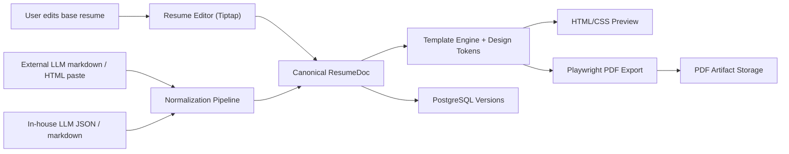

# Resume Maker Plan

## Executive Summary

For your requirements, the best primary stack is:

- `Next.js + React + TypeScript` for the app shell
- `Tiptap (on top of ProseMirror)` for rich editing
- A **typed canonical resume schema** as the source of truth
- `CommonMark/GFM` as the human-facing interchange format for LLM input/output
- `unified + remark-parse + remark-gfm + rehype-parse` for Markdown/HTML normalization
- An `HTML/CSS` renderer shared by preview and export
- `Playwright + Chromium page.pdf()` for PDF generation
- `PostgreSQL` for resumes, versions, templates, and audit/history
- `S3-compatible object storage` for generated PDFs and assets

Optional but strong additions:

- `Pandoc` as a server-side import/normalization sidecar for harder input cases later
- `PrinceXML` as a premium export engine later if you outgrow Chromium for print polish
- `Tauri` later if you want a desktop/offline wrapper

The key design decision is this:

**Do not make raw Markdown, raw HTML, Typst, or LaTeX your system-of-record.**

Make the system-of-record a **resume-specific JSON schema** with rich-text fields. Then accept:

- strict LLM JSON when possible
- a recommended Markdown format when JSON is unavailable
- pasted HTML/Markdown from external LLMs as fallback

That gives you:

- robust parsing
- clean manual editing
- predictable rendering
- precise control over spacing, margins, fonts, bullets, and section layout
- a true WYSIWYG path because preview and export come from the same renderer

## What Your Requirements Actually Imply

Your must-needs force a few conclusions:

1. You need **strong document semantics**, not just a generic editor.
2. You need **loss-minimizing import**, because LLM output will vary.
3. You need **print-first rendering**, not “web page that happens to be printable”.
4. You need **same-source preview and PDF**, or WYSIWYG will drift.
5. You need **manual editing in the same surface** where you inspect the AI output.

That makes some stacks attractive in isolation but wrong as the primary architecture.

## Evaluation Criteria

I would score each candidate stack against:

- WYSIWYG fidelity
- PDF quality
- control over typography and spacing
- resilience to pasted Markdown/HTML from different LLMs
- ability to model bullets, bold, links, special characters, Unicode
- ease of building from scratch
- operational simplicity
- future extensibility for versioning, templates, and collaboration

## Layer 1: Editor / Authoring Surface Options

### 1. Tiptap + ProseMirror

Pros:

- Best balance of maturity and customizability
- Strong schema model, which matters for resumes
- Stores content as JSON or HTML
- Has Markdown import/export support
- Has static rendering paths for server-side output
- Easy to build read-only views that match the editor rendering

Cons:

- You still need to design a strict resume schema yourself
- Complex if you let the entire page be a freeform editor

Verdict:

**Best primary choice.**

Use Tiptap for rich-text fields and constrained block editing, not as a totally free canvas.

### 2. Lexical

Pros:

- Fast, modern, reliable, accessible
- JSON-serializable editor state
- Official HTML and Markdown conversion packages

Cons:

- Lower-level than Tiptap for complex document tooling
- More custom plumbing for a resume CMS-like product

Verdict:

Strong second choice if your team already prefers Meta’s editor stack.

### 3. Slate

Pros:

- Extremely customizable
- Pure JSON model

Cons:

- Still more DIY
- Official docs still frame parts of the ecosystem as beta-ish
- Paste, schema normalization, and rich conversion need more custom work

Verdict:

Not my first pick for a “robust from zero” resume maker.

### 4. CKEditor 5

Pros:

- Enterprise-grade editing experience
- Source editing exists
- Collaboration and track changes are mature
- Markdown output exists

Cons:

- Markdown output intentionally drops unsupported rich-text features
- Advanced features often push you toward paid/commercial paths
- Heavier stack than you need if the product is resume-first, not generic-doc-first

Verdict:

Good enterprise option, but not my top greenfield recommendation here.

### 5. TinyMCE

Pros:

- Mature editor
- Strong paste/import tooling
- Markdown and Word import plugins exist

Cons:

- Important paste/markdown/doc import features skew premium/commercial
- HTML-first model is workable, but less ideal as a canonical resume representation

Verdict:

Good commercial editor option, not the cleanest architecture core.

### 6. Quill

Pros:

- Delta model is simple and machine-readable
- Lightweight

Cons:

- Weaker fit for highly controlled resume authoring
- Less ideal for page-faithful editing and print-first UX

Verdict:

Good for chat/content editors; not my recommendation for this product.

## Layer 2: Source-of-Truth Document Format Options

### A. Raw Markdown

Pros:

- Great for LLMs
- Easy to paste from external models
- Excellent for bullets, bold, links, Unicode, and plain text interchange

Cons:

- Weak for layout semantics
- Cannot safely represent all resume structure or styling decisions
- Different Markdown dialects create drift

Verdict:

Use as an **interchange format**, not the system-of-record.

### B. Raw HTML

Pros:

- Rich and expressive
- Easy to render directly

Cons:

- Too permissive
- Hard to validate semantically
- Easy to accumulate messy pasted markup

Verdict:

Use as an import/export format, not the canonical model.

### C. Editor-native JSON

Pros:

- Structured
- Stable for editor round-tripping

Cons:

- Still not domain-specific enough for resume semantics
- Ties your business logic too tightly to one editor

Verdict:

Good internal editor format, but not the only source of truth.

### D. Typed Resume JSON Schema

Example idea:

- `basics`
- `summary`
- `experience[]`
- `education[]`
- `projects[]`
- `skills[]`
- `customSections[]`
- rich text for bullets and summaries
- template config for margins, fonts, line heights, section spacing

Pros:

- Best validation story
- Easy to diff, version, and test
- Lets you enforce one-page/two-page template logic
- Cleanly supports both AI generation and manual editing

Cons:

- Requires a real schema design upfront

Verdict:

**Best canonical model.**

## Layer 3: Intake / Normalization Options

### 1. `unified` / `remark` / `rehype`

Pros:

- Excellent JS-native path for Markdown and HTML parsing
- Good fit with a TypeScript web stack
- Easy to normalize Markdown/HTML into your canonical schema

Cons:

- You still need custom normalization rules for resume-specific syntax

Verdict:

**Best default ingestion stack.**

### 2. Pandoc

Pros:

- Extremely strong converter
- Supports Markdown, HTML, LaTeX, docx, and many other formats
- Has an AST-based conversion model

Cons:

- Adds operational weight
- Not perfect for preserving every layout detail
- Better as a server-side import utility than as your main runtime editor model

Verdict:

Use as an **optional sidecar**, especially for hard imports and future docx workflows.

### 3. Editor-specific paste tooling only

Pros:

- Quick to start

Cons:

- Too dependent on editor heuristics
- Harder to make deterministic

Verdict:

Useful, but not enough by itself.

## Layer 4: PDF / Typesetting Options

### 1. HTML/CSS + Playwright/Chromium

Pros:

- Best WYSIWYG story because browser preview and PDF can share the same HTML/CSS
- Fine-grained control over margins, fonts, spacing, and `@page`
- Very practical for one-page and two-page resumes
- Easy to test automatically with snapshots

Cons:

- Not as advanced as dedicated print engines in edge-case pagination
- Browser print CSS can still need careful tuning

Verdict:

**Best primary export engine for your product.**

### 2. HTML/CSS + PrinceXML

Pros:

- Best-in-class CSS paged media engine
- Very strong print features
- Excellent if you later need premium print behavior

Cons:

- Commercial
- Harder to preserve true edit-preview-export parity with the browser

Verdict:

Best premium upgrade path, but not my v1 primary choice.

### 3. HTML/CSS + WeasyPrint

Pros:

- Strong paged-media support
- Good Python-based PDF generator

Cons:

- Not full parity with browser preview
- Official docs still list gaps like right-to-left / bidirectional text support

Verdict:

Solid niche choice, but weaker than Chromium for your WYSIWYG requirement.

### 4. HTML/CSS + Vivliostyle

Pros:

- Serious CSS typesetting engine
- Strong paged-media feature set
- Viewer-oriented ecosystem exists

Cons:

- Better fit for publishing/books than a resume editor product
- More specialized complexity than you need

Verdict:

Interesting, but not my first recommendation for resumes.

### 5. HTML/CSS + Paged.js

Pros:

- Open-source
- Browser-based pagination

Cons:

- Official site still describes it as experimental

Verdict:

Good for experiments, not for the “minimal ambiguity / minimal errors” requirement.

### 6. Typst

Pros:

- Excellent print quality
- Clean, modern typesetting model
- Very strong control over page setup, margins, and typography

Cons:

- Weak WYSIWYG story for inline manual editing inside a web product
- You would spend time translating between editor content and Typst source
- Preview/edit/export parity becomes harder

Verdict:

Great typesetting engine, wrong primary architecture for your must-needs.

### 7. LaTeX

Pros:

- Gold standard print quality
- Jake-style resumes come from here

Cons:

- Worst WYSIWYG story
- Hard for casual manual editing
- Poor fit for pasted arbitrary LLM output

Verdict:

Use as inspiration for template design, not as the app’s core authoring stack.

### 8. `react-pdf` / `PDFKit`

Pros:

- Programmatic PDF generation
- Precise control if you want to code layout manually

Cons:

- Separate rendering model from browser UI
- Worse WYSIWYG parity
- More custom layout work than HTML/CSS print

Verdict:

Not ideal for this product.

## Layer 5: App / Product Stack Options

### Option A. Full TypeScript Web App

Stack:

- `Next.js`
- `React`
- `TypeScript`
- `Tiptap`
- `PostgreSQL`
- `Playwright`

Pros:

- Fastest path to a polished browser product
- Shared types across UI, parsing, rendering, and API
- Best fit with Tiptap and unified ecosystem

Cons:

- You must be disciplined about schema boundaries

Verdict:

**Best default product stack.**

### Option B. Separate Frontend + API + Worker Monorepo

Stack:

- `Next.js` frontend
- `Node/Fastify` API
- dedicated render/import worker
- shared TypeScript package for schema and renderer

Pros:

- Clean scaling path
- Easier to isolate PDF generation and AI tasks

Cons:

- More initial setup

Verdict:

Best if you already expect team growth or higher volume.

### Option C. Python Backend + WeasyPrint

Pros:

- Nice print tooling in Python

Cons:

- Worse fit with Tiptap and JS editor ecosystem
- Weaker WYSIWYG parity

Verdict:

Not my recommendation here.

### Option D. Desktop-first Electron/Tauri

Pros:

- Great for offline/local workflows

Cons:

- Adds packaging and distribution complexity too early

Verdict:

Wrap later if needed; do not start here unless offline is mandatory.

## My Final Picks

### Final Architecture

- App: `Next.js + React + TypeScript`
- Editor: `Tiptap`
- Canonical model: `ResumeDoc` typed JSON schema
- Interchange format: `Resume Markdown v1` plus strict JSON
- Intake: `unified + remark-parse + remark-gfm + rehype-parse`
- Render: shared `React -> HTML/CSS` resume renderer
- Export: `Playwright + Chromium page.pdf()`
- Data: `PostgreSQL`
- File storage: `S3-compatible bucket`
- Fonts: self-hosted `woff2` font packs

### Why This Wins

- It is the strongest WYSIWYG path.
- It gives you robust handling of bullets, bold, links, and Unicode text.
- It lets you accept messy real-world LLM output without making messy markup your truth.
- It keeps preview and PDF aligned.
- It is practical to build from zero without inventing a custom document engine.

## Recommended Data Contract

### Preferred LLM Output

Primary:

- strict JSON matching your `ResumeDoc` schema

Fallback:

- `Resume Markdown v1`

Suggested Markdown shape:

```md
# Summary
Senior software engineer with ...

## Experience

### Company | Role | Location | Dates
- Built **X** that improved Y by Z.
- Led migration from A to B.

## Projects

### Project Name | Stack | Dates
- Shipped ...

## Skills
- Languages: ...
- Frameworks: ...
```

Rules:

- keep headings predictable
- bullets only where bullets belong
- allow inline bold, italic, links, code, Unicode characters
- reject unsupported block types with warnings, not silent failure

## Recommended UI

Use a three-pane workflow:

- `Base Resume`
- `AI Draft / pasted external draft`
- `Final Printable Resume`

Each change should be inspectable and editable.

Minimum UX features:

- inline edit for every bullet and section
- side-by-side diff or accept/reject controls
- live page preview using the same renderer as export
- template controls for fonts, margins, section spacing, and line height
- validation warnings when content will overflow or break the template

## Brief System Design



### Core Services

#### 1. Editor Service

- loads and saves `ResumeDoc`
- exposes field-level editing
- stores revisions

#### 2. Normalization Pipeline

- accepts JSON, Markdown, or HTML
- parses input
- maps it into canonical `ResumeDoc`
- surfaces warnings for unsupported constructs

#### 3. Renderer

- pure function from `ResumeDoc + TemplateTheme -> HTML`
- used by both live preview and export

#### 4. Export Worker

- renders HTML
- loads self-hosted fonts
- generates PDF
- stores artifact and checksum

#### 5. Validation Layer

- schema validation
- content length / overflow checks
- missing section warnings
- invalid link or encoding warnings

## Resume Template Strategy

To get close to Jake-style output:

- use a **single-column, print-first template**
- self-host the fonts
- use CSS variables for:
  - page size
  - margins
  - heading size
  - rule thickness
  - bullet indent
  - line height
  - section gap
- add small-caps or all-caps section headings
- add thin section dividers
- use tabular numbers for dates
- enforce tight but readable vertical rhythm

Important:

Do not let arbitrary pasted HTML control margins, fonts, or spacing. Content should be normalized into data; the template should own the layout.

## What I Would Build First

### V1

- one polished template
- structured `ResumeDoc` schema
- Tiptap editor
- Markdown/HTML paste support
- Playwright PDF export
- version history
- overflow warnings

### V2

- multiple templates
- AI suggestions with accept/reject at bullet level
- job queue / worker isolation if traffic grows
- Pandoc import sidecar for richer document ingestion
- optional PrinceXML premium export mode

## Hard Recommendations

Do:

- make resume JSON the source of truth
- keep Markdown as interchange, not storage truth
- share the exact renderer between preview and export
- self-host fonts
- write snapshot tests for HTML and PDF output
- keep layout controlled by templates, not by pasted content

Do not:

- store only raw HTML
- make LaTeX or Typst your primary editable format
- trust arbitrary pasted markup without normalization
- build a freeform page-designer before shipping a strong structured template

## Final Recommendation in One Sentence

Build a **TypeScript web app with Tiptap, a typed resume schema, Markdown/HTML normalization, and a shared HTML/CSS renderer exported through Playwright**, then add Pandoc and PrinceXML only as later power-ups, not as your core v1 architecture.

## Sources Consulted

Official docs and references reviewed on 2026-03-29:

- [Tiptap output and content handling](https://tiptap.dev/docs/guides/output-json-html)
- [Tiptap static renderer](https://tiptap.dev/docs/editor/api/utilities/static-renderer)
- [Lexical intro](https://lexical.dev/docs/intro)
- [Lexical markdown package](https://lexical.dev/docs/packages/lexical-markdown)
- [Lexical HTML package](https://lexical.dev/docs/packages/lexical-html)
- [ProseMirror docs](https://prosemirror.net/docs/)
- [Slate docs](https://docs.slatejs.org/)
- [CKEditor 5 markdown output](https://ckeditor.com/docs/ckeditor5/latest/features/markdown.html)
- [CKEditor 5 source editing](https://ckeditor.com/docs/ckeditor5/latest/features/source-editing/source-editing.html)
- [TinyMCE markdown plugin](https://www.tiny.cloud/docs/tinymce/latest/markdown/)
- [TinyMCE PowerPaste / paste options](https://www.tiny.cloud/docs/tinymce/latest/introduction-to-powerpaste/)
- [Quill Delta format](https://quilljs.com/docs/delta)
- [Playwright page.pdf](https://playwright.dev/docs/api/class-page)
- [Prince XML intro](https://www.princexml.com/doc/intro-userguide/)
- [Prince paged media](https://www.princexml.com/doc/paged/)
- [WeasyPrint API reference](https://doc.courtbouillon.org/weasyprint/latest/api_reference.html)
- [Vivliostyle docs](https://docs.vivliostyle.org/en/)
- [Vivliostyle supported CSS features](https://docs.vivliostyle.org/supported-css-features.html)
- [Paged.js overview](https://pagedmedia.org/paged-js.html)
- [Typst PDF docs](https://typst.app/docs/reference/pdf/)
- [Typst page setup](https://typst.app/docs/guides/page-setup-guide/)
- [Typst page reference](https://typst.app/docs/reference/layout/page/)
- [Pandoc manual](https://pandoc.org/MANUAL.html)
- [Pandoc format overview](https://pandoc.org/)
- [CommonMark spec](https://spec.commonmark.org/spec)
- [Jake's Resume template](https://www.overleaf.com/latex/templates/jakes-resume/syzfjbzwjncs)
