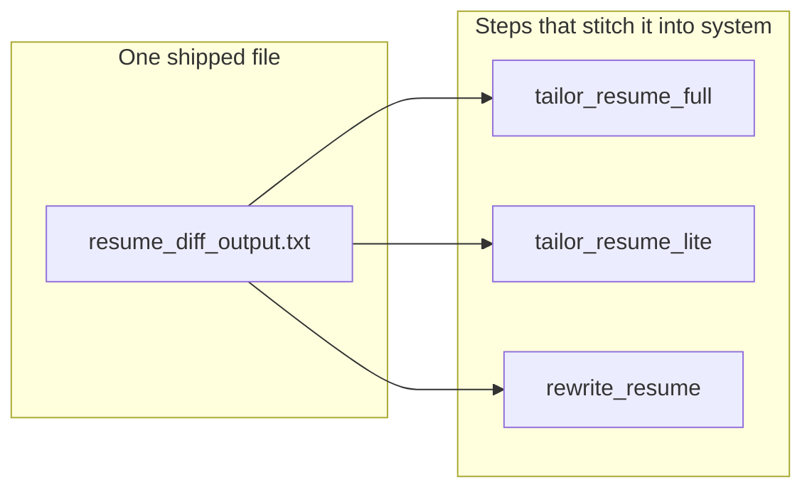
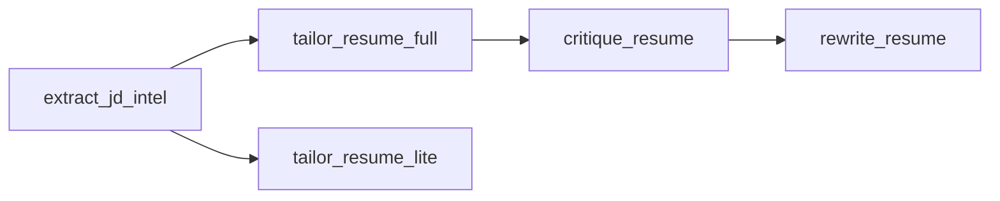
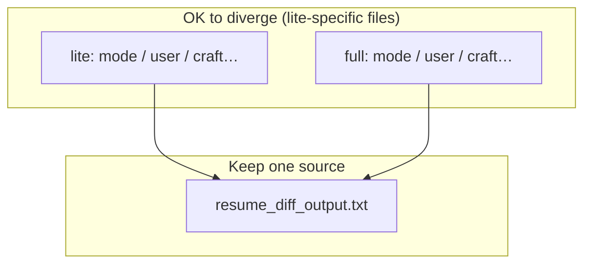

# Phase 3.13.5 — Why we do **not** merge every prompt into `{step}/system.txt` + `user.txt`

**TL;DR:** One file pair per step *looks* simpler. In practice it **duplicates** text that **must** stay identical across steps, so copies **drift** and bugs return. The repo keeps **one source of truth** for shared rules and **small swaps** (full vs lite) instead of two huge nearly-identical blobs.

---

## 1. What you see vs what the model sees

| You (files & folders) | Model (API) |
|----------------------|-------------|
| Many `.txt` fragments + Python | **Two strings:** `system` + `user` |

Folders are for **humans and git**. The LLM only gets the **assembled** messages. Merging files does not change the model — it changes **how hard it is to edit safely**.

---

## 2. The wiring (mental model)

```text
  [ .txt files under text/ ]
           │
           ▼
  [ Python: step module, e.g. tailor_resume_full.py ]
           │
           ├── read fragments + optional overrides
           ├── build_messages(...)  →  (system_string, user_string)
           │
           ▼
  [ LLM API: role=system, role=user ]
```

**Overrides (today):**

- **Per step:** `instructions` + `rules` (and composer JSON can replace **whole** system + user).
- **Shared:** one file for a rule set used by **several** steps (e.g. resume diff JSON shape).

So: **shipped text** can be split; **runtime** is still two messages.

---

## 3. Why “two files per step, everything inside” hurts

**A) Duplicate = drift**  
If the same JSON rules live inside `tailor_resume_full/system.txt` *and* `tailor_resume_lite/system.txt` *and* `rewrite_resume/system.txt`, someone will edit **one** copy and forget the others. Then steps disagree on output shape → **parse errors / bad diffs**.

**B) Full vs lite are almost the same**  
Only a **small** part differs (mode + user shell). Two monolithic `system.txt` files = **two long documents** that are ~90% identical → painful diffs and the same drift risk.

**C) You already have “whole prompt” overrides**  
Composer override = replace **entire** system and/or user when you want. You do **not** need to merge shipped files to get that.

**D) Partial edits stay useful**  
Changing **only** “output JSON rules” without touching “how to write bullets” is easier when those live in **separate** shipped slots (`rules` vs `instructions`) or a **shared** rules file.

---

## 4. Shared rule: one file → **three** steps (graph)

`resume_diff_output.txt` is loaded once in code as **resume diff rules**. **Three** prompt steps include that block in the system side:



If you merged into each step’s `system.txt`, you would **copy** that file’s content **three times**. The graph above would become **three separate blobs** to keep in sync by hand.

*(Other shared packs: `jd_intel` fragments → `extract_jd_intel` only, but that JSON **feeds** full + lite as **input**. `critique_rules` → `critique_resume` only — still split from instructions for the same override reason.)*

---

## 5. Data flow (pipeline), separate from “shared file”

JD extraction runs once; tailoring **consumes** the result. Quick picture:



This is **who runs after whom**. It is **not** the same as the “one file, three steps” graph — but it shows why **full** and **lite** both need **aligned** rules: they share upstream shape and the same diff contract.

---

## 6. When a flat `system.txt` + `user.txt` *is* fine

Steps that **do not** share big rule blocks with others (e.g. self-contained parse / cover flows) can already live as **simple** folders. The argument against merger is strongest where **reuse** and **full/lite** branching exist.

---

## 7. If you still want “simpler,” lower-risk options

- Use **Prompt Catalog** + **composer** for whole-message experiments (no repo merge).
- Add a **“copy assembled system/user”** export for advisors — still **one** source of truth on disk.
- Do **not** duplicate `resume_diff_output.txt` into multiple `system.txt` files unless you accept **manual sync forever**.

---

## 8. Follow-up: full vs lite diverging — still use `fragments/`?

**Question (paraphrased):**  
We plan to change **most** of the **lite** rules soon. **Only** the **resume diff** call / JSON contract should stay **common** between full and lite. Should full and lite **still** share the same fragment files, or not?

**Short answer:**  
- **Yes, keep one shared place** for anything that must stay **byte-for-byte aligned** across full, lite, and rewrite — that is **`resume_diff_output.txt`** (and the `_rules.resume_diff` override path). **Do not** fork that into two copies unless lite truly needs a *different JSON schema* (today it does not).  
- **No obligation** to share *everything* else in one file. If lite’s **voice, limits, and strategy** diverge a lot, **fork the lite-only prose** into its own shipped files (you already have `tailoring_mode_lite.txt` and `tailoring_user_shell_lite.txt`; you can add e.g. `tailoring_craft_lite.txt` if the “craft” block stops being shared, or grow the lite mode file — wiring stays in Python).

**Why this still matches the doc above:**  
The bad pattern is **duplicating the same contract** in two places. The good pattern is **one contract file + separate lite “how to behave” files**. Full and lite **do not** need to share a single mega-fragment for all rules — they only need to **agree on the diff JSON rules** they both load.

**Tiny wiring reminder (today):**  
System for tailor steps is roughly **`instructions`** (craft + mode) + **`rules`** (resume diff). Resume diff is the part you keep shared; the **`instructions`** side is where lite can go its own way without touching `resume_diff_output.txt`.



---

## 9. Target direction (your ask) — restated + cons + example

### What you want (simple restatement)

- **One mental model everywhere:** what the **Prompt Catalog** shows as that step’s **system** and **user** should match how the **backend** loads prompts — **no hidden stitch** of many fragments in Python that differs from “the files on disk.”
- **All LLM calls stay two messages:** `system` + `user` (unchanged at the API).
- **Merge / fold fragments “into parents”:** per step (and per pipeline-relevant operation), ship **one `system.txt` and one `user.txt`** (or your chosen pair) that already contain the full text the catalog would show, instead of scattering body across `fragments/` + assembly code.
- **Down the line:** almost every step is **its own thing**; **only `resume_diff`** (JSON diff contract) should stay a **single shared reference** across the few tailoring steps. Tiny shared micro-fragments elsewhere are **not** worth the complexity.

### Top cons (honest)

1. **`resume_diff` is the trap if you inline it** — If you **paste** the same diff rules into `tailor_resume_full/system.txt`, `tailor_resume_lite/system.txt`, and `rewrite_resume/system.txt`, you will eventually have **three versions**. That breaks parsing consistency. **Fix:** keep **one** `resume_diff` artifact and **include** it at build or load time (one line of code / one import) — still “catalog shows full system” but not three hand-copied blobs.
2. **Lose cheap partial overrides** — Today you can change **only** “rules” vs “instructions.” One monolithic `system.txt` → overrides touch **everything** unless you reintroduce sections or split files again.
3. **Bigger merge conflicts & noisier blame** — One long `system.txt` mixes contract, tone, and edge cases; two people editing different concerns collide on the same file.
4. **Catalog vs runtime must stay wired** — If someone “simplifies” Python but forgets to point `SYSTEM_PROMPT_FILES` / loader at the new single file, the catalog shows **A** and the model gets **B**. You need a **single loader path** per step as a rule.
5. **Steps with real variants** (cover only / outreach only / combined, enrichment analyze vs enhance, etc.) — Either they stay **multiple** prompt identities (still two messages each) or you **re-split** folders; “one pair per step” is easy until **one product feature = multiple LLM recipes** again.

### Tiny scenario (how it goes wrong)

**Setup:** You merge fragments so `rewrite_resume/system.txt` contains **everything**, including a **copy** of the resume-diff JSON rules (same paragraph as in `tailor_resume_full/system.txt`).

**Later:** A bugfix tightens bullet indexing in **tailor full’s** copy. Nobody updates **rewrite’s** copy the same week.

**Result:** Tailor output validates; rewrite pass occasionally emits **slightly different keys** → downstream merge or validation fails **only on some runs**. Hard to debug because “both prompts look fine” in isolation.

**Moral:** Shared contract = **one file or one include**, not three silent duplicates — even in a “flattened” world.

---

**Doc intent:** explain why “merge everything per step” fights **reuse**, **full/lite**, and **overrides** — in one skim; record your **intended simplification** and its **tradeoffs**. Related: `phase-3.13.5-prompt-authoring-and-runtime.md`, `apps/backend/app/prompts/text/README.md`.

**Implementation plan (checklists, paths, rollout):** [`phase-3.13.5-technical-flow.md`](phase-3.13.5-technical-flow.md) — **done** (repo layout: per-step `text/{step}/system.txt` + `user.txt`, shared diff under `text/output_file_schema_rules/`, enrichment subfolders; API `instructions` override → `{step}.system.txt`).
