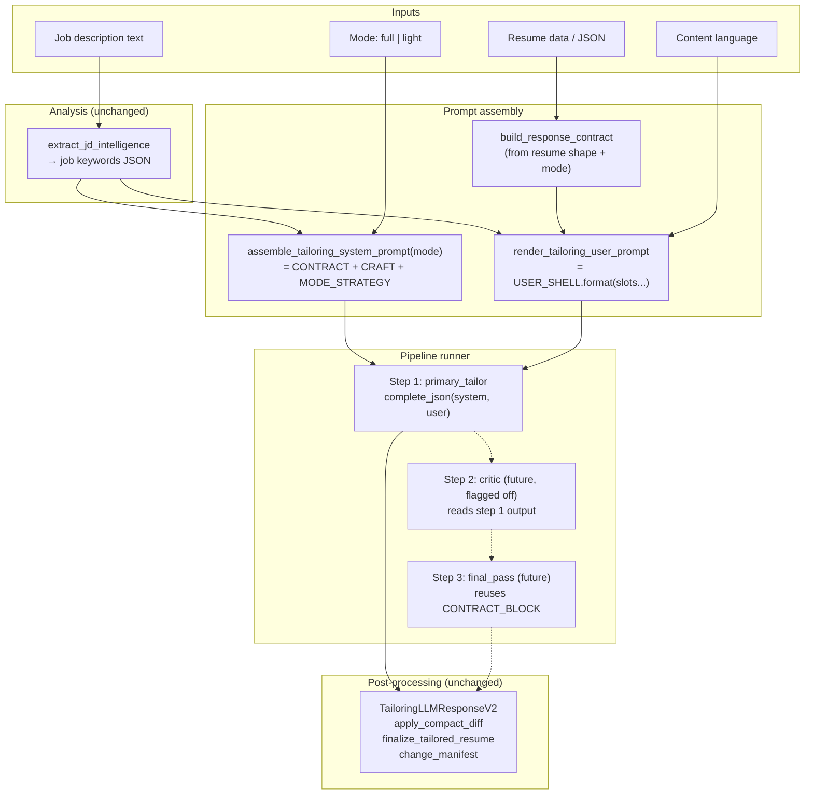

# Phase 3.7.1 — Prompt Schema Redesign (Opus 4.6)

**Status:** Design / plan — awaiting approval  
**Scope:** Main resume **tailoring** pipeline (JD → intelligence → tailor → structured JSON). Enrichment flows are out of scope.  
**Prior art:** [Composer-2 plan](./phase-3.7.1-Prompt-schema-redesign-Composer-2.md) · [Prompt composition doc](../prompts/llm-prompt-composition.md)  
**Principle:** Stability first. Every change must be incremental, testable, and reversible. No new dependencies, no framework, no dedicated version-tracking beyond Git.

---

## 1. Current structure — what works, what doesn't

### 1.1 What is already stable (protect at all costs)

| Strength | Detail |
|----------|--------|
| **Single LLM call** | Tailoring is one `complete_json` call. Simple, fast, predictable latency and cost. The pipeline works. |
| **Response contract builder** | `build_response_contract` in `contracts.py` dynamically generates a JSON schema fence from the actual resume shape. This is the strongest stability anchor we have — the LLM knows exactly which keys, indices, and sections it may touch. |
| **Compact diff path** | `TailoringLLMResponseV2` + `apply_compact_diff` means the LLM returns *only changes*, and code merges them. This keeps output small and structurally safe. |
| **JD intelligence as separate step** | Analysis → tailoring is the right split. `extract_jd_intelligence` runs independently with its own prompt, its own schema, its own validation. No reason to merge. |
| **Git-tracked Python templates** | Reviewable diffs, no mystery state, no database to corrupt. |
| **Post-LLM guardrails** | `finalize_tailored_resume`, `preservation.py`, `change_manifest`, `verification.py` — all of these provide a safety net that catches LLM misbehavior *after* the call. This net stays regardless of prompt changes. |


### 1.2 Issues (why iteration feels dangerous)

#### Issue 1: Calibrated rules and creative content live in one blob

`TAILORING_SYSTEM_PROMPT` (templates.py L130-179) is one 50-line string containing:

- **Calibrated contract** — `OUTPUT FORMAT` block with exact JSON keys, indexing rules, what to emit, what to omit. This is load-bearing: parsers (`TailoringLLMResponse`, `TailoringLLMResponseV2`), `apply_compact_diff`, and every downstream consumer depend on it.
- **Creative content** — `APPROACH`, `WRITING STANDARDS`, `ATS OPTIMIZATION` — voice, tone, banned words, metric guidance. This is what you want to iterate on freely.

**The danger:** When you copy the system prompt to another LLM to improve the writing advice, you're editing a string that also contains the output contract. One accidental key rename = broken JSON parsing in production. There is no structural boundary telling you "stop editing here."

#### Issue 2: Three modes, one system prompt, one tiny line

All three modes (`nudge`, `keywords`, `full`) share the same system prompt — which was written *for aggressive rewriting*. The only per-mode differentiation is the `MODE:` line in the user message (one sentence from `TAILORING_MODE_CONSTRAINTS`).

**Why this causes output drift:** The system prompt says things like "Replace least relevant bullets" and "Rewrite bullets to strongly match." A single `MODE: nudge — Conservative alignment...` line is fighting 50 lines of "rewrite everything" system instructions. The LLM follows the louder signal.

`IMPROVE_STRATEGY_GUIDANCE` exists with per-mode `primary_goal` and `description_rule` — but is **never interpolated into the prompt**. It's loaded in `prompting.py` L44-47, stored in `TailoringPromptContext.strategy_primary_goal`, but `render_tailoring_prompt` does not use it. Dead weight causing confusion.

#### Issue 3: Fragmentation across files

To understand "what text shapes one tailoring call," you must read:

1. `templates.py` — string constants (system prompt, user template, mode constraints, strategy guidance)
2. `prompting.py` — assembly logic (`build_prompt_context`, `render_tailoring_prompt`)
3. `contracts.py` — response contract generation (becomes `{response_contract}` placeholder)
4. `orchestration.py` — actual LLM call with retries, metadata, version tagging
5. `catalog_sections.py` — read-only catalog representation

Five files, three directories. None of these files are large or complex individually, but the mental overhead of tracing "which text ends up where in the final prompt" is real.

#### Issue 4: No clean extension story

If you wanted to add a "critic" or "reflection" step after the main tailoring call, today you would:
- Write a new prompt string somewhere in `templates.py` (it's already 468 lines)
- Write a new `complete_json` call somewhere — new file? `orchestration.py`? `refiner.py`?
- Manually thread the output of step 1 into step 2
- Hope the second step doesn't break the contract that step 1 established

There's no named concept of "pipeline steps" — it's just ad-hoc function calls.

#### Issue 5: Three modes have too much overlap

`nudge` and `keywords` differ by one paragraph. `keywords` and `full` differ by one paragraph. In practice, users can't articulate why they'd pick `keywords` over `full`. The three-mode system creates surface area (three UI options, three constraint strings, three strategy dicts) for very thin behavioral differences.

---

## 2. Design principles

### 2.1 Separate "contract" from "craft" — physically, not just conceptually

**Contract** = everything that parsers, validators, and downstream code depend on:
- JSON-only requirement
- Allowed top-level keys (`summary`, `experience`, `projects`, `skills`, `bold_keywords`)
- Index semantics (0-based, keyed by entry index)
- What must NOT be emitted (`personalInfo`, `education`, `id`, `company`, `location`, `dates`)
- Retry hints tied to JSON shape

**Craft** = everything that shapes *quality* without changing *structure*:
- Voice and tone rules
- Banned words / AI phrase rules
- ATS keyword philosophy (not the exact key schema)
- Metric and calibration guidance
- Rewriting examples

**Mechanism:** Separate Python string constants, concatenated in a fixed order by the assembler. Not separate files, not a framework — just named constants with clear prefixes and a one-function assembler. A human can read the constant name and know: "this one is safe to paste back from another LLM" vs "this one needs a test run."

### 2.2 Two modes with isolated instruction surfaces

| Mode | Label | Default? | Behavior |
|------|-------|----------|----------|
| `full` | Full edit | **Yes** | Maximum alignment. Rewrite bullets, enhance titles, replace weak content, regroup skills. |
| `light` | Light touch | No | Conservative. Improve wording, weave a few keywords, preserve structure and titles. Touch only what clearly benefits. |

Each mode gets its own **strategy block** — not one sentence, but a full paragraph set that covers: what to change, what to preserve, how aggressive to be with titles/bullets/skills. This block is injected into the system or user message alongside the shared contract and craft blocks. The model never sees conflicting instructions.

**Migration from three modes:**
- `full` ← current `full` (unchanged conceptually)
- `light` ← current `nudge` (with richer instructions)
- `keywords` → mapped to `full` (with a one-time user preference migration)

### 2.3 Pipeline = ordered list of named steps

A "pipeline" is a Python list of step descriptors. Each step has:
- A name (for logging, tracing, UI)
- A prompt builder function (returns system + user messages)
- An optional `enabled` flag (feature flag or config)
- An optional model override

The default pipeline has **one step**: the primary tailoring call. Future steps (critic, polish, reflection) are added by appending to the list. Each step that produces JSON reuses the same output contract block. Non-JSON steps (e.g., text critique) are parsed defensively.

### 2.4 No overengineering

- No plugin SDK, no adapter registry, no dependency injection
- No prompt database, no version control beyond Git
- No new Python packages
- String constants + one assembler function + one runner loop
- If it can be done with concatenation, use concatenation

---

## 3. Proposed architecture

### 3.1 Block model — named string constants

```
┌─────────────────────────────────────────────────────────┐
│ SYSTEM MESSAGE (assembled per mode)                     │
│                                                         │
│  ┌───────────────────────┐  ← CONTRACT_BLOCK            │
│  │ Role line             │    (calibrated, rarely edit)  │
│  │ OUTPUT FORMAT rules   │                               │
│  │ Omission rules        │                               │
│  │ Key/index semantics   │                               │
│  └───────────────────────┘                               │
│                                                         │
│  ┌───────────────────────┐  ← CRAFT_BLOCK               │
│  │ WRITING STANDARDS     │    (experimental, safe to     │
│  │ ATS OPTIMIZATION      │     iterate & paste back)     │
│  │ Banned words          │                               │
│  │ Metric calibration    │                               │
│  └───────────────────────┘                               │
│                                                         │
│  ┌───────────────────────┐  ← MODE_STRATEGY_BLOCK[mode] │
│  │ Mode-specific rules   │    (full or light, per-mode)  │
│  │ Scope/aggression      │                               │
│  │ Title/bullet policy   │                               │
│  └───────────────────────┘                               │
└─────────────────────────────────────────────────────────┘

┌─────────────────────────────────────────────────────────┐
│ USER MESSAGE (same structure for all modes)              │
│                                                         │
│  ┌───────────────────────┐  ← USER_SHELL                │
│  │ "Tailor this resume"  │    (template with slots)      │
│  │ MODE: {mode_id}       │                               │
│  │ REWRITING EXAMPLE     │                               │
│  │ JOB INTELLIGENCE:     │                               │
│  │   {job_intelligence}  │  ← runtime slot               │
│  │ MASTER RESUME:        │                               │
│  │   {original_resume}   │  ← runtime slot               │
│  │ RESPONSE CONTRACT:    │                               │
│  │   {response_contract} │  ← runtime slot               │
│  │ Output language:      │                               │
│  │   {output_language}   │  ← runtime slot               │
│  └───────────────────────┘                               │
└─────────────────────────────────────────────────────────┘
```

### 3.2 Assembler (one function)

```python
# Conceptual — not final code

def assemble_tailoring_system_prompt(mode: str) -> str:
    """Build the system message from blocks. Order is fixed."""
    return "\n\n".join([
        TAILORING_CONTRACT_BLOCK,    # JSON shape — rarely changed
        TAILORING_CRAFT_BLOCK,       # Voice/quality — safe to iterate
        TAILORING_MODE_STRATEGY[mode],  # Per-mode behavior
    ])
```

The assembler is the **single place** that decides what text the model sees. No other function builds system prompts for tailoring. If you want to know "what does mode=full see?" → read this function and the three constants it concatenates.

### 3.3 Pipeline runner

```python
# Conceptual

@dataclass
class PipelineStep:
    name: str
    build_messages: Callable[..., tuple[str, str]]  # → (system, user)
    enabled: bool = True
    model_override: str | None = None  # e.g., "gpt-4o-mini" for critic
    max_tokens: int = 15000

TAILORING_PIPELINE: list[PipelineStep] = [
    PipelineStep(
        name="primary_tailor",
        build_messages=build_tailoring_messages,
    ),
    # Future:
    # PipelineStep(name="critic", build_messages=build_critic_messages, enabled=False),
    # PipelineStep(name="final_pass", build_messages=build_final_messages, enabled=False),
]
```

**For v1, the pipeline has exactly one step** — the current tailoring call. The `PipelineStep` dataclass and runner loop are ~30 lines of code. Adding a future step = adding one `PipelineStep` to the list with `enabled=False`, writing its `build_messages` function, and flipping the flag.

### 3.4 Data flow



---

## 4. Concrete block contents (what goes where)

### 4.1 CONTRACT_BLOCK — calibrated, change rarely

Everything currently under `OUTPUT FORMAT:` in `TAILORING_SYSTEM_PROMPT` (L159-179), plus the role-line sentence that establishes JSON-only output:

```
You are a senior resume strategist. Output valid JSON only — no markdown, no commentary.

OUTPUT FORMAT:
- Keys: "summary", "experience", "projects", "skills", "bold_keywords"
- summary: one sentence. "[N]+ years in [domain], [1-2 JD-aligned strengths]."
- experience: object keyed by 0-based entry index ("0", "1", …)
  - include only entries you change
  - each entry: { "position": "enhanced title or omit", "bullets": { "INDEX": "text" } }
  - INDEX must be within the entry's bullet_count
  - omit an INDEX to keep that bullet unchanged
- projects: object keyed by 0-based entry index
  - each entry: { "name": "enhanced title or omit", "tech_stacks": "updated tagline or omit", "bullets": { "INDEX": "text" } }
- skills: array of { "label": "...", "values": [...] }
  - 3-6 groups max, clear labels, no duplicates across groups
  - retain relevant core skills, remove clearly irrelevant
  - place JD-critical skills first
  - omit "skills" key entirely if no changes
- bold_keywords: array of 10-20 strings from the final resume content for JD alignment
- Do NOT emit: id, company, location, dates, github, website, customSections
```

**Edit policy:** repo-only. Any change requires running the tailoring integration tests. Bump `PROMPT_VERSIONS["tailoring_contract"]`.

### 4.2 CRAFT_BLOCK — experimental, safe to iterate

Everything currently under `APPROACH`, `WRITING STANDARDS`, and `ATS OPTIMIZATION` — the "how to write well" instructions:

```
APPROACH:
- Rewrite the resume so the candidate naturally fits the target role
- The writing must read like the candidate genuinely wrote it
- Maintain the candidate's authentic voice and writing culture
- Relate work naturally to what the target employer cares about
[... rest of APPROACH, WRITING STANDARDS, ATS OPTIMIZATION as today ...]
```

**Edit policy:** safe to paste back from another LLM. Safe to edit in UI (future). Does not mention JSON keys, index semantics, or output shape. If you accidentally put "emit a changes array" here, the contract block is the only authority — this block can't override it.

### 4.3 MODE_STRATEGY — per-mode, replaces thin MODE constraints

**`MODE_STRATEGY_FULL`:**
```
TAILORING MODE: Full edit (maximum alignment)
- Rewrite bullets to strongly match the target role. Every bullet should serve the candidate's case.
- Enhance titles with platform, domain, or scope context (e.g., "Software Engineer" → "Software Engineer, Platform & Distributed Systems").
- Replace the least applicable bullets with naturally fitting alternatives.
- Regroup skills into concise, role-relevant categories.
- You may replace the least relevant bullets with content that naturally supports the role.
- For projects, relate them to the company's products or domain where the candidate was employed.
- Calibrate scope to experience level: early career roles get modest bullets; short stints get proportionally scoped bullets.
```

**`MODE_STRATEGY_LIGHT`:**
```
TAILORING MODE: Light touch (conservative alignment)
- Improve wording and weave in a few high-priority keywords. Keep the original voice nearly intact.
- Do NOT change job titles. Do NOT add scope/domain qualifiers to titles.
- Only touch bullets that clearly benefit from adjustment. Preserve all others exactly as-is.
- Do NOT replace bullets with new content. Only refine existing text.
- Skills: minor reordering for relevance is OK. Do not restructure groups.
- If in doubt, leave the bullet unchanged.
```

**Edit policy:** safe to iterate. Same as craft — no JSON schema language here.

> [!IMPORTANT]
> The key difference from today: these are **multi-line instruction paragraphs**, not single sentences. The model receives clear, internally consistent direction for each mode. No more "one line vs 50 lines" conflict.

### 4.4 USER_SHELL — the user-message template

Essentially today's `IMPROVE_RESUME_PROMPT_TEMPLATE` with one change: remove `MODE: {mode_id} — {mode_constraint}` since mode strategy is now in the system message. Keep a minimal mode identifier line for traceability:

```
Tailor this resume for the target role.

MODE: {mode_id}

REWRITING EXAMPLE:
[... same as today ...]

JOB INTELLIGENCE:
{job_intelligence}

MASTER RESUME:
{original_resume}

RESPONSE CONTRACT:
{response_contract}

Output language: {output_language}
```

---

## 5. File layout changes

### 5.1 What changes in `app/prompts/`

| File | Change | Rationale |
|------|--------|-----------|
| `templates.py` | **Split** tailoring constants into named blocks: `TAILORING_CONTRACT_BLOCK`, `TAILORING_CRAFT_BLOCK`, `TAILORING_MODE_STRATEGY` dict, `TAILORING_USER_SHELL`. Remove `TAILORING_SYSTEM_PROMPT` as a single constant. Keep backward-compat alias if needed. | Physical separation of contract vs content. |
| `templates.py` | **Remove** `IMPROVE_STRATEGY_GUIDANCE` entirely. Its content is absorbed into `TAILORING_MODE_STRATEGY`. | Eliminates dead code that causes confusion. |
| `templates.py` | **Update** `TAILORING_MODE_CONSTRAINTS` → fold into `TAILORING_MODE_STRATEGY`. Remove the old dict. | Single source of per-mode instructions. |
| `templates.py` | **Update** `IMPROVE_PROMPT_OPTIONS` → two items instead of three. `DEFAULT_IMPROVE_PROMPT_ID` → `"full"`. | Two-mode model. |
| `templates.py` | **Add** `PROMPT_VERSIONS["tailoring_contract"]` and `PROMPT_VERSIONS["tailoring_craft"]` alongside existing version. | Distinct version tracking for contract vs content changes. |
| `__init__.py` | Update re-exports to match new constant names. Add backward-compat aliases for old names. | Non-breaking import surface. |
| `catalog_sections.py` | Update to reflect new block names and two modes. | Catalog API stays aligned with code. |
| `refinement.py` | **No change.** | Out of scope — local phrase cleanup, no prompt assembly. |
| `enrichment.py` | **No change.** | Out of scope. |

### 5.2 What changes in `services/tailoring/`

| File | Change | Rationale |
|------|--------|-----------|
| `prompting.py` | **Rewrite** `build_prompt_context` and `render_tailoring_prompt` to use the new block assembler. Remove `_resolve_strategy` (no more separate strategy dict). Add `assemble_tailoring_system_prompt(mode)` function. | Central assembler, single place to understand the full prompt. |
| `prompting.py` | **Add** `PipelineStep` dataclass and `TAILORING_PIPELINE` list (single step for v1). | Extension point for future steps. |
| `orchestration.py` | **Minor** — use the pipeline runner instead of directly calling `complete_json`. For v1 this is a thin wrapper. | Future-proofs for multi-step. |
| `contracts.py` | **Minor** — consider whether `light` mode should tighten the contract (e.g., disallow title changes in contract). Decision below. | Behavioral accuracy for light mode. |

### 5.3 What does NOT change

- `analysis.py` — JD intelligence extraction
- `models.py` — response models (`TailoringLLMResponseV2`, `TailoringResumePayload`)
- `preservation.py` — compact diff application
- `diffing.py`, `verification.py`, `change_manifest.py` — post-LLM safety net
- `llm.py` — LLM client (`complete_json`)
- All enrichment, cover letter, application questions code

---

## 6. Extension points

### 6.1 Adding a new pipeline step

1. Write a `build_X_messages(context, previous_output) -> (system, user)` function
2. Add a `PipelineStep(name="X", build_messages=build_X_messages, enabled=False)` to `TAILORING_PIPELINE`
3. JSON-producing steps **must** include `TAILORING_CONTRACT_BLOCK` in their system message
4. Non-JSON steps (critic) return structured text parsed defensively
5. Flip `enabled=True` when ready; feature-flag in config for production

### 6.2 Adding/removing modes

1. Add/remove an entry in `TAILORING_MODE_STRATEGY` dict
2. Update `IMPROVE_PROMPT_OPTIONS` list
3. The assembler picks up the new mode automatically
4. No other code changes needed

### 6.3 Editing craft/voice text

1. Edit `TAILORING_CRAFT_BLOCK` in `templates.py`
2. No tests required beyond "does the output still parse?" (which existing tests cover)
3. Bump `PROMPT_VERSIONS["tailoring_craft"]`
4. Future: UI editing exposes only this block + mode strategy blocks

---

## 7. Model routing (per-step)

### 7.1 Current state

All LLM calls go through `complete_json` / `complete` in `llm.py`, which uses a single `LLMConfig` (resolved from environment/settings). The config already supports `provider`, `model`, `api_key`, `api_base` — sufficient for routing.

### 7.2 Proposed: per-step model override

Each `PipelineStep` has an optional `model_override: str | None`. When set, the runner passes a custom `LLMConfig` to `complete_json` for that step.

**Resolution order:**
1. Step-level `model_override` (if set)
2. Global config (default — what we have today)

**CLIProxyAPI vs direct API:** Both already work through LiteLLM's router in `llm.py`. A `model_override` string like `"cliproxyapi/gpt-4o-mini"` or `"openai/gpt-4o"` works with either. No special handling needed.

**Deferred (do not build now):**
- Per-step cost caps
- Automatic A/B model testing
- Dynamic model selection by resume size
- Fallback chains per step

### 7.3 Implementation

```python
# In orchestration.py — conceptual

async def run_tailoring_pipeline(pipeline, context):
    result = None
    for step in pipeline:
        if not step.enabled:
            continue
        system, user = step.build_messages(context, result)
        config = _resolve_step_config(step.model_override)
        result = await complete_json(
            prompt=user,
            system_prompt=system,
            config=config,
            max_tokens=step.max_tokens,
            operation=f"tailoring_{step.name}",
        )
    return result
```

~15 lines. The `_resolve_step_config` helper clones the global config and overrides the model field.

---

## 8. Light mode: contract tightening decision

**Question:** Should `light` mode only differ in prompt instructions, or should the response contract also be tighter (e.g., disallow `position` changes)?

**Recommendation: prompt-only for v1.** Rationale:

1. The contract is already defensive — `apply_compact_diff` only applies fields the LLM returns, and `finalize_tailored_resume` validates everything.
2. Tightening the contract for light mode adds a code path in `contracts.py` that must be maintained and tested.
3. The prompt-level `MODE_STRATEGY_LIGHT` saying "do NOT change job titles" is sufficient — the model follows it, and if it doesn't, the post-LLM guardrails catch it.
4. If prompt-only proves insufficient (model ignores light-mode instructions), then tighten the contract in a follow-up — but start simple.

---

## 9. UX / operations implications

### 9.1 Finding prompts

| What you want to know | Where to look |
|-----------------------|---------------|
| "What JSON shape does the LLM return?" | `TAILORING_CONTRACT_BLOCK` in `templates.py` |
| "What voice/quality rules apply?" | `TAILORING_CRAFT_BLOCK` in `templates.py` |
| "How does full mode differ from light?" | `TAILORING_MODE_STRATEGY["full"]` vs `["light"]` |
| "What placeholders get filled at runtime?" | `TAILORING_USER_SHELL` in `templates.py` |
| "What's the full assembled prompt?" | `assemble_tailoring_system_prompt()` in `prompting.py` |
| "How does the pipeline run?" | `run_tailoring_pipeline()` in `orchestration.py` |

**One question → one location.** No more cross-referencing five files.

### 9.2 Safe paste-back workflow

When you copy prompts to another LLM for improved wording:

1. **Copy only** `TAILORING_CRAFT_BLOCK` and/or `TAILORING_MODE_STRATEGY[mode]`
2. Paste improved text back into those constants
3. **Never** paste anything into `TAILORING_CONTRACT_BLOCK` without running tests
4. The constant names and inline comments make this boundary obvious

### 9.3 UI editing (future, not this phase)

| Block | UI exposure | Rationale |
|-------|-------------|-----------|
| `CRAFT_BLOCK` | Editable text area | Safe to iterate, no structural risk |
| `MODE_STRATEGY[mode]` | Editable text area (per mode) | Safe to iterate |
| `CONTRACT_BLOCK` | Read-only with "edit in repo" note | Structural risk — needs tests |
| `USER_SHELL` | Hidden / advanced only | Rarely changed, slot ordering matters |
| Runtime slots | Not shown | Code-generated, not human-editable |

### 9.4 Catalog API alignment

`catalog_sections.py` already mirrors the prompt structure for the read-only API. Update it to use block names:

- `tailoring_contract` → maps to `TAILORING_CONTRACT_BLOCK`, policy `system` (read-only)
- `tailoring_craft` → maps to `TAILORING_CRAFT_BLOCK`, policy `user_editable_future`
- `tailoring_strategy_full` / `tailoring_strategy_light` → policy `user_editable_future`

---

## 10. Risks and mitigation

| Risk | Likelihood | Impact | Mitigation |
|------|-----------|--------|------------|
| **JSON regressions from prompt split** | Medium | High | Contract block is copy-pasted from current working system prompt. No rewording. Integration tests run before and after. |
| **Light mode produces different output quality** | Medium | Medium | Light mode inherits the same `CRAFT_BLOCK` and `CONTRACT_BLOCK`. Only the strategy differs. Test with 3-5 real resumes before shipping. |
| **Mode confusion after 3→2 collapse** | Low | Low | Map old `keywords` → `full` in user preferences migration. Clear changelog. `nudge` → `light`. |
| **Pipeline runner adds complexity for no benefit** | Low | Low | v1 pipeline has exactly one step. The runner is ~15 lines. If it proves unneeded, revert to direct call — the interface is the same. |
| **`IMPROVE_STRATEGY_GUIDANCE` removal breaks something** | Low | Low | It's provably dead code — `render_tailoring_prompt` doesn't interpolate it. `strategy_primary_goal` is stored in `TailoringPromptContext` but never emitted to the LLM. grep confirms no usage. |
| **Drift between docs and code** | Medium | Medium | The assembler function is the single source of truth. Catalog API reads from the same constants. Composition doc links to function names. |

---

## 11. Migration plan (incremental, phased)

### Phase A — Clarify without behavior change ✦ lowest risk

**Goal:** Restructure the code without changing what the LLM sees.

1. **Split `TAILORING_SYSTEM_PROMPT`** into `CONTRACT_BLOCK`, `CRAFT_BLOCK`, and `MODE_STRATEGY_FULL` (the current default). Concatenation of all three equals the current system prompt byte-for-byte.
2. **Create `MODE_STRATEGY_LIGHT`** with content from current `nudge` constraint + expanded instructions. Do not expose yet.
3. **Remove `IMPROVE_STRATEGY_GUIDANCE`** — it's dead code.
4. **Create `assemble_tailoring_system_prompt(mode)`** that concatenates blocks. For now, always called with `mode="full"` internally.
5. **Add `PipelineStep` dataclass** and single-step pipeline. Orchestration calls through the runner. Net behavior: identical.
6. **Update `catalog_sections.py`** to reflect new block names.
7. **Run all existing tests.** Output must be identical to pre-change.

**Verification:** Golden-file comparison — capture the assembled system+user prompt before and after. Must match exactly.

### Phase B — Two modes (user-visible change)

**Goal:** Replace three modes with two.

1. **API + UI:** Replace `nudge`/`keywords`/`full` with `light`/`full`. Update `IMPROVE_PROMPT_OPTIONS` and `DEFAULT_IMPROVE_PROMPT_ID`.
2. **User preference migration:** Stored `keywords` → `full`, stored `nudge` → `light`. One-time migration script or on-read mapping.
3. **Wire `MODE_STRATEGY_LIGHT`** into the assembler. Now the system prompt genuinely differs between modes.
4. **Test with real resumes:** Run 3-5 resumes through both modes. Verify light mode is genuinely conservative.
5. **Update composition doc** and changelog.

### Phase C — Optional pipeline steps (future)

1. Add a `critic` step with its own prompt and `enabled=False` flag.
2. Add per-step `model_override` support in the runner.
3. Test behind feature flag. Measure latency/cost impact before enabling in production.

### Phase D — UI editing (future)

1. Expose `CRAFT_BLOCK` and `MODE_STRATEGY` blocks via API endpoint.
2. Contract block read-only with "edit in repo" tooltip.
3. Requires a persistence story for UI-edited prompts (config file or DB field — decide when needed).

---

## 12. Success criteria

- [ ] A contributor can state where contract ends and craft begins in under 2 minutes.
- [ ] Swapping voice/quality text does not require touching JSON key instructions.
- [ ] `light` and `full` produce internally consistent behavior (no conflicting rewrite vs preserve instructions).
- [ ] Adding a flagged second LLM step does not require rewriting JD extraction, contract builder, or post-processing.
- [ ] The assembled prompt for `full` mode after Phase A is byte-identical to today's prompt.
- [ ] No new Python dependencies introduced.
- [ ] All existing tests pass without modification in Phase A.

---

## 13. Explicit assumptions

1. **JD intelligence extraction** stays as-is. This redesign touches only tailoring prompt assembly and modes.
2. **Output JSON contract** remains compatible with `TailoringLLMResponseV2` / compact diff path unless a separate migration epic changes the schema.
3. **CLIProxyAPI** is the preferred model routing path. Direct API remains supported through the same `LLMConfig` / `complete_json` interface.
4. **Two modes** are sufficient. If analytics later show `keywords` behavior was distinctly valuable, it can be re-added as a third mode — the architecture supports N modes trivially.
5. **Phase A is a pure refactor** — zero behavior change. This is the safest possible first step and the validation that the split is correct.

---

## 14. Open follow-ups (not blocking approval)

- **Default for migrated `keywords` users:** Map to `full` or `light`? Product decision. Recommendation: `full` (closest behavior).
- **Light mode contract tightening:** Start with prompt-only. Revisit if models ignore light-mode instructions.
- **Craft block editing workflow:** When UI editing ships, do we store overrides in a config file alongside `templates.py` or in a DB column? Defer until Phase D.

---

*End of design document.*
