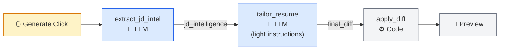
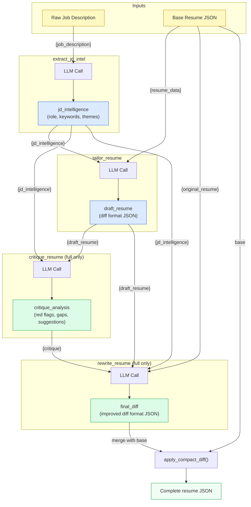

# Phase 3.7.3 — Prompt Pipeline Simplification & Critique Layer

**Author:** Architecture session  
**Status:** Draft — awaiting user review  
**Scope:** Backend prompt refactor, critique pipeline (full mode only), per-step model override, catalog UI overhaul.  
**In scope:** `parse_resume`, `extract_jd_intel`, `tailor_resume`, `critique_resume` (new), `rewrite_resume` (new), `cover_letter_outreach`, `answer_questions`  
**Out of scope:** The 4 enrichment prompts (`enrich_analyze`, `enrich_enhance`, `enrich_regen_item`, `enrich_regen_group`) — they stay as-is in `prompts/enrichment.py`.

---

## Table of Contents

1. [Current State Audit](#1-current-state-audit)
2. [Design Decisions](#2-design-decisions)
3. [Pipeline Architecture](#3-pipeline-architecture)
4. [One File Per Prompt — Structure](#4-one-file-per-prompt--structure)
5. [File Layout](#5-file-layout)
6. [Critique + Rewrite Pipeline (Full Mode)](#6-critique--rewrite-pipeline-full-mode)
7. [Per-Step Model Override](#7-per-step-model-override)
8. [Prompt Catalog UI](#8-prompt-catalog-ui)
9. [Naming Convention](#9-naming-convention)
10. [Backend Changes — File by File](#10-backend-changes--file-by-file)
11. [Frontend Changes — File by File](#11-frontend-changes--file-by-file)
12. [Migration & Backward Compatibility](#12-migration--backward-compatibility)
13. [Phased Checklist](#13-phased-checklist)
14. [Testing Plan](#14-testing-plan)
15. [Open Questions](#15-open-questions)

---

## 1. Current State Audit

### 1.1 Where prompts live today

| File | Lines | What's inside |
|------|-------|---------------|
| `prompts/templates.py` | 459 | **Everything** mixed together: parse, JD extraction, tailoring (contract+craft+mode+user shell), cover letter, outreach, combined cover+outreach, application questions, all system prompts, schema, language map |
| `prompts/enrichment.py` | 92 | Enrichment prompts (out of scope) |
| `prompts/refinement.py` | 146 | AI phrase blacklist + polish prompt |
| `prompts/catalog_sections.py` | 173 | Builds nested tree structure for the catalog UI |
| `prompts/__init__.py` | 62 | Re-exports 30+ constants from `templates.py` |

### 1.2 What makes it painful

| Problem | Root cause |
|---------|-----------|
| Can't find what to edit | One 459-line file with 30+ string constants. The tailoring prompt is built by concatenating `TAILORING_CONTRACT_BLOCK` + `TAILORING_CRAFT_BLOCK` + `TAILORING_MODE_STRATEGY[mode]` — you have to read `assemble_tailoring_system_prompt()` in `prompting.py` to know this. |
| "System prompt" and "user prompt" everywhere in the UI | The catalog splits every prompt into two boxes labeled "System Prompt" and "User Prompt" — but these don't map to anything you'd want to edit independently. The real editing unit is the full prompt for a given LLM call. |
| Naming is inconsistent | `TAILORING_CONTRACT_BLOCK` vs `JD_INTELLIGENCE_CONTRACT_BLOCK` vs `COVER_LETTER_SYSTEM_PROMPT` vs `PARSE_SYSTEM_PROMPT` — four naming patterns for the same concept (system prompt). |
| Can't see data flow | The catalog shows a tree of nested sections, but not which variables (`{job_intelligence}`, `{original_resume}`) come from where. |
| No per-call model override | `PRIMARY_TAILORING_MODEL_OVERRIDE` exists as a Python constant but there's no settings UI. The existing direct_api model picker sets one global model. |
| No critique pass | Single LLM call, accept whatever comes back. |

### 1.3 In-scope LLM calls (complete list)

| # | Current call site | Current operation name | What it does |
|---|-------------------|----------------------|--------------|
| 1 | `services/parser.py:164` | `resume_parse` | Parse uploaded resume → JSON |
| 2 | `services/tailoring/analysis.py:169` | `job_extract_keywords` | Extract JD intelligence |
| 3 | `services/tailoring/orchestration.py:65` | `resume_generate_full` | Main tailoring (diff output) |
| 4 | *(new)* | — | Critique: identify red flags |
| 5 | *(new)* | — | Rewrite: fix red flags |
| 6 | `routers/resumes.py` → `services/cover_letter.py` | `messages_generate` | Cover letter + outreach |
| 7 | `services/application_questions.py:375` | `application_questions_generate` | Answer app questions |

---

## 2. Design Decisions

These are the architectural decisions baked into this plan. Any implementing model should follow these exactly.

### D1: One file = one LLM call

Every LLM call gets its own Python file in `prompts/`. The file contains ALL text going to the LLM — rules, instructions, user message template, variable docs, and the `build_system_prompt()` / `build_user_prompt()` assembly functions.

**Why:** When you want to edit the tailoring prompt, you open `prompts/tailor_resume.py`. Everything is there. No hunting across files.

### D2: Two sections per prompt — Instructions + Rules

Every prompt file splits its content into exactly **two** sections:
- **INSTRUCTIONS** — the task itself: persona, data variables (`{resume_data}`, `{jd_intelligence}`), approach, writing style, what to do. The `{variables}` live inline in the instructions — you can see exactly where each piece of data goes. Safe to iterate by pasting improved text from other LLMs.
- **RULES** — rigid output constraints: output JSON schema, forbidden fields, format requirements. Changing these requires testing downstream parsers.

The **raw prompt** sent to the LLM is `INSTRUCTIONS + RULES`. That's it — nothing else. No separate "system prompt" vs "user prompt" from the editing perspective. Subsections within Instructions are plain text headings (e.g., `APPROACH:`, `WRITING STANDARDS:`), not code constructs. You edit them like a document.

> [!IMPORTANT]
> **Implementation detail:** Under the hood, `build_prompt()` maps these two sections to the LLM API's system/user messages for optimal model behavior. But from the **editing and viewing** perspective, you only see and edit INSTRUCTIONS + RULES. The catalog UI shows the raw combined prompt.

### D3: Critique is two LLM calls, not one

The "critique" feature is actually two sequential calls:
1. **`critique_resume`** — Receives the draft. Acts as a hiring manager. Outputs a structured critique: red flags, missed keywords, weak points. Pure analysis, no rewrite.
2. **`rewrite_resume`** — Receives the original resume, the draft, AND the critique output. Rewrites based on the red flags. Outputs the same diff format as `tailor_resume`.

**Why two calls:** A single model asked to "critique and rewrite" tends to give a shallow critique and then a marginally different rewrite. Separating forces the critique to be genuine (it has no rewriting obligation), and the rewrite to actually address it.

### D4: Critique + rewrite is FULL mode only

- **Full mode flow:** `extract_jd_intel` → `tailor_resume` → `critique_resume` → `rewrite_resume` → apply diff
- **Light mode flow:** `extract_jd_intel` → `tailor_resume` → apply diff (no critique, no rewrite)

The critique toggle is a global config setting, defaulting to `true`. When disabled, full mode runs the same flow as light (just one tailoring call). Light mode always skips critique — it's isolated.

### D5: Per-step model override uses existing provider infrastructure

The settings page already has provider/model selection with direct_api. The per-step override reuses the same `LLMProvider` types, `PROVIDER_INFO`, and `LLMConfig` structures. Each step can pick from the same model list as the global default. The UI is a simple dropdown per step, populated from the same source (direct_api models or cliproxy models).

### D6: Prompt files are Python, not YAML/Markdown

Prompt templates stay as Python string constants. Advantages: IDE autocomplete, imports, `build_*()` functions live next to the template, type checking. No template loader needed.

### D7: Catalog UI shows the raw prompt = instructions + rules

The catalog page's primary value is showing **exactly what goes to the LLM** for each call. The raw prompt is visually `INSTRUCTIONS + RULES` — nothing else. The key elements per prompt card:
- File path (so you know where to edit)
- Variables with source descriptions (each `{variable}` highlighted in the instructions text)
- Instructions section (collapsible) — the main editable content
- Rules section (collapsible) — the output constraints
- Raw prompt (expandable) — INSTRUCTIONS + RULES concatenated, exactly as it goes to the LLM
- Active model for this step

### D8: The `__init__.py` exports a registry, not 30 constants

```python
# prompts/__init__.py
PROMPT_REGISTRY: dict[str, module] = {
    "parse_resume": parse_resume,
    "extract_jd_intel": extract_jd_intel,
    # ...
}

def get_prompt(step_name: str) -> module:
    return PROMPT_REGISTRY[step_name]
```

All consumers import from the registry: `get_prompt("tailor_resume").build_prompt(mode="full")`.

Backward-compat aliases (for enrichment code that still imports `ENRICHMENT_ANALYZE_SYSTEM_PROMPT` etc.) stay during migration.

---

## 3. Pipeline Architecture

### 3.1 Full mode — the "Generate" click


> [!NOTE]
> `extract_jd_intel` runs during JD upload/save, not during Generate. Its cached output (`jd_intelligence`) is passed to the tailoring pipeline. Shown here for completeness.

### 3.2 Light mode — the "Generate" click



### 3.3 Data flow — what each step receives and produces



---

## 4. One File Per Prompt — Structure

Every prompt file follows this exact structure. Implementing model: copy this template for each file.

### 4.1 The template

```python
"""LLM prompt: <step_name> — <one-line description>."""

# ──────────────────────── META ────────────────────────
STEP_NAME = "<step_name>"           # snake_case, matches filename
STEP_LABEL = "<Human Readable>"     # Title Case, shown in catalog UI
STEP_VERSION = "v1.0"               # Bump when prompt content changes
FILE_PATH = "prompts/<step_name>.py"  # Self-ref, shown in catalog UI

# ──────────────────────── VARIABLES ────────────────────
# Documents every {placeholder} in INSTRUCTIONS below.
# Shown in the catalog UI as a reference table.
VARIABLES = {
    "resume_data": "Source: base resume JSON",
    "jd_intelligence": "Source: output of extract_jd_intel step",
}

# ──────────────────────── INSTRUCTIONS ─────────────────
# This is the main body of the prompt. Contains:
#   - Persona ("consider yourself as...")
#   - Data variables inline ({resume_data}, {jd_intelligence})
#   - Task description ("how would you rewrite...")
#   - Writing guidelines, approach, strategy
#
# Safe to iterate — paste improved wording from other LLMs.
INSTRUCTIONS = """
You are a senior resume strategist. Your single goal: craft a resume
that earns the interview call.

Here is the candidate's base resume:
{resume_data}

Here is the extracted job description intelligence:
{jd_intelligence}

Rewrite the resume to match this role. Maintain the candidate's
authentic voice...

WRITING STANDARDS:
- Write like a real engineer — specific, concrete, direct
- Every bullet earns its place: what was done, how, what it achieved
...

ATS OPTIMIZATION:
- Weave keywords throughout...
"""
# For prompts with modes, use INSTRUCTIONS_FULL / INSTRUCTIONS_LIGHT.

# ──────────────────────── RULES ────────────────────────
# Rigid output constraints. Changing these requires testing the
# downstream parser that consumes this LLM call's output.
RULES = """
OUTPUT FORMAT:
- Valid JSON only — no markdown, no commentary
- Keys: "summary", "experience", "projects", "skills", "bold_keywords"
- Do NOT emit: id, company, location, dates

Output language: {output_language}
"""

# ──────────────────────── ASSEMBLY ─────────────────────
def build_prompt(*, mode: str = "full", **kwargs) -> str:
    """Assemble the complete prompt: INSTRUCTIONS + RULES.
    
    Fills {variables} with runtime data. Returns one string —
    this is what goes to the LLM.
    """
    instructions = INSTRUCTIONS_FULL if mode == "full" else INSTRUCTIONS_LIGHT
    raw = instructions + "\n\n" + RULES
    return raw.format(**kwargs)
```

### 4.2 What you see when you open the file

```
┌─────────────────────────────────────────────┐
│  prompts/tailor_resume.py                   │
├─────────────────────────────────────────────┤
│  META                                       │
│    STEP_NAME, STEP_LABEL, VERSION, PATH     │
│                                             │
│  VARIABLES                                  │
│    {jd_intelligence} ← from Step 2          │
│    {resume_data} ← from base resume         │
│    {output_language} ← from settings        │
│                                             │
│  INSTRUCTIONS (the task — edit this!)       │
│    "You are a senior resume strategist..."  │
│    "Here is the resume: {resume_data}..."   │
│    "Here is the JD: {jd_intelligence}..."   │
│    "Rewrite to match this role..."          │
│    WRITING STANDARDS: ...                   │
│    ATS OPTIMIZATION: ...                    │
│                                             │
│  RULES (output format — edit carefully)     │
│    "Valid JSON only..."                     │
│    "Keys: summary, experience..."           │
│    "Do NOT emit: id, company, dates..."     │
│                                             │
│  build_prompt(mode, **vars) → str           │
│    returns INSTRUCTIONS + RULES (filled)    │
└─────────────────────────────────────────────┘
```

### 4.3 How the LLM API call works (implementation detail)

The `build_prompt()` returns one big string. The `llm_calls.py` wrapper splits it for the API:

```python
# services/tailoring/llm_calls.py
async def call_tailor_resume(...):
    prompt_mod = get_prompt("tailor_resume")
    full_prompt = prompt_mod.build_prompt(
        mode=mode,
        resume_data=resume_json,
        jd_intelligence=jd_json,
        output_language=language_name,
        ...
    )
    # The LLM API requires system/user split.
    # We use a minimal system message and put the full prompt as the user message.
    return await complete_json(
        prompt=full_prompt,          # ← INSTRUCTIONS + RULES, fully filled
        system_prompt="Respond with valid JSON only.",  # ← minimal, fixed
        operation=prompt_mod.STEP_NAME,
        ...
    )
```

The user never sees or edits the system message — it's a fixed one-liner handled by the LLM wrapper. **Everything the user cares about is in INSTRUCTIONS + RULES.**

### 4.4 Key rules

- `INSTRUCTIONS` and `RULES` are plain multi-line strings. Subsections within them (like `WRITING STANDARDS:`, `ATS OPTIMIZATION:`) are just text headings, not Python objects.
- `{variables}` live inline in INSTRUCTIONS (and optionally in RULES for things like `{output_language}`).
- You paste in new text and it works.
- `build_prompt()` returns `INSTRUCTIONS + RULES` with variables filled in. That's the raw prompt.

---

## 5. File Layout

### 5.1 Target directory structure

```
prompts/
├── __init__.py               ← REWRITE: thin registry + compat aliases
├── _schema.py                ← NEW: RESUME_SCHEMA_COMPACT (shared constant)
├── _refinement.py            ← RENAME from refinement.py (underscore = internal)
├── parse_resume.py           ← NEW: from templates.py PARSE_*
├── extract_jd_intel.py       ← NEW: from templates.py JD_INTELLIGENCE_* + EXTRACT_*
├── tailor_resume.py          ← NEW: from templates.py TAILORING_* (full + light)
├── critique_resume.py        ← NEW: brand new prompt
├── rewrite_resume.py         ← NEW: brand new prompt
├── cover_letter_outreach.py  ← NEW: from templates.py COVER_LETTER_* + OUTREACH_*
├── answer_questions.py       ← NEW: from templates.py APPLICATION_QUESTIONS_*
├── enrichment.py             ← KEEP: out of scope, stays as-is
└── (templates.py)            ← DELETE after migration
└── (catalog_sections.py)     ← DELETE: catalog built from registry
```

### 5.2 What moves where

| Old constant(s) | New file | New export |
|-----------------|----------|------------|
| `PARSE_RESUME_PROMPT` + `PARSE_SYSTEM_PROMPT` + `RESUME_SCHEMA_COMPACT` reference | `parse_resume.py` | `RULES`, `INSTRUCTIONS`, `USER_MESSAGE`, `build_*` |
| `EXTRACT_JD_INTELLIGENCE_PROMPT` + `EXTRACT_JD_INTELLIGENCE_SYSTEM_PROMPT` + `JD_INTELLIGENCE_CONTRACT_BLOCK` + `JD_INTELLIGENCE_CRAFT_BLOCK` | `extract_jd_intel.py` | `RULES`, `INSTRUCTIONS`, `USER_MESSAGE`, `build_*` |
| `TAILORING_CONTRACT_BLOCK` + `TAILORING_CRAFT_BLOCK` + `TAILORING_MODE_STRATEGY` + `TAILORING_USER_SHELL` | `tailor_resume.py` | `RULES`, `INSTRUCTIONS_FULL`, `INSTRUCTIONS_LIGHT`, `USER_MESSAGE`, `build_*` |
| *(new)* | `critique_resume.py` | `RULES`, `INSTRUCTIONS`, `USER_MESSAGE`, `build_*` |
| *(new)* | `rewrite_resume.py` | `RULES`, `INSTRUCTIONS`, `USER_MESSAGE`, `build_*` |
| `COVER_LETTER_OUTREACH_PROMPT` + `COMBINED_MESSAGES_SYSTEM_PROMPT` + `COVER_LETTER_PROMPT` + `OUTREACH_MESSAGE_PROMPT` + `COVER_LETTER_SYSTEM_PROMPT` + `OUTREACH_SYSTEM_PROMPT` | `cover_letter_outreach.py` | `RULES`, `INSTRUCTIONS`, `USER_MESSAGE`, `build_*` |
| `APPLICATION_QUESTIONS_PROMPT` + `APPLICATION_QUESTIONS_SYSTEM_PROMPT` | `answer_questions.py` | `RULES`, `INSTRUCTIONS`, `USER_MESSAGE`, `build_*` |

---

## 6. Critique + Rewrite Pipeline (Full Mode)

### 6.1 Two-call design

```
┌─────────────────────────────────────────────────────────────┐
│  CRITIQUE PIPELINE (full mode only, togglable in settings)  │
│                                                             │
│  Step A: critique_resume                                    │
│  ┌────────────────────────────────────────────────────┐     │
│  │  INPUT:  draft_resume + jd_intelligence            │     │
│  │  TASK:   Act as hiring manager. Think out loud.    │     │
│  │  OUTPUT: { red_flags: [...], missed_keywords: [],  │     │
│  │           weak_bullets: [...], suggestions: [...] } │     │
│  └────────────────────────────────────────────────────┘     │
│                           │                                  │
│                    critique_analysis                         │
│                           │                                  │
│                           ▼                                  │
│  Step B: rewrite_resume                                     │
│  ┌────────────────────────────────────────────────────┐     │
│  │  INPUT:  draft_resume + critique + original_resume │     │
│  │          + jd_intelligence                         │     │
│  │  TASK:   Fix all red flags. Rewrite bullets.       │     │
│  │  OUTPUT: same diff JSON format as tailor_resume    │     │
│  └────────────────────────────────────────────────────┘     │
│                           │                                  │
│                     final_diff                               │
│                           │                                  │
│                           ▼                                  │
│               apply_compact_diff()                           │
└─────────────────────────────────────────────────────────────┘
```

### 6.2 critique_resume output schema

```json
{
  "overall_assessment": "Brief overall impression of the draft resume's fit for this role",
  "red_flags": [
    {
      "location": "experience.0.bullets.2",
      "issue": "Scope claim too large for a 6-month internship",
      "severity": "high"
    }
  ],
  "missed_keywords": [
    {
      "keyword": "Kubernetes",
      "suggestion": "Could be added to experience.1 where candidate mentions container deployment"
    }
  ],
  "weak_bullets": [
    {
      "location": "experience.2.bullets.0",
      "current": "Worked on backend systems",
      "issue": "Generic — no specifics about what was built or achieved"
    }
  ],
  "suggestions": [
    "The summary could mention cloud experience more prominently",
    "Skills section is missing 'CI/CD' which appears 3 times in the JD"
  ]
}
```

### 6.3 rewrite_resume uses the critique

The rewrite prompt receives the full critique JSON and is instructed to address every red flag and suggestion. Its output format is identical to `tailor_resume`'s output (the diff JSON format), so the downstream `apply_compact_diff()` works unchanged.

### 6.4 What the user sees

In the preview diff modal, add an expandable section:

```
┌─ Critique Analysis (by {model_name}) ──────────────────────┐
│ Overall: Strong fit, but 3 issues found.                   │
│                                                            │
│ 🔴 Red flag: experience.0.bullets.2                        │
│    "Scope claim too large for a 6-month internship"        │
│                                                            │
│ 🟡 Missing keyword: Kubernetes                             │
│    "Could be added to experience.1..."                     │
│                                                            │
│ 💡 Suggestion: Skills section missing 'CI/CD'              │
└────────────────────────────────────────────────────────────┘
```

### 6.5 Config

```json
// config.json
{
  "enable_critique": true  // default: true. Only applies to full mode.
}
```

Settings UI: a toggle under the "Pipeline" section: `☐ Enable critique + rewrite pass (full mode only)`.

When disabled, full mode skips both `critique_resume` and `rewrite_resume`.

---

## 7. Per-Step Model Override

### 7.1 Architecture

Each in-scope LLM step can use a different model. The override is stored in `config.json`:

```json
{
  "model_overrides": {
    "parse_resume": null,
    "extract_jd_intel": null,
    "tailor_resume": null,
    "critique_resume": "openai/gpt-4o",
    "rewrite_resume": null,
    "cover_letter_outreach": null,
    "answer_questions": null
  }
}
```

`null` = use the global default model configured in settings.

### 7.2 Backend: resolving the config

```python
# app/config.py (addition)

def get_model_config_for_step(step_name: str) -> LLMConfig | None:
    """Return model override for a pipeline step, or None for global default.
    
    The override string format is "provider/model" (e.g., "openai/gpt-4o",
    "anthropic/claude-sonnet-4-20250514"). Uses the existing LLMConfig structure.
    Falls back to global when override is null or empty.
    """
    config = _load_config()
    overrides = config.get("model_overrides", {})
    override_model = overrides.get(step_name)
    if not override_model:
        return None  # caller will use global default
    
    # Parse "provider/model" format
    provider, _, model = override_model.partition("/")
    if not model:
        model = provider
        provider = config.get("llm", {}).get("provider", "openai")
    
    # Build LLMConfig using global credentials + overridden model
    global_llm = config.get("llm", {})
    return LLMConfig(
        provider=provider,
        model=model,
        api_key=global_llm.get("api_key", ""),
        api_base=global_llm.get("api_base"),
        ai_route=global_llm.get("ai_route", "direct_api"),
    )
```

### 7.3 Frontend: Settings UI section

Add a new section to `/settings` page (below the existing LLM config):

**"Pipeline Models"** section with a table. Each row:
- Step label (e.g., "Tailor Resume")
- Model dropdown: `[Default ▾]` / fetched model list from the active provider
- The model dropdown options come from the same source as the main model picker (direct_api models or cliproxy models)

### 7.4 Catalog API — include active model per step

The `GET /config/prompts/catalog` response includes the resolved model for each step:

```python
{
    "step_name": "tailor_resume",
    "model": "anthropic/claude-sonnet-4-20250514",  # resolved (override or default)
    "model_is_override": false,         # true if using a per-step override
    # ... rest of catalog entry
}
```

---

## 8. Prompt Catalog UI

### 8.1 Layout — one card per LLM call

Replace the current tree-hierarchy page with a flat list of cards, grouped by pipeline:

```
PROMPT CATALOG
View what goes to each LLM call. Edit the source files directly.

━━━ TAILORING PIPELINE ━━━━━━━━━━━━━━━━━━━━━━━━━━━━━━━

┌─ Extract JD Intel ──────────────────────────── v2.1 ─┐
│ 📁 prompts/extract_jd_intel.py                        │
│ 🤖 anthropic/claude-sonnet-4-20250514 (default)               │
│                                                       │
│ Variables:                                            │
│   {job_description} ← raw JD text from user           │
│                                                       │
│ ▶ Rules   ┃  ▶ Instructions   ┃  ▶ Raw Prompt        │
└───────────────────────────────────────────────────────┘

┌─ Tailor Resume ─────────────────────────────── v6.0 ─┐
│ 📁 prompts/tailor_resume.py                           │
│ 🤖 anthropic/claude-sonnet-4-20250514 (default)               │
│ Mode: [Full ▾] [Light]                                │
│                                                       │
│ Variables:                                            │
│   {jd_intelligence} ← output of extract_jd_intel      │
│   {resume_data}     ← base resume JSON                │
│   {response_contract} ← computed from resume shape    │
│   {output_language} ← from settings                   │
│   {mode}            ← full | light                    │
│                                                       │
│ ▶ Rules   ┃  ▶ Instructions   ┃  ▶ Raw Prompt        │
└───────────────────────────────────────────────────────┘

┌─ Critique Resume ──────────── v1.0 ── FULL ONLY ─────┐
│ 📁 prompts/critique_resume.py                         │
│ 🤖 openai/gpt-4o (override)                           │
│ ...                                                   │
└───────────────────────────────────────────────────────┘

┌─ Rewrite Resume ───────────── v1.0 ── FULL ONLY ─────┐
│ 📁 prompts/rewrite_resume.py                          │
│ ...                                                   │
└───────────────────────────────────────────────────────┘

━━━ OTHER PROMPTS ━━━━━━━━━━━━━━━━━━━━━━━━━━━━━━━━━━━━

┌─ Parse Resume ──────────────────────────────── v2.2 ─┐
│ ...                                                   │
└───────────────────────────────────────────────────────┘

┌─ Cover Letter & Outreach ───────────────────── v2.0 ─┐
│ ...                                                   │
└───────────────────────────────────────────────────────┘

┌─ Answer Questions ──────────────────────────── v1.0 ─┐
│ ...                                                   │
└───────────────────────────────────────────────────────┘
```

### 8.2 Expandable sections within each card

Each card has three collapsible blocks:

**Rules** — Yellow-ish background with ⚠️ icon. Shows the `RULES` string content. Warning text: "Changing rules may break the output parser. Test after editing."

**Instructions** — Green-ish background with ✏️ icon. Shows the `INSTRUCTIONS` (or `INSTRUCTIONS_FULL`/`INSTRUCTIONS_LIGHT` with tab toggle for tailor_resume). Indicator: "Safe to edit and iterate."

**Raw Prompt** — Gray background. Shows the fully assembled system prompt + user message template. Variables like `{jd_intelligence}` are highlighted in a distinct color (e.g., monospace blue-purple badge). This is the "what actually goes to the LLM" view.

### 8.3 Backend API change — catalog response shape

The current `PromptCatalogEntry` + `PromptCatalogSection` schema is replaced:

```python
# schemas/models.py — new types

class PromptVariable(BaseModel):
    name: str                    # "jd_intelligence"
    description: str             # "JSON from extract_jd_intel step"

class PromptCatalogEntry(BaseModel):
    step_name: str               # "tailor_resume"
    label: str                   # "Tailor Resume"
    version: str                 # "v6.0"
    file_path: str               # "prompts/tailor_resume.py"
    pipeline_group: str          # "tailoring" | "other"
    pipeline_order: int          # 2
    model: str                   # "anthropic/claude-sonnet-4-20250514" (resolved)
    model_is_override: bool      # false
    variables: list[PromptVariable]
    rules: str                   # RULES text
    instructions: str            # INSTRUCTIONS text (active mode)
    modes: list[dict] | None     # [{"id":"full","label":"Full","instructions":"..."},...]
    raw_system_prompt: str       # fully assembled
    raw_user_message: str        # template with {vars}
    full_mode_only: bool         # true for critique/rewrite
    notes: str | None = None
```

---

## 9. Naming Convention

### One consistent scheme everywhere

| What | Convention | Example |
|------|-----------|---------|
| Step name (code, config, logs) | `snake_case` verb+noun | `tailor_resume` |
| Step label (UI display) | Title Case | `Tailor Resume` |
| Prompt file | `prompts/{step_name}.py` | `prompts/tailor_resume.py` |
| Operation name (LLM telemetry) | Same as step name | `tailor_resume` |
| Config key (model override) | Same as step name | `"tailor_resume": "openai/gpt-4o"` |
| Registry lookup | Same as step name | `get_prompt("tailor_resume")` |

### Old → New name mappings

| Old | New | Note |
|-----|-----|------|
| `TAILORING_CONTRACT_BLOCK` | `tailor_resume.RULES` | |
| `TAILORING_CRAFT_BLOCK` | `tailor_resume.INSTRUCTIONS_FULL` | |
| `TAILORING_MODE_STRATEGY["full"]` | Merged into `tailor_resume.INSTRUCTIONS_FULL` | The mode strategy text is appended to the instructions |
| `TAILORING_MODE_STRATEGY["light"]` | `tailor_resume.INSTRUCTIONS_LIGHT` | |
| `TAILORING_USER_SHELL` | `tailor_resume.USER_MESSAGE` | |
| `TAILORING_SYSTEM_PROMPT` | `tailor_resume.build_system_prompt(mode="full")` | |
| `JD_INTELLIGENCE_CONTRACT_BLOCK` | `extract_jd_intel.RULES` | |
| `JD_INTELLIGENCE_CRAFT_BLOCK` | Merged into `extract_jd_intel.INSTRUCTIONS` | |
| `EXTRACT_JD_INTELLIGENCE_PROMPT` | `extract_jd_intel.USER_MESSAGE` | |
| `EXTRACT_JD_INTELLIGENCE_SYSTEM_PROMPT` | `extract_jd_intel.build_system_prompt()` | |
| `PARSE_RESUME_PROMPT` | `parse_resume.USER_MESSAGE` | |
| `PARSE_SYSTEM_PROMPT` | `parse_resume.build_system_prompt()` | |
| `COVER_LETTER_OUTREACH_PROMPT` | `cover_letter_outreach.USER_MESSAGE` | |
| `COMBINED_MESSAGES_SYSTEM_PROMPT` | `cover_letter_outreach.build_system_prompt()` | |
| `APPLICATION_QUESTIONS_PROMPT` | `answer_questions.USER_MESSAGE` | |
| `APPLICATION_QUESTIONS_SYSTEM_PROMPT` | `answer_questions.build_system_prompt()` | |
| `resume_generate_full` (operation) | `tailor_resume` | |
| `job_extract_keywords` (operation) | `extract_jd_intel` | |
| `messages_generate` (operation) | `cover_letter_outreach` | |
| `application_questions_generate` (operation) | `answer_questions` | |

---

## 10. Backend Changes — File by File

### Files to CREATE

| # | File | Purpose | Key content |
|---|------|---------|-------------|
| 1 | `prompts/_schema.py` | Shared resume JSON schema | `RESUME_SCHEMA_COMPACT` (moved from templates.py L37-45) |
| 2 | `prompts/parse_resume.py` | Parse LLM call prompt | META, RULES, INSTRUCTIONS, USER_MESSAGE, `build_*`. Migrate from `PARSE_RESUME_PROMPT` + `PARSE_SYSTEM_PROMPT`. References `_schema.RESUME_SCHEMA_COMPACT`. |
| 3 | `prompts/extract_jd_intel.py` | JD extraction prompt | META, RULES, INSTRUCTIONS, USER_MESSAGE, `build_*`. Merge `JD_INTELLIGENCE_CONTRACT_BLOCK` + `JD_INTELLIGENCE_CRAFT_BLOCK` into RULES/INSTRUCTIONS. Merge `EXTRACT_JD_INTELLIGENCE_PROMPT` into USER_MESSAGE. |
| 4 | `prompts/tailor_resume.py` | Main tailoring prompt | META, RULES, INSTRUCTIONS_FULL, INSTRUCTIONS_LIGHT, USER_MESSAGE, `build_system_prompt(mode)`, `build_user_prompt(...)`. RULES = current `TAILORING_CONTRACT_BLOCK`. INSTRUCTIONS_FULL = current `TAILORING_CRAFT_BLOCK` + `TAILORING_MODE_STRATEGY["full"]`. INSTRUCTIONS_LIGHT = `TAILORING_MODE_STRATEGY["light"]` (the craft block is omitted for light — light only gets constraints). USER_MESSAGE = current `TAILORING_USER_SHELL`. |
| 5 | `prompts/critique_resume.py` | Critique prompt (new) | META, RULES (JSON output schema for critique analysis), INSTRUCTIONS (hiring manager persona, think-out-loud, red flags), USER_MESSAGE. See section 6.2 for output schema. |
| 6 | `prompts/rewrite_resume.py` | Rewrite prompt (new) | META, RULES (same diff format as tailor_resume.RULES), INSTRUCTIONS (address every red flag, keep authentic voice, use evidence from original), USER_MESSAGE (receives draft + critique + original + jd_intelligence). |
| 7 | `prompts/cover_letter_outreach.py` | Cover letter + outreach | META, RULES, INSTRUCTIONS, USER_MESSAGE. Merge `COVER_LETTER_OUTREACH_PROMPT` content into INSTRUCTIONS. The system prompt role line + output format go to RULES. Keep the individual `COVER_LETTER_PROMPT` and `OUTREACH_MESSAGE_PROMPT` as secondary exports for fallback. |
| 8 | `prompts/answer_questions.py` | Application questions | META, RULES, INSTRUCTIONS, USER_MESSAGE. Migrate from `APPLICATION_QUESTIONS_PROMPT` + `APPLICATION_QUESTIONS_SYSTEM_PROMPT`. |
| 9 | `services/tailoring/llm_calls.py` | LLM call wrappers | `call_tailor_resume()`, `call_critique_resume()`, `call_rewrite_resume()`. Each imports from its prompt module, calls `build_*`, and invokes `complete_json()` with `get_model_config_for_step()`. |

### Files to MODIFY

| # | File | Changes |
|---|------|---------|
| 10 | `prompts/__init__.py` | Complete rewrite: build `PROMPT_REGISTRY` dict, export `get_prompt()`, add compat aliases for enrichment and any other old consumers. Keep `PROMPT_VERSIONS`, `get_language_name`, `IMPROVE_PROMPT_OPTIONS`, `DEFAULT_IMPROVE_PROMPT_ID` exports. |
| 11 | `prompts/refinement.py` → `prompts/_refinement.py` | Rename only. Underscore prefix marks it as internal utility (blacklist data), not a prompt module. |
| 12 | `services/tailoring/orchestration.py` | Import from `llm_calls.py` instead of building prompts inline. Add critique+rewrite steps gated by `enable_critique` config. Update `generate_tailored_resume()` to call the pipeline. |
| 13 | `services/tailoring/prompting.py` | Simplify heavily — most logic moves to `llm_calls.py` and individual prompt modules. Keep `TailoringPromptContext` dataclass if still needed by orchestration, or replace with simpler dict. Remove `assemble_tailoring_system_prompt()`, `render_tailoring_user_prompt()`, `PipelineStep`, `DEFAULT_TAILORING_PIPELINE`. |
| 14 | `services/tailoring/analysis.py` | Change import from `prompts.templates` to `prompts.extract_jd_intel`. Update `extract_jd_intelligence()` to use `extract_jd_intel.build_system_prompt()` and `extract_jd_intel.build_user_prompt()`. |
| 15 | `services/parser.py` | Change import from `prompts.templates` to `prompts.parse_resume`. Update `parse_resume_to_json()` (or wherever it builds the prompt) to use `parse_resume.build_*()`. |
| 16 | `services/cover_letter.py` | Change import to `prompts.cover_letter_outreach`. Update `generate_cover_letter_and_outreach()` to use `cover_letter_outreach.build_*()`. |
| 17 | `services/application_questions.py` | Change import to `prompts.answer_questions`. Update the prompt assembly to use `answer_questions.build_*()`. |
| 18 | `routers/config.py` | Rewrite `_get_prompt_catalog()` to iterate `PROMPT_REGISTRY` and build catalog entries from each module's META + RULES + INSTRUCTIONS + VARIABLES exports. Remove import of `catalog_sections.py`. Add `model_overrides` read/write endpoints or extend existing config API. Add `enable_critique` to feature config. |
| 19 | `config.py` | Add `get_model_config_for_step()` function. Add `model_overrides` and `enable_critique` to config load/save. |
| 20 | `schemas/models.py` | Replace `PromptCatalogSection` with `PromptVariable`. Update `PromptCatalogEntry` to new shape (see section 8.3). |

### Files to DELETE

| # | File | Why |
|---|------|-----|
| 21 | `prompts/templates.py` | Everything migrated to individual files |
| 22 | `prompts/catalog_sections.py` | Catalog built from registry, not manual tree |

---

## 11. Frontend Changes — File by File

### Files to MODIFY

| # | File | Changes |
|---|------|---------|
| 1 | `lib/api/config.ts` | Replace `PromptCatalogSection` interface with `PromptVariable`. Update `PromptCatalogEntry` to match new backend shape (step_name, label, version, file_path, pipeline_group, model, variables, rules, instructions, modes, raw_system_prompt, raw_user_message). Add `fetchModelOverrides()`, `updateModelOverrides()`, `fetchCritiqueConfig()`, `updateCritiqueConfig()` API functions (or extend existing config functions). |
| 2 | `app/(default)/settings/prompt-catalog/page.tsx` | Complete rewrite. Flat card layout grouped by pipeline_group. Each card shows: file path, model badge, variables table, collapsible Rules/Instructions/Raw sections. For `tailor_resume`: add mode toggle tabs (Full/Light) that switch the displayed instructions text. For `critique_resume`/`rewrite_resume`: show "FULL ONLY" badge. Variable placeholders `{name}` highlighted in raw prompt text with styled inline spans. |
| 3 | `app/(default)/settings/page.tsx` | Add two new sections: (a) "Pipeline Models" — table with step name + model dropdown per step. Dropdown fetches model list from existing provider/cliproxy infrastructure. (b) "Critique Pass" — toggle for enable/disable, with note "Full mode only." |

### Files to DELETE

| # | File | Why |
|---|------|-----|
| 4 | `components/settings/prompt-catalog-tree.tsx` | Tree component replaced by flat card layout |

### New components to consider

| File | Purpose |
|------|---------|
| `components/settings/prompt-card.tsx` | Reusable card component for a single catalog entry |
| `components/settings/pipeline-model-table.tsx` | Table of step names with model dropdowns |

---

## 12. Migration & Backward Compatibility

### 12.1 Strategy: create → update call sites → add aliases → delete old files

1. Create all new `prompts/*.py` files with identical prompt text (copy-paste content from `templates.py`, restructure into RULES/INSTRUCTIONS/USER_MESSAGE).
2. Update every call site to import from the new module.
3. In `prompts/__init__.py`, keep backward-compat aliases for anything enrichment.py still imports (the enrichment system prompts).
4. Delete `templates.py` and `catalog_sections.py`.

### 12.2 Prompt text must be identical during migration

When migrating a prompt, the assembled system prompt and user message must produce **byte-identical** output to the old code. The restructuring into RULES/INSTRUCTIONS changes the source organization but NOT the text that reaches the LLM. Verify with tests (see section 14.2).

### 12.3 Config migration

Both `model_overrides` and `enable_critique` are new config keys. Default to `{}` and `true` respectively. No existing config needs to change.

### 12.4 Operation names in telemetry

The `operation` parameter changes (e.g., `resume_generate_full` → `tailor_resume`). This only affects future LLM call logs. Existing logs keep their old operation names. No migration needed.

---

## 13. Phased Checklist

### Phase 1: Prompt files

Migrate all in-scope prompts from `templates.py` to individual files. No behavior changes. No new features.

```
1.1  [ ] Create prompts/_schema.py — move RESUME_SCHEMA_COMPACT from templates.py
1.2  [ ] Create prompts/parse_resume.py — migrate PARSE_RESUME_PROMPT + PARSE_SYSTEM_PROMPT
1.3  [ ] Create prompts/extract_jd_intel.py — migrate JD_INTELLIGENCE_* + EXTRACT_JD_* 
1.4  [ ] Create prompts/tailor_resume.py — migrate TAILORING_* (CONTRACT + CRAFT + MODE + USER_SHELL)
1.5  [ ] Create prompts/cover_letter_outreach.py — migrate COVER_LETTER_* + OUTREACH_* + COMBINED_*
1.6  [ ] Create prompts/answer_questions.py — migrate APPLICATION_QUESTIONS_*
1.7  [ ] Rename prompts/refinement.py → prompts/_refinement.py
1.8  [ ] Rewrite prompts/__init__.py — registry + get_prompt() + compat aliases
1.9  [ ] Verify: assembled text from new modules is byte-identical to old code (write test)
1.10 [ ] Delete prompts/templates.py
1.11 [ ] Delete prompts/catalog_sections.py
```

### Phase 2: Update call sites

Point every consumer at the new prompt modules. Still no behavior changes.

```
2.1  [ ] Update services/parser.py — import from prompts/parse_resume
2.2  [ ] Update services/tailoring/analysis.py — import from prompts/extract_jd_intel
2.3  [ ] Update services/tailoring/prompting.py — import from prompts/tailor_resume, simplify
2.4  [ ] Update services/tailoring/orchestration.py — use new prompt imports
2.5  [ ] Update services/cover_letter.py — import from prompts/cover_letter_outreach
2.6  [ ] Update services/application_questions.py — import from prompts/answer_questions
2.7  [ ] Update routers/enrichment.py — keep enrichment.py imports, add ENRICHMENT_*_SYSTEM_PROMPT compat aliases if needed
2.8  [ ] Run all existing tests — must pass with zero prompt text changes
```

### Phase 3: Critique + rewrite pipeline

Add the two new prompt files and wire them into the orchestration (full mode only).

```
3.1  [ ] Create prompts/critique_resume.py — new prompt (hiring manager critique)
3.2  [ ] Create prompts/rewrite_resume.py — new prompt (fix red flags, same diff output)
3.3  [ ] Register both in prompts/__init__.py PROMPT_REGISTRY
3.4  [ ] Create services/tailoring/llm_calls.py — call_tailor_resume(), call_critique_resume(), call_rewrite_resume()
3.5  [ ] Add enable_critique config key to app/config.py (default: true)
3.6  [ ] Update services/tailoring/orchestration.py — add critique+rewrite steps gated by enable_critique AND mode=="full"
3.7  [ ] Wire critique_analysis into preview response (store in TailoringResult, pass to frontend)
3.8  [ ] Test: full mode with critique ON produces valid resume (end-to-end)
3.9  [ ] Test: full mode with critique OFF produces valid resume (same as before)
3.10 [ ] Test: light mode never runs critique regardless of config
```

### Phase 4: Per-step model override

Add the model override infrastructure and settings.

```
4.1  [ ] Add model_overrides config key to app/config.py (default: {})
4.2  [ ] Implement get_model_config_for_step() in app/config.py
4.3  [ ] Wire get_model_config_for_step() into all in-scope complete_json() calls
4.4  [ ] Add GET/PUT /config/model-overrides endpoints to routers/config.py
4.5  [ ] Test: setting an override for tailor_resume routes that call to the override model
4.6  [ ] Test: null override falls back to global default
```

### Phase 5: Catalog API rewrite

Replace the old catalog endpoint with the new flat structure.

```
5.1  [ ] Update PromptCatalogEntry schema in schemas/models.py (new shape per section 8.3)
5.2  [ ] Remove PromptCatalogSection from schemas/models.py
5.3  [ ] Rewrite _get_prompt_catalog() in routers/config.py — iterate PROMPT_REGISTRY, read each module's META/RULES/INSTRUCTIONS/VARIABLES, include resolved model + override status
5.4  [ ] Test: GET /config/prompts/catalog returns all 8 entries (7 migrated + parse_resume or 9 with critique/rewrite) with correct fields
```

### Phase 6: Frontend — Catalog UI

Replace the tree-based catalog page with the flat card layout.

```
6.1  [ ] Update PromptCatalogEntry type in lib/api/config.ts to match new backend shape
6.2  [ ] Remove PromptCatalogSection type from lib/api/config.ts
6.3  [ ] Create components/settings/prompt-card.tsx — reusable card for one catalog entry
         - File path with 📁 icon
         - Model badge (🤖 icon, shows "default" or override)
         - Variables table
         - Collapsible Rules section (yellow bg, ⚠️ warning)
         - Collapsible Instructions section (green bg, ✏️ safe indicator)
         - Collapsible Raw Prompt section (gray bg, variables highlighted)
         - For tailor_resume: Full/Light tab toggle for instructions
         - For critique/rewrite: "FULL ONLY" badge
6.4  [ ] Rewrite settings/prompt-catalog/page.tsx
         - Group cards by pipeline_group (tailoring | other)
         - Section headers: "TAILORING PIPELINE" and "OTHER PROMPTS"
         - Cards ordered by pipeline_order within each group
6.5  [ ] Add variable highlighting in raw prompt text — regex replace {var_name} with styled <span>
6.6  [ ] Delete components/settings/prompt-catalog-tree.tsx
6.7  [ ] Visual test: verify all cards render, expandable sections work, mode toggle works
```

### Phase 7: Frontend — Model override settings + critique toggle

```
7.1  [ ] Add fetchModelOverrides() and updateModelOverrides() to lib/api/config.ts
7.2  [ ] Add "Pipeline Models" section to settings/page.tsx
         - Table with rows: step label | model dropdown
         - Model dropdown reuses existing model list from the active provider
         - "Default" option = null (use global model)
7.3  [ ] Add "Critique Pass" toggle to settings/page.tsx
         - Toggle for enable/disable
         - Note: "Applies to full mode only"
7.4  [ ] Wire save/load for both model overrides and critique toggle
7.5  [ ] Test: changing override in settings reflects in catalog page model badge
```

### Phase 8: Critique UI in preview

```
8.1  [ ] Add critique_analysis field to the TailoringResult → preview API response
8.2  [ ] Add expandable "Critique Analysis" section in the preview diff modal
         - Show overall_assessment
         - List red_flags with 🔴 severity badges
         - List missed_keywords with 🟡 badges
         - List weak_bullets with locations
         - List suggestions with 💡 icons
         - Show the model name that produced the critique
8.3  [ ] When critique is disabled, hide the section entirely
8.4  [ ] Test: full mode with critique shows the section, light mode hides it
```

### Phase 9: Final verification

```
9.1  [ ] Full tailoring flow — full mode, critique ON: end-to-end
9.2  [ ] Full tailoring flow — full mode, critique OFF: end-to-end
9.3  [ ] Light tailoring flow: end-to-end
9.4  [ ] Parse resume upload: still works
9.5  [ ] Cover letter + outreach generation: still works
9.6  [ ] Application questions: still works
9.7  [ ] Enrichment endpoints: still work (no changes)
9.8  [ ] Model override: set critique_resume to a different model, verify in LLM logs
9.9  [ ] Prompt catalog page: all cards render correctly
9.10 [ ] Settings page: model overrides save/load, critique toggle saves/loads
9.11 [ ] All existing automated tests pass
```

---

## 14. Testing Plan

### 14.1 Prompt text equivalence (Phase 1 gate)

For every migrated prompt, verify the assembled output is byte-identical:

```python
# test_prompt_migration.py

def test_tailor_resume_full_system_prompt_unchanged():
    old = "\n\n".join([TAILORING_CONTRACT_BLOCK, TAILORING_CRAFT_BLOCK, TAILORING_MODE_STRATEGY["full"]])
    new = get_prompt("tailor_resume").build_system_prompt(mode="full")
    assert old == new

def test_tailor_resume_light_system_prompt_unchanged():
    old = "\n\n".join([TAILORING_CONTRACT_BLOCK, TAILORING_CRAFT_BLOCK, TAILORING_MODE_STRATEGY["light"]])
    new = get_prompt("tailor_resume").build_system_prompt(mode="light")
    assert old == new

def test_tailor_resume_user_message_unchanged():
    old = TAILORING_USER_SHELL
    new = get_prompt("tailor_resume").USER_MESSAGE
    assert old == new

def test_extract_jd_intel_system_prompt_unchanged():
    old = JD_INTELLIGENCE_CONTRACT_BLOCK
    new = get_prompt("extract_jd_intel").build_system_prompt()
    assert old == new

# ... repeat for each migrated prompt
```

### 14.2 Registry completeness

```python
def test_all_in_scope_prompts_registered():
    expected = {
        "parse_resume", "extract_jd_intel", "tailor_resume",
        "critique_resume", "rewrite_resume",
        "cover_letter_outreach", "answer_questions",
    }
    from app.prompts import PROMPT_REGISTRY
    assert expected == set(PROMPT_REGISTRY.keys())
```

### 14.3 Module interface compliance

```python
@pytest.mark.parametrize("step_name", PROMPT_REGISTRY.keys())
def test_prompt_module_has_required_exports(step_name):
    mod = get_prompt(step_name)
    assert hasattr(mod, "STEP_NAME")
    assert hasattr(mod, "STEP_LABEL")
    assert hasattr(mod, "STEP_VERSION")
    assert hasattr(mod, "FILE_PATH")
    assert hasattr(mod, "VARIABLES")
    assert hasattr(mod, "RULES")
    assert hasattr(mod, "USER_MESSAGE")
    assert callable(getattr(mod, "build_system_prompt"))
    assert callable(getattr(mod, "build_user_prompt"))
```

### 14.4 Critique pipeline tests

```python
async def test_critique_produces_valid_analysis():
    """critique_resume LLM call returns the expected JSON schema."""
    result = await call_critique_resume(draft_resume=..., jd_intelligence=...)
    assert "red_flags" in result
    assert "missed_keywords" in result
    assert isinstance(result["red_flags"], list)

async def test_rewrite_produces_valid_diff():
    """rewrite_resume returns same format as tailor_resume (diff JSON)."""
    result = await call_rewrite_resume(
        draft_resume=..., critique=..., original_resume=..., jd_intelligence=...
    )
    # Should have at least one of the diff keys
    assert any(k in result for k in ["summary", "experience", "projects", "skills", "bold_keywords"])

async def test_full_mode_critique_off_skips_both():
    """When enable_critique=False, orchestration returns result without critique steps."""
    result = await generate_tailored_resume(..., enable_critique=False)
    assert result.critique_analysis is None

async def test_light_mode_never_runs_critique():
    """Light mode skips critique even if enable_critique=True."""
    result = await generate_tailored_resume(..., prompt_id="light", enable_critique=True)
    assert result.critique_analysis is None
```

### 14.5 Model override test

```python
async def test_model_override_routes_to_correct_model():
    """When model_overrides has a value, the LLM call uses it."""
    # Set override
    save_config({"model_overrides": {"tailor_resume": "openai/gpt-4o"}})
    config = get_model_config_for_step("tailor_resume")
    assert config is not None
    assert config.model == "gpt-4o"
    assert config.provider == "openai"

async def test_model_override_null_uses_default():
    config = get_model_config_for_step("tailor_resume")
    assert config is None  # caller uses global default
```

---

## 15. Open Questions

### Q1: Should the rewrite_resume prompt include the full INSTRUCTIONS from tailor_resume?

**Current design:** `rewrite_resume` has its own INSTRUCTIONS focused on "address the critique, fix red flags, keep authentic voice." It does NOT re-paste the tailoring writing standards.

**Alternative:** Include the tailor_resume INSTRUCTIONS (writing standards, ATS guidance, banned words) in rewrite_resume too, so the rewrite adheres to the same quality bar.

**Recommendation:** Yes, include them. The rewrite should follow the same writing standards. Import `tailor_resume.INSTRUCTIONS_FULL` and append it to `rewrite_resume.INSTRUCTIONS`. This keeps a single source of truth for writing standards.

### Q2: How to handle the cover_letter + outreach dual-output prompt?

**Current state:** There are three prompts: `COVER_LETTER_PROMPT` (standalone), `OUTREACH_MESSAGE_PROMPT` (standalone), and `COVER_LETTER_OUTREACH_PROMPT` (combined using `<<COVER_LETTER>>` wrapper tags). The combined version is what's actually used.

**Recommendation:** The primary file `cover_letter_outreach.py` contains the combined prompt (what actually goes to the LLM). The standalone prompts are kept as secondary exports (`STANDALONE_COVER_LETTER_INSTRUCTIONS`, `STANDALONE_OUTREACH_INSTRUCTIONS`) for reference but are not called in the current flow.

### Q3: What model should critique_resume and rewrite_resume default to?

**Current:** Both default to `null` (use global model).

**Recommendation:** Start with both using the global default. The user can override in settings. A practical setup might be: use a cheaper/faster model for critique (it's analysis only), and the main model for rewrite. But this is a user preference, not a code decision.

---

*End of design document.*
