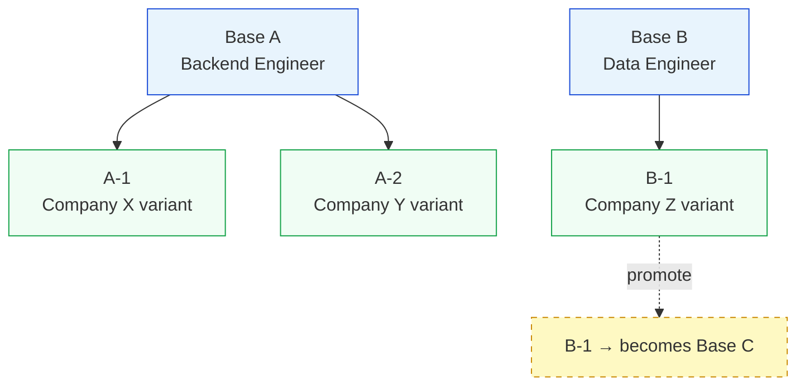

# Phase 3.8.1 — Multi-Base Resume Support: Design Document

**Author:** Architecture session  
**Status:** Draft — awaiting user review  
**Scope:** Design only. No implementation code.

---

## Table of Contents

1. [Current-State Summary](#1-current-state-summary)
2. [Target Mental Model](#2-target-mental-model)
3. [Architecture Options](#3-architecture-options)
4. [Recommended Approach](#4-recommended-approach)
5. [Data Model Sketch](#5-data-model-sketch)
6. [UX Outline](#6-ux-outline)
7. [Backend / API Implications](#7-backend--api-implications)
8. [Robustness Section](#8-robustness-section)
9. [Phased Rollout Plan](#9-phased-rollout-plan)
10. [Open Questions](#10-open-questions)

---

## 1. Current-State Summary

### 1.1 The singleton master resume

The system is built around the assumption of **exactly one** master resume per workspace. This assumption is embedded in six layers:

| Layer | Where it lives | What it does |
|-------|---------------|--------------|
| **DB column** | `Resume.is_master` (boolean, indexed) | Exactly one row can be `True`. `set_master_resume()` clears all others first. |
| **DB repository** | `get_master_resume()` returns `.limit(1)` | Callers assume at most one result. |
| **Database wrapper** | `create_resume_atomic_master()` | Auto-promotes the first uploaded resume to master; replaces a failed master. Uses an `asyncio.Lock` to serialize the flag swap. |
| **Frontend state** | `localStorage.get('master_resume_id')` | Dashboard, tailor page, and settings all read a single ID. The dashboard infers it from `is_master` in the list response. |
| **Tailor page** | `masterResumeId` state, `buildConfirmPayload` | The tailor flow always sends `resume_id = masterResumeId` to the preview/confirm endpoints. There is no picker. |
| **Backend tailoring** | `_generate_tailored_resume_data()` (L925) | Calls `db.get_master_resume()` to get `cleanup_source_data` — the truthfulness baseline for post-processing validation. |

### 1.2 The parent_id relationship

The system already has a rudimentary parent–child relationship:

- `Resume.parent_id` (nullable FK-like string) — set when a tailored resume is confirmed. The confirmed resume records which resume it was tailored **from**.
- `ApplicationPack.base_resume_id` — the resume used as the source for a tailoring run.
- Various endpoints check `resume.get("parent_id")` to decide whether a resume is "tailored" or "original".
- Cover letter, outreach, and application question generation endpoints require `parent_id` to be set, refusing to operate on base resumes.

### 1.3 Where "one master" actually matters

There are exactly **four behavioral dependencies** on the singleton master:

1. **Auto-promotion on upload** (`create_resume_atomic_master`) — if no master exists, the uploaded resume becomes one.
2. **Cleanup source fallback** (`_generate_tailored_resume_data` L925-929) — if a master resume exists, it's used as the ground-truth for skills/company validation during post-processing. If not, the source resume itself is used.
3. **Dashboard gate** — if `masterResumeId` is null, the dashboard shows "upload your resume" instead of the workspace.
4. **Tailor page gate** — if `masterResumeId` is null, the page redirects to `/dashboard`.

### 1.4 LLM prompt impact

The word "master" appears in prompts as `MASTER RESUME:` (a label in the user message template). The LLM receives whichever resume the user is tailoring **from** — this is `original_resume` in the tailoring pipeline, not `db.get_master_resume()`. So the LLM is already multi-base-ready; it tailors whatever you pass it. No prompt changes needed.

The one exception is the `cleanup_source_data` call in `_generate_tailored_resume_data()` which calls `db.get_master_resume()` to get a ground-truth baseline. This is a **correctness concern**: if resume B is being tailored and the master is resume A, the cleanup validation is checking against the wrong resume.

> [!WARNING]
> This means **today**, if you manually create a second resume and tailor it (by passing its `resume_id` to the API), the post-processing cleanup will validate against resume A's skills and companies — not resume B's. This is already a latent bug.

---

## 2. Target Mental Model

### 2.1 Definitions

| Term | Definition | Database marker |
|------|-----------|----------------|
| **Base resume** | A top-level resume that represents a stable identity. Example: "Backend Engineer" resume, "Data Engineer" resume. Not derived from another resume. | `parent_id IS NULL`, `resume_type = 'base'` |
| **Variant** | A resume derived from a base (or another variant) for a specific job application. Created by the tailoring pipeline. | `parent_id IS NOT NULL`, `resume_type = 'variant'` |
| **Active base** | The base resume currently selected for tailoring in the UI. Replaces the singleton "master" concept. | Stored as `active_base_id` in frontend state. No DB column needed — it's a UI selection, not a data property. |
| **Lineage** | The chain from a variant back to its base. Single-parent: every variant has exactly one `parent_id`. | Walk `parent_id` upward. |

### 2.2 Invariants

1. A base resume has `parent_id = NULL`.
2. A variant has `parent_id = <some_resume_id>`. The parent must exist at creation time.
3. Deleting a base with existing variants is a **destructive** operation — must be confirmed. Variants are NOT cascade-deleted; they become orphaned bases.
4. At most one base resume can be flagged `is_master = True` (backward compat). This is the **default** base for legacy flows.
5. A variant can be "promoted" to a base (sets `parent_id = NULL`, `resume_type = 'base'`). This is a one-way operation.
6. Re-tailoring a variant creates a new variant with `parent_id` pointing to the **original base**, not to the sibling variant. (Keeps the tree flat: base → {v1, v2, v3} rather than base → v1 → v2 → v3.)

### 2.3 Visual model



---

## 3. Architecture Options

### Option A: Minimal — Rename + UI picker only

**What changes:** Add a "base resume picker" dropdown on the tailor page. The `is_master` column becomes "default base." No new DB columns. The frontend stores the last-selected base in localStorage and sends it as `resume_id` to the tailor endpoints.

**What stays:** `parent_id` works as today. No new `resume_type` column. No lineage queries. The backend doesn't distinguish base from variant except by `parent_id IS NULL`.

| Dimension | Assessment |
|-----------|-----------|
| **Complexity** | Low. ~2 days of work. Frontend picker + remove `get_master_resume()` from cleanup. |
| **Risk** | Low. Minimal backend changes. |
| **What breaks if Phase 1 only** | Nothing functional. Users can pick a base, tailor from it, and the cleanup uses the correct source. |
| **Long-term debt** | No explicit base/variant typing — the system relies on convention (`parent_id IS NULL` = base). No lineage view. No promotion workflow. As resume count grows, the list becomes unusable without filtering. The dashboard stays cluttered. |

**Verdict:** Solves the immediate pain but accumulates UX debt quickly once you have >5 resumes.

---

### Option B: Balanced — Multi-base with optional lineage (Recommended)

**What changes:**

1. Add `resume_type` column (`base` | `variant`) to `Resume`. Derived from `parent_id` but explicit for queries.
2. Add a base-resume picker to the tailor page and dashboard.
3. Add a `label` column to `Resume` for user-provided names ("Backend", "Data Eng").
4. Backend: `get_master_resume()` → `get_default_base()` (returns the `is_master=True` base, or first base by created_at).
5. Fix `cleanup_source_data` to use the **actual base ancestor** of the resume being tailored, not the global master.
6. Dashboard groups variants under their parent base.
7. Add `GET /resumes?type=base` filter.

**What stays:** The `is_master` column stays (marks "default base"). `parent_id` stays as-is. No tree recursion — lineage is always exactly one hop (variant → base). Promotion is a simple `parent_id = NULL` + `resume_type = 'base'` update.

| Dimension | Assessment |
|-----------|-----------|
| **Complexity** | Medium. ~5-7 days. One migration, backend API adjustments, frontend picker + grouped dashboard. |
| **Risk** | Medium-low. The migration is additive (new columns with defaults). Existing data works — all current resumes without `parent_id` become `resume_type = 'base'`, all with `parent_id` become `resume_type = 'variant'`. |
| **What breaks if Phase 1 only** | Nothing. Phase 1 ships the migration and backend changes. Frontend can follow in Phase 2. |
| **Long-term debt** | Minimal. The model naturally supports future needs (lineage view is just a `WHERE parent_id = ?` query). Promotion is a single update. Adding labels/tags later is additive. |

**Verdict:** Right-sized. Solves the real problem (multiple bases, correct cleanup, clear UX) without inventing abstractions the product doesn't need yet.

---

### Option C: Full tree — Recursive lineage with branching

**What changes:**

1. Everything in Option B, plus:
2. Variants can be parents of other variants (deep trees: A → A-1 → A-1a).
3. Add `lineage_root_id` column to avoid recursive parent walks.
4. Add a tree-view UI component.
5. Promote operation creates a new lineage root.
6. API supports `GET /resumes/{id}/lineage` for tree traversal.
7. Add constraints: max depth = 3, max children per parent = 20.

| Dimension | Assessment |
|-----------|-----------|
| **Complexity** | High. ~10-14 days. Recursive queries, tree UI, depth constraints, orphan handling. |
| **Risk** | Medium-high. Recursive parent chains create edge cases: what happens when a mid-tree node is deleted? What if the root is promoted out? Orphan detection, cycle prevention. |
| **What breaks if Phase 1 only** | The tree UI is the whole value prop — shipping backend-only gives no user value. |
| **Long-term debt** | Actually increases maintenance cost. Trees are hard to render, hard to explain to users, and most resume workflows don't need depth > 1. |

**Verdict:** Over-engineered for the problem. The user described A-1, A-2 (flat variants) and "B2 → B2-1" (promotion, then a new line). A one-level parent relationship handles all of this. Deep trees solve a problem that doesn't exist.

---

## 4. Recommended Approach

> [!IMPORTANT]
> **Recommendation: Option B (Balanced multi-base with optional lineage).**

### Why Option B

1. **Fixes the latent bug** (cleanup source uses wrong resume) — this is a correctness issue, not just UX.
2. **Enables the stated workflow** (A, B, C bases with variants) without multi-month effort.
3. **Migration is trivial** — additive columns with computed defaults. Zero data loss risk.
4. **Frontend work is containable** — a picker dropdown + grouped list, not a tree visualizer.
5. **Leaves the door open** for Option C's tree features later, because the data model is already compatible (just allow `parent_id` to point to variants, and add `lineage_root_id`).

### What we explicitly defer

| Deferred | Why |
|----------|-----|
| Deep lineage trees (variant → variant → variant) | No demonstrated user need. Can be unlocked later by relaxing the "parent must be a base" constraint. |
| Per-base LLM config (different model per base) | Not requested. The pipeline already supports model override; this is a UI problem, not a data model one. |
| Base resume duplication/fork | Simple "duplicate" button is trivial to add later as a separate feature. |
| UI for editing base label/description | Can land in a fast-follow. The column exists from day one. |
| Lineage visualization | Group-by-parent in the dashboard list is sufficient for v1. A dedicated lineage page can come later. |

---

## 5. Data Model Sketch

### 5.1 Schema changes

```sql
-- Migration: add resume_type and label columns
ALTER TABLE resumes ADD COLUMN resume_type VARCHAR(16) NOT NULL DEFAULT 'base';
ALTER TABLE resumes ADD COLUMN label VARCHAR(120) NULL;

-- Backfill: resumes with parent_id are variants, others are bases
UPDATE resumes SET resume_type = 'variant' WHERE parent_id IS NOT NULL;
UPDATE resumes SET resume_type = 'base' WHERE parent_id IS NULL;

-- Optional: index for fast base-resume queries
CREATE INDEX ix_resumes_resume_type ON resumes (resume_type);
```

### 5.2 Entity: Resume (updated)

```
Resume
├── resume_id: str (PK, UUID)
├── resume_type: str ("base" | "variant")    ← NEW
├── label: str | null                         ← NEW (user-provided name)
├── is_master: bool (default False)           ← KEPT (marks default base)
├── parent_id: str | null (FK → resume_id)    ← KEPT
├── application_pack_id: str | null
├── title: str | null (auto-generated from JD)
├── content: text
├── content_type: str
├── processed_data: json | null
├── processing_status: str
├── ... (other existing fields unchanged)
```

### 5.3 Invariants (enforced in application code, not DB constraints)

| # | Invariant | Enforcement point |
|---|-----------|-------------------|
| I1 | `resume_type = 'base'` ↔ `parent_id IS NULL` | `create_resume()`, `update_resume()` — validate consistency |
| I2 | `resume_type = 'variant'` ↔ `parent_id IS NOT NULL` | Same |
| I3 | `is_master = True` requires `resume_type = 'base'` | `set_master_resume()` — reject if variant |
| I4 | At most one `is_master = True` across all resumes | `set_master_resume()` — clear-then-set (existing behavior) |
| I5 | `parent_id` must reference an existing resume at creation time | `create_resume()` — validate parent exists |
| I6 | `parent_id` points to a base resume (not a variant) | `create_resume()` — validate `parent.resume_type = 'base'` |
| I7 | Deleting a base with variants orphans the variants (sets their `parent_id = NULL`, `resume_type = 'base'`) | `delete_resume()` — pre-delete hook |

### 5.4 Deletion rules

| Scenario | Behavior |
|----------|----------|
| Delete a variant | Just delete. No side effects. |
| Delete a base with no variants | Just delete. If it was `is_master`, promote next-oldest base. |
| Delete a base with variants | **Confirm dialog required.** Orphan variants: set `parent_id = NULL`, `resume_type = 'base'`. If the base was `is_master`, promote next-oldest base. |
| Delete the last base | Clear `is_master`. Dashboard shows "upload resume" state. |

### 5.5 Promotion rules

| Operation | Effect |
|-----------|--------|
| Promote variant to base | Set `parent_id = NULL`, `resume_type = 'base'`. Optionally set `is_master = True`. |
| Demote base to variant | **Not supported.** A base that has variants cannot be demoted. A base with no variants can be deleted. |

---

## 6. UX Outline

### 6.1 Dashboard — Base resume section (replaces "master resume" card)

**Current:** Single card showing "MASTER RESUME" with processing status and action buttons.

**Proposed:** A horizontal scrollable row of base-resume cards. Each card shows:
- Label (user-provided, e.g. "Backend") or filename
- Processing status indicator
- Variant count badge (e.g. "12 variants")
- "Active" indicator if this is the currently selected base
- Click to select as active → localStorage stores `active_base_id`

**Default selection logic:**
1. If `active_base_id` in localStorage and that resume exists → use it
2. Else if a resume has `is_master = True` → use it
3. Else use the most recently created base
4. Else show "upload resume" state

### 6.2 Dashboard — Variant list (replaces "tailored resumes")

**Current:** Flat list of all non-master resumes, filterable by company/role/date.

**Proposed:** Same list but with a new "Base" column showing which base each variant came from (label or filename). When a base is selected in the top row, the list auto-filters to show that base's variants (with a "Show all" toggle).

### 6.3 Tailor page — Base resume picker

**Current:** The tailor page reads `masterResumeId` from localStorage. No choice.

**Proposed:** A dropdown/selector above the job description textarea:
- Label: "Tailoring from: [Base Name ▾]"
- Shows all base resumes with `processing_status = 'ready'`
- Defaults to `active_base_id` from localStorage
- Changing the selection updates `active_base_id` in localStorage
- The selected base's `resume_id` is passed to the tailoring endpoints

### 6.4 Builder page — "Based on" indicator

When viewing a variant in the builder, show a small breadcrumb:
```
← Base: Backend Engineer  |  Variant for: Senior Backend Engineer @ Stripe
```

Clicking "Base: Backend Engineer" navigates to the base resume in the builder.

### 6.5 Mistakes users might make

| Mistake | Mitigation |
|---------|-----------|
| Editing a base resume and expecting all variants to update | Not how it works — variants are snapshots. Show toast: "Updating a base resume does not change existing variants." |
| Deleting a base they still need | Confirm dialog with variant count. "This base has 8 variants. Deleting it will make them independent resumes." |
| Tailoring from the wrong base | The picker prominently shows the label. The confirm modal shows "Based on: [label]." |
| Uploading a resume and not realizing it's a new base | After upload, show: "New base resume created: [filename]. You can rename it in the builder." |

---

## 7. Backend / API Implications

### 7.1 New/modified endpoints

| Endpoint | Change | Notes |
|----------|--------|-------|
| `GET /resumes` | Add `?type=base\|variant` filter, add `?parent_id=X` filter | Backward-compatible: no filter = all resumes |
| `POST /resumes/upload` | Add optional `label` field. New uploads always create base resumes. | `is_master` auto-promotion stays for first-upload case |
| `PATCH /resumes/{id}` | Accept `label` field update | |
| `POST /resumes/{id}/promote` | **New.** Promote variant to base | Sets `parent_id=NULL`, `resume_type='base'` |
| `DELETE /resumes/{id}` | Enhanced: if deleting a base with variants, orphan them | Return `orphaned_count` in response |
| `POST /resumes/improve/preview` | No change — already takes `resume_id` | |
| `POST /resumes/improve/confirm` | No change — `parent_id` is set correctly today | |

### 7.2 Internal function changes

| Function | Change |
|----------|--------|
| `_generate_tailored_resume_data()` | **Bug fix:** Replace `db.get_master_resume()` with `db.get_resume(resume["parent_id"] or resume["resume_id"])` for cleanup source. If resume is a variant being re-tailored, walk to its base. |
| `create_resume_atomic_master()` | Keep as-is but rename conceptually to "auto-promote first base." Only fires when `resume_type='base'` count is 0. |
| `Database.get_master_resume()` | **Keep.** Add `get_default_base()` as an alias that prefers `is_master=True`, falls back to first base by `created_at`. |
| `_resolve_source_and_tailored_resume_ids()` | No change. Already correctly uses `parent_id`. |

### 7.3 Serialization changes

`_serialize_resume()` adds:
```python
"resume_type": record.resume_type,
"label": record.label,
```

`ResumeSummary` schema adds:
```python
resume_type: str = "base"
label: str | None = None
```

`ResumeFetchData` schema adds:
```python
resume_type: str = "base"
label: str | None = None
```

### 7.4 Migration helper

```python
def _ensure_resume_type(data: dict[str, Any]) -> dict[str, Any]:
    """Backfill resume_type for resumes loaded from DB without the column."""
    if "resume_type" not in data:
        data["resume_type"] = "variant" if data.get("parent_id") else "base"
    return data
```

---

## 8. Robustness Section

### 8.1 Failure modes

| # | Failure mode | Severity | Likelihood |
|---|-------------|----------|------------|
| F1 | **Wrong cleanup source (existing bug)** — Global master used instead of actual base ancestor | High | Already happening whenever a non-master resume is tailored |
| F2 | **Orphan variants after base deletion** — Variants lose their parent reference | Medium | Expected behavior, but confusing if unmanaged |
| F3 | **Stale localStorage active_base_id** — Base was deleted but frontend still tries to use it | Low | Moderate — can happen when user deletes from a different tab |
| F4 | **Race condition: two tabs set different active base** — No server-side "active" state means tabs can diverge | Low | By design — active base is a UI preference, not data |
| F5 | **Migration fails mid-backfill** — Some resumes have `resume_type` set, others don't | Medium | Very unlikely with a single UPDATE statement |
| F6 | **parent_id points to a deleted resume** — Can happen if deletion doesn't clean up variants | High | Prevented by the orphan-on-delete rule |
| F7 | **Invariant violation: base resume has parent_id** — Data corruption | High | Prevented by application-level validation |

### 8.2 Mitigations

| Failure | Mitigation |
|---------|-----------|
| F1 | **Phase 1 fix.** Change `_generate_tailored_resume_data()` to resolve the actual base ancestor. Add a `get_base_ancestor(resume_id)` utility. |
| F2 | Orphan-on-delete rule. Frontend shows a toast: "X variants were made independent." |
| F3 | Frontend: if `fetchResume(active_base_id)` returns 404, clear localStorage and fall back to `is_master=True` base. Already done for the current master flow. |
| F4 | Not a bug — it's a feature. Each tab can be working from a different base. |
| F5 | The migration is a single idempotent `UPDATE` with a `WHERE` clause. Safe to re-run. |
| F6 | Pre-delete validation: before deleting a resume, find all variants with `parent_id = resume_id` and orphan them. |
| F7 | Add a DB-level CHECK constraint (optional) or application-level validator on every `create_resume()` and `update_resume()` call. |

### 8.3 Validation rules (application-level)

```python
def validate_resume_consistency(*, resume_type: str, parent_id: str | None, is_master: bool) -> None:
    """Raise ValueError if resume state is internally inconsistent."""
    if resume_type == "base" and parent_id is not None:
        raise ValueError("A base resume cannot have a parent_id.")
    if resume_type == "variant" and parent_id is None:
        raise ValueError("A variant must have a parent_id.")
    if is_master and resume_type != "base":
        raise ValueError("Only base resumes can be set as default.")
```

### 8.4 Testing strategy (plan-level)

> [!IMPORTANT]
> These must be true before we trust the system:

| Test category | What must be verified |
|---------------|----------------------|
| **Migration correctness** | After migration: all resumes with `parent_id` have `resume_type='variant'`; all without have `resume_type='base'`. Exactly one `is_master=True` resume (if any existed before). |
| **Cleanup source correctness** | Tailoring resume B (base B) uses base B's data for cleanup, NOT the global master (base A). Write a test with two bases and verify. |
| **Invariant enforcement** | Cannot create a base with `parent_id`. Cannot create a variant without `parent_id`. Cannot set `is_master=True` on a variant. |
| **Deletion cascade** | Deleting a base with 3 variants: all 3 become bases with `parent_id=NULL`. The `is_master` flag transfers to the next oldest base. |
| **API filter** | `GET /resumes?type=base` returns only bases. `GET /resumes?type=variant` returns only variants. `GET /resumes?parent_id=X` returns only variants of X. |
| **Frontend fallback** | If `active_base_id` in localStorage points to a deleted resume, the dashboard recovers gracefully (shows is_master or first base). |
| **Promote variant** | After promotion, `parent_id=NULL`, `resume_type='base'`, variant no longer appears under old parent's group. |
| **Backward compat** | Old API calls without `type` filter still work. Old frontends that only read `is_master` still function. |

---

## 9. Phased Rollout Plan

### Phase 1: Backend foundation + bug fix (Days 1-3)

**Goal:** Fix the cleanup source bug. Add `resume_type` and `label` columns. No frontend changes.

```
- [ ] Add resume_type and label columns to Resume model
- [ ] Write and run Alembic migration with backfill
- [ ] Add validate_resume_consistency() function
- [ ] Wire validation into create_resume() and update_resume()
- [ ] Add get_base_ancestor(resume_id) utility function
- [ ] Fix _generate_tailored_resume_data() to use base ancestor for cleanup
- [ ] Update _serialize_resume() to include resume_type and label
- [ ] Update ResumeSummary and ResumeFetchData schemas
- [ ] Add ?type= and ?parent_id= query filters to GET /resumes
- [ ] Write unit tests for invariants, migration, cleanup fix
- [ ] All existing tests pass
```

**Value delivered:** Correctness fix for the cleanup source bug. No user-visible changes.

### Phase 2: Base resume management API (Days 4-5)

**Goal:** Backend supports creating, labeling, and promoting base resumes.

```
- [ ] Add POST /resumes/{id}/promote endpoint
- [ ] Update DELETE /resumes/{id} to orphan variants on base deletion
- [ ] Add label to upload flow (optional field)
- [ ] Add PATCH /resumes/{id} label update
- [ ] Update get_default_base() to prefer is_master, fallback to first base
- [ ] Write integration tests for promote, delete-with-orphan, label update
```

**Value delivered:** API consumers (and future frontend) can manage multiple bases.

### Phase 3: Frontend — Base picker on tailor page (Days 6-8)

**Goal:** Users can choose which base to tailor from.

```
- [ ] Add base-resume API fetch (GET /resumes?type=base)
- [ ] Add base picker component to tailor page
- [ ] Replace masterResumeId with activeBaseId in localStorage
- [ ] Send selected base's resume_id to preview/confirm endpoints
- [ ] Add fallback logic: active_base_id → is_master → first base → upload prompt
- [ ] Update tailor page tests
```

**Value delivered:** Users can pick which resume to tailor from. This is the primary feature.

### Phase 4: Frontend — Dashboard grouping (Days 9-11)

**Goal:** Dashboard shows base resumes as top-level cards with variants grouped underneath.

```
- [ ] Redesign dashboard master-resume section to show multiple base cards
- [ ] Add label display and edit capability
- [ ] Group variant list by parent base
- [ ] Add "Show all" / "Filter by base" toggle
- [ ] Add variant count badge on base cards
- [ ] Add "Based on" breadcrumb in builder page
- [ ] Update dashboard tests
```

**Value delivered:** Clear visual hierarchy. Users can see lineage at a glance.

### Phase 5: Polish + promote workflow (Days 12-13)

**Goal:** Promote-to-base UI, deletion confirmation with orphan notification, and rename labels.

```
- [ ] Add "Promote to base" action in builder/variant context menu
- [ ] Add deletion confirmation dialog with variant count
- [ ] Add toast notifications for lifecycle events
- [ ] Add label rename in base card context menu
- [ ] End-to-end manual testing with 3+ bases and 10+ variants
- [ ] Update documentation
```

**Value delivered:** Full lifecycle management.

---

## 10. Open Questions

These questions materially affect the design if answered differently.

### Q1: Should `active_base_id` be server-side or client-side?

**Current design:** Client-side (localStorage). This means different browsers/tabs can have different active bases.

**Alternative:** Store it as a user preference on the server (e.g., column on `User` table). This gives consistent state across devices.

**Impact if changed:** Adds a new API call on every page load to fetch the preference. Adds server-side state management. More complex but more predictable.

**Recommendation:** Start client-side. Add server-side persistence later if multi-device usage becomes a real need.

### Q2: Should variant lineage be exactly one level deep (variant → base) or allow arbitrary depth?

**Current design:** One level only. Variants always point to a base.

**Alternative:** Allow `parent_id` to point to another variant ("variant of a variant").

**Impact if changed:** Requires `lineage_root_id` column, recursive queries or CTE, max-depth constraints, and a more complex UI. This is Option C.

**Recommendation:** One level. The user's "B2 → B2-1" scenario is better modeled as "promote B2 to base, then create B2-1 as a variant of the new base."

### Q3: What happens to application packs when a base is deleted?

**Current design:** Application packs reference `base_resume_id`. If the base is deleted, the pack's `base_resume_id` becomes a dangling reference.

**Options:**
- (a) Soft-delete bases (add `deleted_at` timestamp). Packs still resolve. Complexity: garbage collection.
- (b) Let the reference dangle. Packs still function — the tailored resume and job are the valuable data. Mark the pack as "base unavailable." Complexity: low.
- (c) Cascade update packs to point to the orphaned variant (if one was promoted). Complexity: medium.

**Recommendation:** Option (b). The pack is a historical record. A deleted base doesn't invalidate the tailored resume or the job. Show "Base resume no longer available" in the pack detail view.

### Q4: Should we rename "master" in the UI to something else?

**Current UI text:** "MASTER RESUME", "Initialize master resume", etc.

**Options:** "Base resume", "Primary resume", "Source resume"

**Recommendation:** "Base resume" — it matches the data model exactly and avoids connotation issues. The `is_master` DB column stays for backward compat but the UI text changes.

---

*End of design document.*
