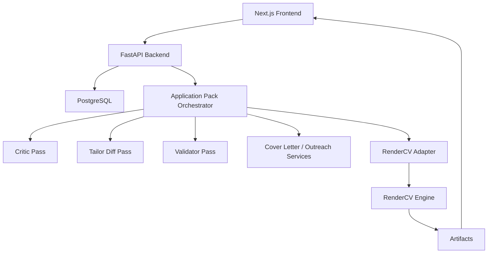
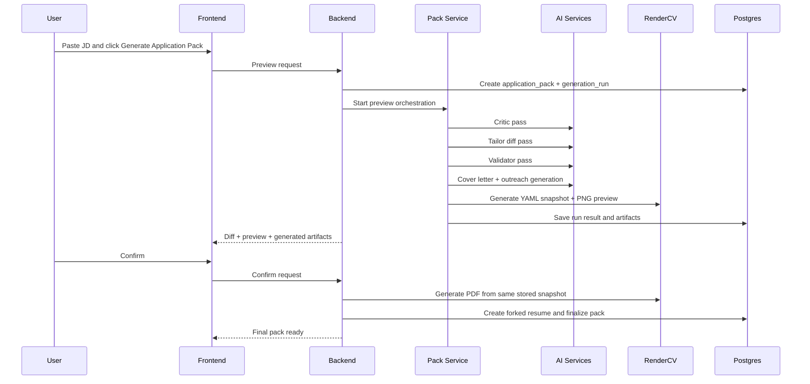

# Phase 6: Final Design Checkpoint

## Purpose

This is the final design checkpoint before implementation starts.

The goal of this phase is to remove ambiguity and lock the execution path.

From this point onward, the project should follow **one concrete implementation plan**:

- reuse mature pieces wherever possible
- avoid rebuilding polished features that already exist in the reference repos
- minimize unknowns
- minimize integration risk
- optimize for a fast path that is still technically sound

## Final Decision

We will **build on top of `Resume-Matcher`**, and we will **integrate `RenderCV` as the authoritative rendering engine**.

We will **not** build on top of `Reactive Resume`.

We will **not** recreate the `RenderCV` hosted web app.

We will use `Reactive Resume` only as a source of safety patterns:

- minimal patching
- schema validation
- output sanitization

## Why This Is The Final Choice

This is the best fit for your actual priorities:

- fastest path to working software
- one-click JD-driven workflow
- built-in cover letter and outreach support
- better odds of low-error implementation
- minimal reinvention
- high-quality final resume rendering

`Resume-Matcher` already gives us the closest product loop.

`RenderCV` gives us the best output quality and ATS-safe rendering discipline.

That combination is the strongest implementation plan with the least wasted effort.

## Closed Decisions

These decisions are now treated as final unless we hit a hard technical blocker.

### Product model

- one master resume only
- tailored versions are forks of the master
- every JD run creates an application pack

### AI model

- no open-ended agent graph
- 3-pass pipeline only:
  - critic
  - tailor
  - validator

### Rendering model

- RenderCV is the source of truth for resume preview and PDF
- preview must be generated from the same snapshot as final PDF

### Frontend model

- keep the existing `Resume-Matcher` forms and workflow shell
- replace only the preview and formatting layers

### Infrastructure model

- replace TinyDB with PostgreSQL before serious feature work
- keep FastAPI + Next.js
- keep LiteLLM

### Scope model

- no full RenderCV app clone
- no job search automation in MVP
- no prompt-builder UI in MVP
- no multi-master resume support in MVP

## Final Product Scope

## In Scope For Initial Build

- one master resume
- manual editing through existing builder forms
- JD paste
- one-click `Generate Application Pack`
- tailored resume diff review
- RenderCV preview
- final resume PDF
- cover letter generation
- LinkedIn / outreach generation
- application history by company / role / date
- one default prompt pack
- one default RenderCV theme profile, with a second theme slot supported structurally

## Out Of Scope For Initial Build

- full job board search integration
- external prompt marketplace
- autonomous prompt graphs
- collaborative multi-user editing
- theme marketplace
- advanced analytics dashboards
- automatic external ATS scoring integrations
- exact RenderCV web UI reproduction

## Final Reuse Strategy

## Reuse From Resume-Matcher

We will keep and adapt:

- FastAPI app shell
- Next.js app shell
- resume upload and parse flow
- JD paste flow
- diff preview modal
- cover letter and outreach generators
- builder form components
- regenerate and enrichment flows as optional secondary features
- LiteLLM integration
- existing prompt foundations

### Keep with minimal edits

- `apps/backend/app/main.py`
- `apps/backend/app/llm.py`
- `apps/backend/app/services/parser.py`
- `apps/backend/app/services/cover_letter.py`
- `apps/frontend/app/(default)/tailor/page.tsx`
- `apps/frontend/components/tailor/diff-preview-modal.tsx`
- `apps/frontend/components/builder/forms/*`
- `apps/frontend/components/builder/cover-letter-editor.tsx`
- `apps/frontend/components/builder/outreach-editor.tsx`

### Keep but refactor

- `apps/backend/app/services/improver.py`
- `apps/backend/app/services/refiner.py`
- `apps/backend/app/routers/resumes.py`
- `apps/frontend/components/builder/resume-builder.tsx`
- `apps/frontend/lib/api/resume.ts`

## Reuse From RenderCV

We will use it as an installed backend dependency.

We will not vendor or rewrite its engine.

We will build a controlled adapter around:

- schema builder
- Typst generation
- PDF generation
- PNG generation
- optional HTML debug generation
- built-in theme system

### Core integration seam

Our app keeps its own internal resume JSON.

That JSON is converted into RenderCV input through a dedicated adapter.

That adapter is the only place where the two systems are coupled.

This is the safest architecture.

## Reuse From Reactive Resume

We will not integrate its codebase.

We will borrow the following patterns:

- minimal targeted changes instead of full blind rewrites
- strict path validation
- output sanitization
- schema validation after applying changes

## Final Architecture



## Final Implementation Repo Shape

This is the target structure for the implementation repo.

```text
apps/backend/app/
  main.py
  config.py
  llm.py
  db/
  routers/
  schemas/
  services/
  rendering/
  prompt_packs/
  migrations/

apps/frontend/
  app/
  components/
  lib/
  tests/

docs/
  plans/
  research/
```

## Final Backend Decisions

## Storage

We will use:

- PostgreSQL
- SQLAlchemy
- Alembic

We will not keep TinyDB for any production path.

### Final tables

- `users`
- `resumes`
- `jobs`
- `application_packs`
- `generation_runs`
- `artifacts`

## Rendering

Resume rendering will use:

- RenderCV YAML snapshot generation
- RenderCV Typst compilation
- RenderCV PNG previews
- RenderCV PDF output

Cover letter PDF may temporarily use:

- simple HTML template
- Playwright PDF

That is acceptable because the resume is the artifact that must match RenderCV exactly.

## AI orchestration

We will implement:

### Pass 1: Critic

Inputs:

- master resume
- job description
- house writing rules

Outputs:

- important recruiter-facing gaps
- priority keywords
- bullets to strengthen
- unsupported claims to avoid

### Pass 2: Tailor

Inputs:

- original resume
- critic output
- job description
- house rules

Outputs:

- targeted diff only
- no freeform full resume rewrite

### Pass 3: Validator

Inputs:

- tailored resume result
- original resume
- job description

Outputs:

- cleaned and validated final tailored resume
- blocked unsupported claims removed

### Parallel side artifacts

In the same orchestration run:

- cover letter text
- outreach text
- resume title

## Final frontend decisions

We keep:

- builder form stack
- tailor page
- diff modal
- current navigation shell

We replace:

- local React resume renderer
- local CSS-based resume templates
- old formatting panel
- frontend print route for resume PDFs

We add:

- exact RenderCV preview panel
- RenderCV theme controls
- application pack side panel
- generation status and artifact actions

## Final design system decisions

To keep implementation concrete and low-risk, we reduce design flexibility at first.

### We will support only a controlled theme profile layer

Instead of exposing every underlying RenderCV design field directly, we expose:

- `theme_id`
- `page_size`
- `density_profile`
- `bold_keywords`

Optional later:

- curated font family override
- curated accent profile override

This is much safer than trying to surface all of RenderCV's raw design model immediately.

## Initial themes

The implementation will support exactly two MVP theme profiles structurally.

Default assumption for the first implementation:

- `classic`
- `moderncv`

Why:

- both are mature
- both are professional
- both are low-risk defaults

If you later want a different pair, the theme profile system will allow that without changing core architecture.

## Final module plan

## New backend modules

- `app/db/base.py`
- `app/db/session.py`
- `app/db/models.py`
- `app/db/repositories/resumes.py`
- `app/db/repositories/jobs.py`
- `app/db/repositories/application_packs.py`
- `app/db/repositories/generation_runs.py`
- `app/db/repositories/artifacts.py`
- `app/services/prompt_pack_loader.py`
- `app/services/critic_service.py`
- `app/services/tailor_diff_service.py`
- `app/services/resume_change_guard.py`
- `app/services/change_sanitizer.py`
- `app/services/validation_service.py`
- `app/services/application_pack_service.py`
- `app/services/artifact_service.py`
- `app/services/job_metadata.py`
- `app/rendering/rendercv_adapter.py`
- `app/rendering/theme_profiles.py`
- `app/rendering/rendercv_engine.py`
- `app/rendering/document_pdf.py`
- `app/routers/application_packs.py`
- `app/routers/artifacts.py`
- `app/routers/themes.py`

## New frontend modules

- `components/preview/rendercv-preview.tsx`
- `components/preview/rendercv-preview-page.tsx`
- `components/preview/rendercv-preview-toolbar.tsx`
- `components/builder/render-theme-controls.tsx`
- `components/builder/application-pack-panel.tsx`
- `components/builder/generation-run-status.tsx`
- `components/builder/artifact-actions.tsx`
- `lib/api/application-pack.ts`
- `lib/api/artifacts.ts`
- `lib/api/themes.ts`
- `lib/types/application-pack.ts`
- `lib/types/render-theme-settings.ts`

## Final implementation flow



## Final milestone checklist

This is the checklist that should drive actual coding.

## Milestone 1: Repo and Environment Foundation

- [ ] create dedicated implementation repo from `Resume-Matcher`
- [ ] keep this planning repo as architecture/reference workspace
- [ ] add Postgres to local dev stack
- [ ] add SQLAlchemy and Alembic
- [ ] confirm backend and frontend still boot

## Milestone 2: Storage Migration

- [ ] define SQLAlchemy models
- [ ] create initial Alembic migration
- [ ] replace TinyDB repositories
- [ ] migrate resume CRUD endpoints to Postgres
- [ ] migrate job storage to Postgres
- [ ] migrate improvement history to generation runs

## Milestone 3: RenderCV Integration

- [ ] add `rendercv[full]` dependency
- [ ] implement RenderCV adapter
- [ ] implement theme profile mapping
- [ ] generate YAML snapshots from internal resume JSON
- [ ] compile PNG preview successfully
- [ ] compile PDF successfully
- [ ] store preview and PDF artifacts

## Milestone 4: Application Pack Orchestration

- [ ] implement critic pass
- [ ] implement diff-based tailor pass
- [ ] implement validation pass
- [ ] unify cover letter and outreach generation into one pack run
- [ ] create preview endpoint
- [ ] create confirm endpoint

## Milestone 5: Frontend Replacement Layer

- [ ] add RenderCV preview panel
- [ ] add application pack panel
- [ ] replace formatting controls with RenderCV theme controls
- [ ] wire preview endpoint to tailor flow
- [ ] wire confirm endpoint to final artifact actions

## Milestone 6: Cleanup and Stabilization

- [ ] remove old React resume template renderer
- [ ] remove old resume print route
- [ ] remove old CSS template settings model
- [ ] keep cover letter and outreach editors
- [ ] add adapter, orchestration, and preview tests

## Final acceptance checklist

These are the minimum conditions for “ready to build on confidently.”

- [ ] master resume can be uploaded, parsed, edited, and saved
- [ ] JD can be pasted once and generate a full application pack
- [ ] diff review is human-readable
- [ ] preview matches final resume PDF because both come from same RenderCV snapshot
- [ ] no fabricated dates or unsupported skills pass through validator
- [ ] cover letter and outreach text are generated in the same run
- [ ] application history is queryable by company / role / time
- [ ] filenames follow the agreed tracking convention
- [ ] at least one RenderCV theme profile is production-ready

## Rules that implementation must follow

These rules are mandatory because they reduce breakage.

### Rule 1

Never let the LLM output become the final rendered resume directly.

It must go through:

- diff validation
- schema validation
- sanitization
- RenderCV adapter

### Rule 2

Never generate the preview and PDF from different data.

Both must use the same stored YAML snapshot.

### Rule 3

Do not expose full raw RenderCV design complexity in MVP.

Use curated theme profiles only.

### Rule 4

Do not rewrite working Resume-Matcher UX flows if they already fit the requirement.

We should modify, not redesign.

### Rule 5

Do not delay Postgres migration.

It must happen before major feature layering.

## Final risk controls

## Risk: adapter mismatch

Mitigation:

- build fixture-based adapter tests before frontend switch

## Risk: preview/final drift

Mitigation:

- frozen YAML snapshot per generation run

## Risk: LLM hallucination

Mitigation:

- 3-pass flow
- diff-only edits
- validator gate
- explicit no-date/no-skill invention checks

## Risk: feature sprawl

Mitigation:

- freeze MVP scope in this document
- no extra features until Milestone 6 is stable

## Final engineering principle

If a mature reference implementation already solves a problem well, we adapt it instead of reimagining it.

That means:

- keep `Resume-Matcher` for workflow and artifact flow
- keep `RenderCV` for rendering and template quality
- keep `Reactive Resume` patterns only where they reduce risk

## Final statement

This is the final implementation checkpoint.

The project should now proceed with this locked plan:

- `Resume-Matcher` as the implementation base
- `RenderCV` as the resume rendering engine
- `PostgreSQL` as the persistence layer
- `3-pass AI pipeline` as the generation model
- `RenderCV preview + diff review + one-click application pack` as the primary UX

No new architectural alternatives should be introduced unless we hit a proven blocker during implementation.
