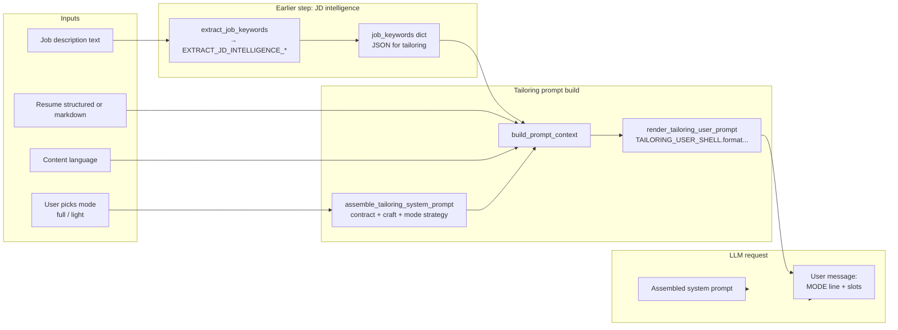
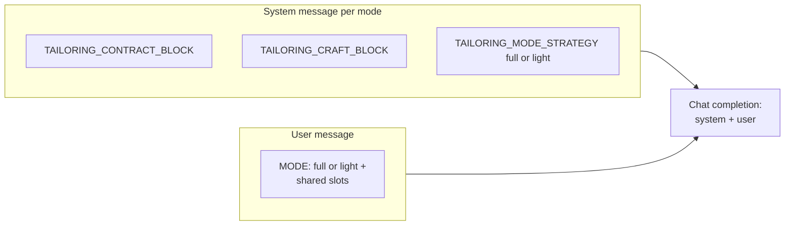
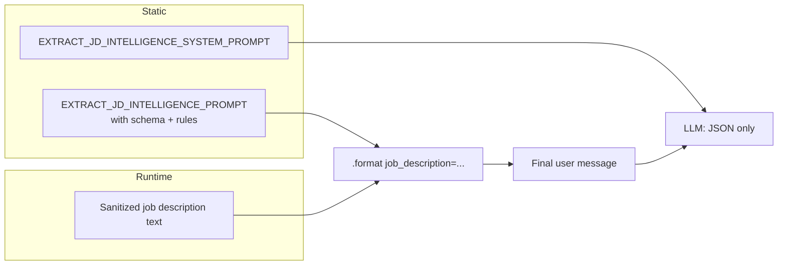
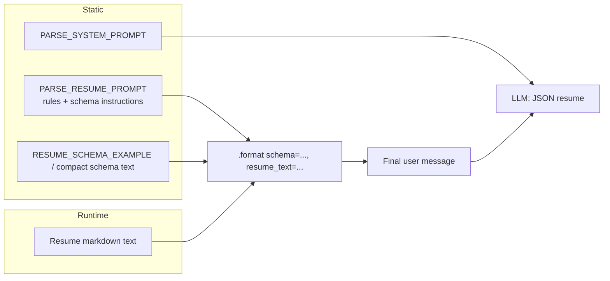
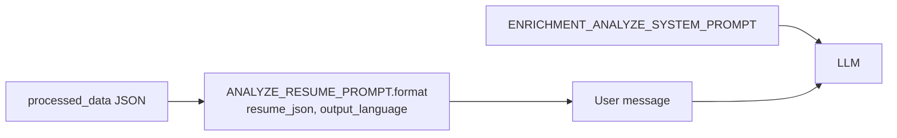
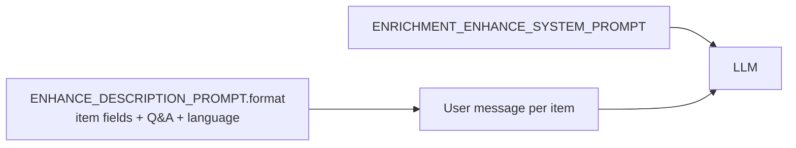
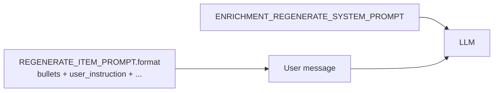
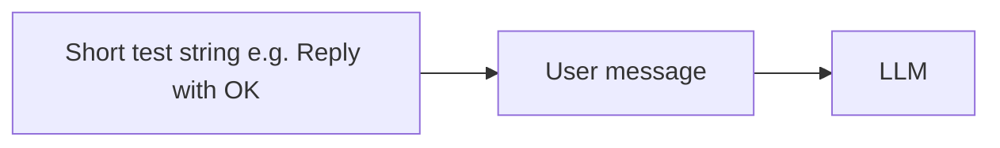
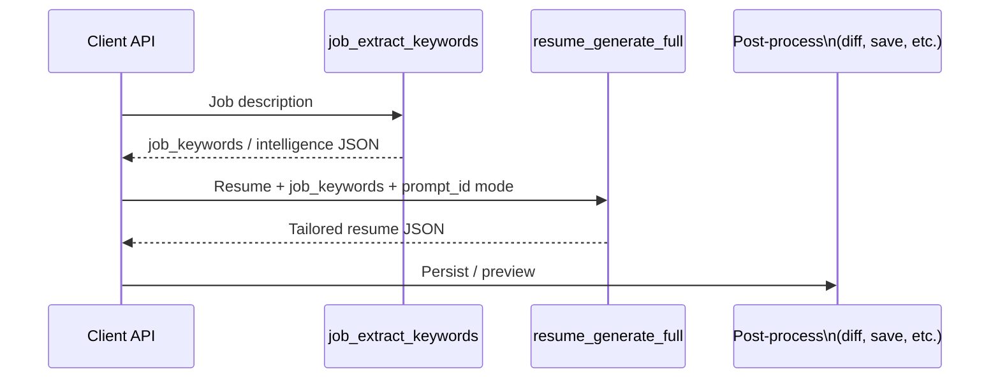

# LLM prompt composition

This document explains how **static templates** in `apps/backend/app/prompts/` combine with **runtime data** to form the **final system + user messages** sent to the model. It is the mental model behind the Prompt Catalog entry IDs.

**Single source of truth:** prompt *text* lives in Python modules (`templates.py`, `enrichment.py`, etc.). The catalog API and this doc **describe** those templates—they do not duplicate the strings.

---

## 1. Resume tailoring: two modes (`resume_generate_full`)

### What “two modes” means

There is **one** tailoring operation in the catalog: `resume_generate_full`. The user picks **`full`** (default) or **`light`** via `prompt_id`. Legacy values **`nudge`** and **`keywords`** are migrated to **`light`** and **`full`** respectively (API and localStorage).

The system message is assembled in one place — `assemble_tailoring_system_prompt(mode)` in `services/tailoring/prompting.py` — by concatenating:

1. **`TAILORING_CONTRACT_BLOCK`** — role line + OUTPUT FORMAT (JSON shape; calibrated).
2. **`TAILORING_CRAFT_BLOCK`** — APPROACH, WRITING STANDARDS, ATS OPTIMIZATION (voice and quality; iterate freely).
3. **`TAILORING_MODE_STRATEGY[mode]`** — full multi-paragraph strategy for **full** vs **light** (isolated instructions; not a single `MODE:` constraint line).

The **user** message uses **`TAILORING_USER_SHELL`**: same template for both modes, with `MODE: {mode_id}` (and runtime slots for job intelligence, resume, response contract, language). Mode-specific behavior lives primarily in the **system** message.

### Flow: from user choice to LLM call



### How the user message is assembled (building blocks)

```mermaid
flowchart TB
  subgraph static["User shell TAILORING_USER_SHELL"]
    T1[Intro: Tailor this resume...]
    T2[MODE: {mode_id}]
    T3[REWRITING EXAMPLE block]
    T4[JOB INTELLIGENCE:\n{job_intelligence}]
    T5[MASTER RESUME:\n{original_resume}]
    T6[RESPONSE CONTRACT:\n{response_contract}]
    T7[Output language:\n{output_language}]
  end

  subgraph runtime["Runtime-filled"]
    J[jd_intelligence JSON]
    O[Resume JSON or markdown]
    RC[Response contract JSON]
    OL[Language name]
  end

  J --> T4
  O --> T5
  RC --> T6
  OL --> T7
  static --> OUT[Final user message string]
```

### System vs user: what the model sees



The primary LLM call is wrapped by `run_tailoring_pipeline()` in `orchestration.py` (optional per-step model override via `PRIMARY_TAILORING_MODEL_OVERRIDE`). JD extraction still runs **before** tailoring in the HTTP flow.

---

## 2. Job description intelligence (`job_extract_keywords`)

**Catalog ID:** `job_extract_keywords`  
**Code:** `extract_jd_intelligence` / `extract_job_keywords` in `services/tailoring/analysis.py`



**Downstream:** Output is merged with legacy metadata and consumed by tailoring, cover letter, application questions, etc.

---

## 3. Resume parsing (`resume_parse_json`)

**Catalog ID:** `resume_parse_json`  
**Code:** `parse_resume_to_json` in `services/parser.py`



---

## 4. Cover letter + outreach (single call) (`cover_letter_outreach_generate`)

**Catalog ID:** `cover_letter_outreach_generate`  
**Code:** `generate_cover_letter_and_outreach` in `services/cover_letter.py`

```mermaid
flowchart LR
  subgraph static["Static"]
    SYS[COMBINED_MESSAGES_SYSTEM_PROMPT]
    TMPL[COVER_LETTER_OUTREACH_PROMPT\nmarkers for two outputs]
  end

  subgraph built["Built from resume + JD"]
    JT[job_target JSON]
    JD[job description excerpt]
    RP[resume_profile JSON]
    OL[output_language name]
  end

  built --> F[.format(...)]
  TMPL --> F
  F --> USER[One user message;\nmodel returns delimited\ncover + outreach]
  SYS --> LLM
  USER --> LLM
```

---

## 5. Application questions (`application_questions_generate`)

**Catalog ID:** `application_questions_generate`  
**Code:** `application_questions.py` (batch answer generation)

```mermaid
flowchart LR
  subgraph static["Static"]
    SYS[APPLICATION_QUESTIONS_SYSTEM_PROMPT]
    TMPL[APPLICATION_QUESTIONS_PROMPT]
  end

  subgraph runtime["Runtime JSON chunks"]
    JT[job_target]
    JD[job description]
    RP[resume_profile]
    TR[tailored_resume_context]
    Q[questions list JSON]
  end

  runtime --> F[.format(...)]
  TMPL --> F
  F --> USER[Final user message]
  SYS --> LLM
  USER --> LLM
```

---

## 6. Enrichment flows (`enrichment_*`)

These use prompts from `app/prompts/enrichment.py` and system strings from the same module / templates.

### 6a. Analyze resume (`enrichment_analyze`)

**Catalog ID:** `enrichment_analyze` (template `ANALYZE_RESUME_PROMPT`)



*Note:* HTTP handlers may log trace operations like `enrichment_analyze_resume`; the **prompt template** is the catalog entry above.

### 6b. Enhance descriptions (`enrichment_enhance`)

**Catalog ID:** `enrichment_enhance`



### 6c. Regenerate one item (`enrichment_regenerate_item`)

**Catalog ID:** `enrichment_regenerate_item`



### 6d. Regenerate additional group (`enrichment_regenerate_group`)

**Catalog ID:** `enrichment_regenerate_group`

```mermaid
flowchart LR
  SYS[ENRICHMENT_REGENERATE_SYSTEM_PROMPT]
  P[REGENERATE_ADDITIONAL_GROUP_PROMPT.format(...)]
  P --> U[User message]
  SYS --> LLM
  U --> LLM
```

---

## 7. Health check (`llm_health_check`)

**Catalog ID:** `llm_health_check`  
**Code:** `check_llm_health` in `llm.py`

Minimal **user** prompt (default `LLM_HEALTH_CHECK_PROMPT`), often **no system prompt**. Used only to verify connectivity—not part of resume logic.



---

## 8. End-to-end: improve resume (typical path)

How **multiple** prompt types chain in the product (simplified):



Optional later steps (same session, separate LLM calls) might include `cover_letter_outreach_generate` or `application_questions_generate`; they **reuse** JD/resume context but are **not** merged into the tailoring user message.

---

## Quick reference: catalog ID → main code path

| Catalog `id`              | Primary module(s)                          | Notable placeholders / inputs                          |
|---------------------------|--------------------------------------------|--------------------------------------------------------|
| `llm_health_check`        | `app/llm.py`                               | Fixed short user prompt                                |
| `resume_parse_json`       | `services/parser.py`                       | `schema`, `resume_text`                                |
| `job_extract_keywords`    | `services/tailoring/analysis.py`         | `job_description`                                    |
| `resume_generate_full`    | `services/tailoring/prompting.py`, `orchestration.py` | `mode_id`, `mode_constraint`, JSON blobs, language |
| `cover_letter_outreach_generate` | `services/cover_letter.py`          | `job_target`, `job_description`, `resume_profile`, language |
| `application_questions_generate` | `services/application_questions.py` | Job + resume + questions JSON                     |
| `enrichment_analyze`      | `routers/enrichment.py`                    | `resume_json`, `output_language`                     |
| `enrichment_enhance`      | `routers/enrichment.py`                    | Per-item Q&A, descriptions                           |
| `enrichment_regenerate_item` | `routers/enrichment.py`                 | Instruction + item content                           |
| `enrichment_regenerate_group` | `routers/enrichment.py`                | Group rewrite instruction                            |

---

## Related files

- Templates: `apps/backend/app/prompts/templates.py`, `enrichment.py`
- Tailoring assembly: `apps/backend/app/services/tailoring/prompting.py`, `orchestration.py`
- Catalog API: `apps/backend/app/routers/config.py` (`_get_prompt_catalog`)
- Structured catalog sections (tailoring only): `apps/backend/app/prompts/catalog_sections.py`
